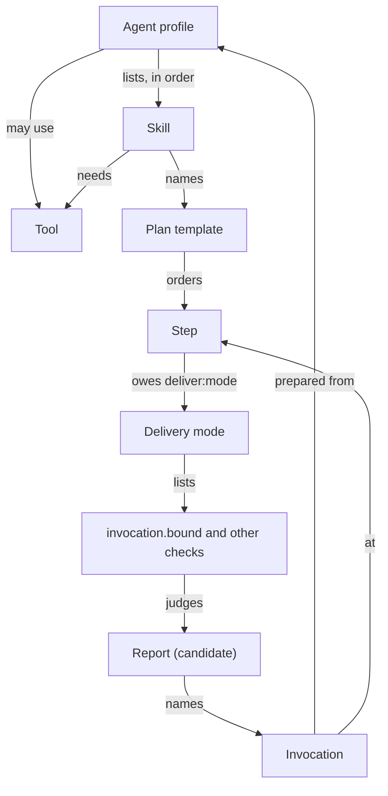

# RFC: Composable tools, gates, skills and agent profiles

Groomed on 25 November 2026. The first draft, its
[calculus](2026-11-25-agent-vocabulary/calculus.md) and the two enforcement
drafts ([evidence-governed execution](https://github.com/writfold-dev/writfold/pull/158)
and KB research contracts) were reviewed together. The review found that
they describe one calculus, and that most of it is the gate calculus
Writfold already ships and has proved. This RFC is now the first slice of
that one design. The [grooming review](2026-11-25-agent-vocabulary/grooming.md)
lists each claim of the drafts with agree, disagree, generalize or tweak.

## Summary

A user defines **tools**, **skills** and **agent profiles** as TOML files
under `.writfold/`. A skill is a reusable method. An agent profile is a
worker configuration: instructions, an ordered list of skills and the tools
it may use. Plans stay the only place that lists steps and the gates they
owe. Gates stay the only judges of evidence.

Three things are built:

1. `writfold kb agent inspect <id>` resolves a profile and its skills and
   tools, and refuses a composition that does not hold together.
2. `writfold kb agent prepare <id>` records an **invocation** in the
   current run at the current step and writes a package for an external
   harness. Writfold starts no model.
3. The worker's report comes back as a **delivery candidate**
   (`deliver prepare --invocation <id>`). A new built-in check,
   `invocation.bound`, passes only while the candidate is bound to an
   invocation of this run and step that was prepared under the profile as
   it is now. A plan step owes the report as `deliver:<mode>`, exactly as
   it owes any other delivery.

Nothing else is new. Which report decides, how a draft is withdrawn, what a
statement about it means, when a step may advance and what a receiver
accepts are all existing, proved behaviour.

Not built by this RFC: schemas and effects for tools, harness bindings,
budgets, delegation, an adapter for a particular harness, and any strict or
authenticated boundary. Each has an owner in [Rollout](#rollout).

## Proof obligations

Two new kernels in `crates/writfold-core`. Each takes facts the caller has
already gathered, as every shipped kernel does: small enums, booleans and
slices, explicit `while` loops, no maps, traits or closures
([aeneas.md](../writfold/aeneas.md#writing-kernels-for-translation)).

### `writfold_core::compose`

- `covers(required: &[Vec<u8>], granted: &[Vec<u8>]) -> Option<usize>`:
  the first required tool that is not granted.
- `closure(refs: &[RefFact], required: &[Vec<u8>], granted: &[Vec<u8>])
  -> Result<(), Refusal>`. `RefFact` is what the caller found for one
  reference (agent to skill, agent to tool, skill to tool, skill to plan
  template), in the order the files list them: `Found`, `Missing`,
  `WrongKind` or `Twice` (defined in both the KB root and the repository).
  `Refusal` is `Reference(usize)` or `Tool(usize)`.

`proofs/Writfold/Compose.lean` proves:

- `covers_spec`: the result is the least index of a required tool that is
  not among the granted ones, and `None` when there is none.
- `covers_none_iff`: `None` exactly when every required tool is granted.
- `closure_spec`: the refusal is the first reference that is not `Found`;
  when every reference is found, the first tool a skill needs that the
  profile does not list.
- `closure_ok_iff`: admitted exactly when every reference resolves to one
  definition of the expected kind and every tool a listed skill needs is in
  the profile's `tools`.
- `more_skills_never_admit`: adding a skill to a profile never turns a
  refused closure into an admitted one. A skill can add needs. It cannot
  add a grant.

### `writfold_core::invoke`

- `prepare_check(facts: &Prepare) -> Result<(), PrepareRefusal>`, in this
  fixed order: the run is open; the step named is the current step; the
  closure is admitted; every plan template a listed skill names is in the
  run at the current step or an ancestor; the input file was read; when
  the profile asks for the handover packet, the packet is complete
  (`packet::complete`).
- `bound(named: &Named) -> gate::Outcome`: what `invocation.bound` records
  for one candidate. `Named` holds: the candidate names an invocation; its
  record reads and is intact; it is of this run; its step is the step the
  candidate is judged for; its agent is the mode's agent; its closure
  digest is the present one; every live candidate naming it holds the same
  bytes.

`proofs/Writfold/Invoke.lean` proves:

- `prepare_check_spec`: the refusal, in the fixed order.
- `prepare_ok_iff`: admitted exactly when all six hold.
- `bound_spec`: `Unknown` when a named record cannot be read; else `Pass`
  when every fact holds; else `Fail`.
- `bound_pass_iff`: a pass exactly when the candidate names an intact
  invocation of this run, step and agent, under the present closure, and
  no other live candidate holds other bytes for it.
- `bound_unread_unknown`: an unreadable record is never a pass and never a
  failure.
- `conflict_never_passes`: two different reports for one invocation never
  pass, whichever is newer.

Reused as they stand, not proved again: the on-read re-check
(`delivery::rechecked`, `rechecked_spec`), readiness (`ready_iff`,
`empty_never_ready`), the step's decision (`fact_met_iff_ready`,
`advance_facts_ok_iff`), which candidate decides (`deciding_spec`), the
splice key (`splice_idempotent`), pins (`pin_all_spec`) and the packet
(`complete_iff`).

### Mutants

Each names the spec theorem whose proof unfolds the mutated function.

| Mutant | Change | Breaks |
|---|---|---|
| `covers-ignores-last` | the loop stops one short | `covers_spec` |
| `closure-wrong-kind-found` | `WrongKind` counts as found | `closure_spec` |
| `closure-skips-tools` | `covers` is not consulted | `closure_spec` |
| `prepare-skips-packet` | an incomplete packet is admitted | `prepare_check_spec` |
| `prepare-skips-plan` | a skill's missing plan is admitted | `prepare_check_spec` |
| `bound-ignores-closure` | a report under another closure passes | `bound_spec` |
| `bound-ignores-step` | a report prepared at another step passes | `bound_spec` |
| `bound-ignores-single` | conflicting reports pass | `bound_spec` |
| `bound-unread-passes` | an unreadable record passes | `bound_spec` |

### Protocol model

`spec/Invocation.tla`, a small module of its own: two clones, prepare,
deliver, check, advance and merge, with the worker as a source of zero, one
or two different reports at any time. Its invariants and mutants are in the
[calculus](2026-11-25-agent-vocabulary/calculus.md#6-protocol-model).
`KbWrite` and `RunGraph` are not changed: prepare and deliver are ordinary
publications under the write lock.

### Tested, not proved

- Parsing the three new file kinds and their diagnostics.
- Resolving references and classifying each as a `RefFact`.
- The closure digest and the package bytes.
- Reading invocation records and finding the candidates that name one.
- The write plans, the lock and the re-check under it.
- Rendering.
- That `deliver prepare` writes no plan record. No pure function can break
  this, so a test and the TLC invariant `DeliveryDoesNotAdvance` keep it.

A proof about `bound` says the candidate is tied to a recorded invocation.
It does not say a model ran, read its instructions or told the truth.

## Motivation

The owner asked for structured agent definitions, their relation to skills,
user-supplied tools and explicit composition laws, authored under
`.writfold/`. A second request asked that an agent should not be able to
skip a required skill or claim a result without evidence that the work was
set up as required.

Today a skill is Markdown that a harness loads, and Writfold does not read
it ([skills](../guide/skills.md)). A plan step can owe gates, but no record
says which worker configuration produced a report, or whether the skill
text that was required is the text the worker was given.

The drafts answered with a large new surface. This RFC keeps the smallest
part that closes the gap: a definition that can be resolved, a record of
what was handed to a worker, and one check that ties a report to that
record.

## Mission note

The mission's "Gates, runs and progress" section (12 November 2026) lists
"a Writfold skill format" and "profile composition" under "Not now". The
owner's request of 25 November 2026 is a later decision on the same
subject. When this RFC is accepted, the acceptance commit adds a dated line
to [mission.md](../writfold/mission.md) saying that skill and agent
manifests are now in scope and that "authority levels", "a governed
profile" and "signing" stay out. Until that line exists, this RFC grants no
exception by itself.

A skill manifest binds the text a harness already loads. It does not
replace `SKILL.md`, and Writfold still does not parse it.

## Vocabulary

| Building block | Owns | Lives in |
|---|---|---|
| Tool | a name and a description of one operation | `.writfold/tools/<id>.toml` |
| Skill | reusable instructions, the tools it needs, at most one plan template | `.writfold/skills/<id>.toml` |
| Agent profile | instructions, an ordered list of skills, the tools it may use, model and limit hints | `.writfold/agents/<id>.toml` |
| Plan | ordered steps and the gates each owes (unchanged) | `.writfold/plans/` |
| Gate, delivery mode | what evidence meets an obligation (unchanged) | `.writfold/gates/`, `.writfold/deliveries/` |
| Invocation | one use of a profile at a step of a run | `runs/<run>/invocations/<id>.json` |
| Report | what the worker returned: a delivery candidate (unchanged kind) | `runs/<run>/deliveries/<id>/` |

Write a skill when the reusable thing is a method. Write an agent profile
when the reusable thing is a worker: its instructions, its skills and its
tools. A method used both by the main session and by a reviewer is one
skill. A new profile is not needed when only the task input changes.



Three rules keep one source for each fact:

- A profile and a skill have no key that names a gate, an `accept` list or
  a step. Obligations come from plans and modes only, so choosing a
  profile cannot remove one.
- A skill names at most one plan template. A profile names none.
- A skill does not list skills, and a profile does not extend a profile.
  References are two levels deep and cannot form a cycle.

## Behaviour

### The files

```toml
# .writfold/tools/repo.read.toml
schema = "writfold-tool/1"
id = "repo.read"
description = "Read a path from the subject repository."
```

```toml
# .writfold/skills/verify-pr-claims.toml
schema = "writfold-skill/1"
id = "verify-pr-claims"
description = "Compare a PR description's claims with the diff and the checks."
tools = ["repo.read", "repo.diff"]
plan = "claims-review"
instructions = """
Compare each claim in the proposed PR description with the diff and the
cited check evidence. Give each claim a supported, contradicted or unknown
judgment, with the evidence and its limits.
"""
# Or, in place of instructions, the file a harness already loads:
# instructions_file = ".claude/skills/verify-pr-claims/SKILL.md"
```

```toml
# .writfold/agents/pr-claims-reviewer.toml
schema = "writfold-agent-profile/1"
id = "pr-claims-reviewer"
description = "Reviews the claims made about one change."
skills = ["verify-pr-claims"]
tools = ["repo.read", "repo.diff"]
packet = "required"            # or "none" (the default)
model = "reviewer"             # a hint: recorded and exported, not judged
instructions = """
Review only the supplied change and its evidence. Keep uncertainty.
"""
```

Rules, each a diagnostic at its line and column like every other file
`kb lint` reads:

- `id` is the file's stem and follows the gate id grammar. A tool id may
  hold one `.`, as `repo.read` does. Agent and skill ids hold none, because
  `name.name` already means a built-in check or a checklist item.
- Exactly one of `instructions` and `instructions_file`. The file path is
  relative to the repository that holds the definition and must stay inside
  it. It may be outside `.writfold/`, so a manifest can bind the
  `SKILL.md` a harness loads instead of copying it.
- Unknown keys, a duplicate id in the KB root and the repository, an
  unresolved reference and a reference of the wrong kind are errors.
- Reading a definition runs nothing and fetches nothing.

`writfold-agent-profile/1` is a new name. The archived `writfold.agent/1`
runtime is not restored and its name is not reused.

The plan and the mode use today's syntax, with one new check name and one
new mode key:

```toml
# .writfold/plans/claims-review.toml
schema = "writfold-plan/1"
name = "claims-review"
steps = ["check: deliver:claims-report"]
```

```toml
# .writfold/deliveries/claims-report.toml
schema = "writfold-delivery-mode/1"
mode = "claims-report"
description = "the claims reviewer's report, delivered to the run"
checks = ["invocation.bound", "claims.cited-fresh"]
agent = "pr-claims-reviewer"       # required with invocation.bound
attest = ["report.read"]
waivable = []
```

### The verbs

```text
$ writfold kb agent inspect pr-claims-reviewer
agent pr-claims-reviewer [ok] closure=3f9c1a2b77d0 skills=1 tools=2 @.writfold/agents/pr-claims-reviewer.toml:1
  skill: verify-pr-claims plan=claims-review tools=repo.read,repo.diff @.writfold/skills/verify-pr-claims.toml:1
  tool: repo.read @.writfold/tools/repo.read.toml:1
  tool: repo.diff @.writfold/tools/repo.diff.toml:1
```

`inspect` is read-only. Exit 0 for an admitted closure, 3 for a refused
one, with the first fault:

```text
refused: skill verify-pr-claims needs tool repo.diff, which agent pr-claims-reviewer does not list (tools @.writfold/agents/pr-claims-reviewer.toml:5)
```

```text
$ writfold kb agent prepare pr-claims-reviewer --input review-request.json --out /tmp/inv
invocation 20261125T101500Z-3fa9c1 [prepared] pr-claims-reviewer closure=3f9c1a2b77d0 at review-change#1/review/check @runs/run-…/invocations/20261125T101500Z-3fa9c1.json:1
  package: /tmp/inv (instructions.md, input, packet.md, invocation.json)
  next: run the worker on /tmp/inv, then: writfold kb deliver prepare --mode claims-report --from REPORT --invocation 20261125T101500Z-3fa9c1
```

`prepare` judges `prepare_check` under the write lock, publishes the
invocation record, then writes the package. A refusal writes nothing.
`--retry-of <id>` links a new invocation to an earlier one. Two calls with
the same inputs are two invocations: Writfold cannot know whether a worker
ran on the first.

The package is the whole interface to a harness:

| File | Content |
|---|---|
| `invocation.json` | the invocation record |
| `instructions.md` | the profile's instructions, then each skill's, in listed order |
| `input` | the bytes of `--input` |
| `packet.md` | the handover packet, when the profile says `packet = "required"` |

The worker's report comes back through the existing verb, with one new
flag:

```text
$ writfold kb deliver prepare --mode claims-report --from report.md --invocation 20261125T101500Z-3fa9c1
$ writfold kb deliver check
delivery 20261125T102210Z-77aa01 [blocked] claims-report candidate=9d2e0c5a1b44 …
  check: invocation.bound [satisfied] mechanical pass for 9d2e0c5a1b44 (invocation 20261125T101500Z-3fa9c1, closure 3f9c1a2b77d0) @runs/run-…/checks/invocation.bound-….json:1
  check: claims.cited-fresh [satisfied] observed pass for 9d2e0c5a1b44 (4 citation tokens)
  attest: report.read [open]
  next: writfold kb deliver attest --check report.read --statement TEXT --by WHO
```

What `invocation.bound` says when it does not pass:

| Case | Line |
|---|---|
| no `--invocation` | `failed: this candidate names no invocation; prepare one: writfold kb agent prepare pr-claims-reviewer …` |
| another run or step | `failed: invocation … was prepared at review-change#1/implement, not at this step` |
| another agent | `failed: invocation … is of agent summarizer; this mode takes pr-claims-reviewer` |
| the closure moved | `failed: skill verify-pr-claims changed since invocation … was prepared; prepare again` |
| two reports | `failed: candidate … holds other bytes for invocation …; withdraw one: writfold kb deliver withdraw ID --reason TEXT --by WHO` |
| record unreadable | `unknown: invocation … does not read` |

A passed `invocation.bound` receipt is re-judged on every read, as
`claims.cited-fresh` is: when the closure has moved since, or a second
report has appeared, it reads `stale`. A done step bound to that candidate
then shows `!stale` and the current step does not move back.

The harness, or a person, may add what it observed as a statement the mode
asks for:

```sh
writfold kb deliver attest --check context.submitted \
  --statement "sent instructions.md sha256:… as the system prompt" \
  --by adapter:claude-code@2.1
```

That is an attestation. It is shown as attested, never as satisfied, and
`--by` is recorded as given.

### What an existing setup can notice

Nothing changes for a KB without the new files. New: three file kinds that
`kb lint` reads, the verbs `agent inspect` and `agent prepare`, the flag
`deliver prepare --invocation`, the check name `invocation.bound`, the mode
key `agent`, the directory `runs/<run>/invocations/`, and an `invocation`
key in `delivery.json` when the flag was given. A mode that lists
`invocation.bound` without `agent` is refused when it is loaded.

## Design

### The closure digest

The closure of a profile is the profile, its skills in listed order, and
the tools they name. Its digest is computed as a gate's definition digest
is: over the keys that change behaviour, not over comments or layout.
Instruction text counts byte for byte. Skills keep their listed order.
Tools are sorted by id, since their order means nothing. `description`
does not count.

The closure digest plays the part a gate's definition digest plays, and
the candidate's bytes play the part of the content digest. So an
invocation report is judged for being "about the present" by the same
comparison as every receipt (`gate::about`).

### The invocation record

```json
{
  "schema": "writfold-invocation/1",
  "id": "20261125T101500Z-3fa9c1",
  "seq": 1,
  "run": "run-20261125T100000Z-1c2d3e",
  "step": "review-change#1/review/check",
  "agent": "pr-claims-reviewer",
  "closure": "sha256:3f9c1a2b77d0…",
  "definitions": [
    {"kind": "agent", "id": "pr-claims-reviewer", "path": ".writfold/agents/pr-claims-reviewer.toml", "digest": "sha256:…"},
    {"kind": "skill", "id": "verify-pr-claims", "path": ".writfold/skills/verify-pr-claims.toml", "digest": "sha256:…"}
  ],
  "input": {"name": "review-request.json", "bytes": 412, "digest": "sha256:…"},
  "packet": {"asked": true, "complete": true, "digest": "sha256:…"},
  "package": "sha256:…",
  "retry_of": null,
  "by": "agent:claude-opus-5-5@3f9c…",
  "recorded": "2026-11-25T10:15:00Z"
}
```

One create-new file. `seq` orders invocations as it orders receipts;
`recorded` is shown, never compared. A run with no plan has no step: the
record then holds none, and a report is judged for none. The record holds paths and digests,
not copies: Git holds the bytes. The package is written outside the KB and
is not committed.

### State is derived

An invocation has no stored phase. Readers derive it:

| Word | When |
|---|---|
| `prepared` | its record exists and no live candidate names it |
| `delivered` | exactly one payload is held by the live candidates naming it |
| `conflicting` | the live candidates naming it hold more than one payload |
| `retried` | a later invocation names it as `retry_of` |

Writfold never says a worker ran, finished or failed. A prepared
invocation with no report is unknown, and stays so.

### Pins

The definitions a run's modes name join the run's policy pins. A profile
edited in the middle of a run then reads `policy moved`, as an edited gate
does, and `plan repin` is the existing way to adopt it.

### Crash points

- Before the invocation record is published: nothing exists.
- After it, before the package is complete: the record exists and reads
  `prepared`. Run `prepare` again; the first invocation stays in history.
- `deliver prepare` and `deliver check` are unchanged.

## Compatibility and reversibility

Pre-alpha: no reader for the archived agent format and no migration
([#105](https://github.com/writfold-dev/writfold/issues/105),
[#107](https://github.com/writfold-dev/writfold/issues/107)). An older
binary does not know `invocation.bound` and refuses a mode that lists it,
which is the right answer. Deleting a profile does not delete history: the
invocation records name digests, and Git holds the files. Removing the
feature is removing the three directories and the modes that name
`invocation.bound`.

## Alternatives

| Alternative | Why it lost |
|---|---|
| A separate result record with its own verb (`agent record`), phases and conflict rules, as first drafted | It rebuilds what delivery candidates already do and have proved: kept bytes, `seq`, the newest deciding, withdrawal, checks, attestations, a step bound to a candidate and `!stale` |
| A new gate class whose receipts are worker reports | A report would read `satisfied`. A worker's word must not read as a passed check |
| Ten directories (`context/`, `models/`, `bindings/`, `schemas/`, `instructions/`, `local/`) | Most hold declarations nothing judges. A git-ignored `local/` that changes a decision is state a fresh clone lacks |
| Tool contracts with JSON schemas, effect atoms and path scopes | Nothing checks them without a validator dependency and a decidable scope inclusion; a declared effect does not confine a shell |
| A kernel that merges obligation maps from skills, profiles and plans | No decision needs it: plans and modes are the only source of obligations |
| Budgets with reservations in this slice | Writfold records usage and cannot stop a model; the algebra has gaps the review lists. Deferred to [#159](https://github.com/writfold-dev/writfold/issues/159) |
| Keep external Markdown only | It cannot say which skill text a report was produced under |

## Evidence and tests

- Parser and diagnostic fixtures for each file kind: both instruction
  keys, neither, an escaping path, a duplicate id, a wrong-kind reference,
  an unknown key.
- `fixtures/kb/agent-review/`: the reviewer example above with a fake
  worker (a shell script that reads the package and writes a report). It
  runs the whole flow and each line of the `invocation.bound` table.
- A test that `deliver prepare --invocation` writes no plan record.
- The proofs gate with the mutants above; `tlc` on `spec/Invocation.tla`
  with its mutants; quality and unit.

No model is called and no benchmark is run. The example shows the
mechanism, not a quality or cost benefit.

## Rollout

Milestone names are for the main session to set. The order is fixed.

| Step | Issue | Ships |
|---|---|---|
| 0 | [#143](https://github.com/writfold-dev/writfold/issues/143) | this RFC accepted; the mission line |
| 1 | [#145](https://github.com/writfold-dev/writfold/issues/145) | `spec/Invocation.tla` with its mutants, before any verb |
| 2 | [#144](https://github.com/writfold-dev/writfold/issues/144) | the three file kinds, `kb lint`, `compose` proved, `agent inspect` |
| 3 | [#147](https://github.com/writfold-dev/writfold/issues/147) | a skill's plan must be in the run: the plan fact of `prepare_check` |
| 4 | [#148](https://github.com/writfold-dev/writfold/issues/148) | `agent prepare`, the record and the package |
| 5 | [#149](https://github.com/writfold-dev/writfold/issues/149) | `--invocation`, `invocation.bound`, the re-check on read |
| 6 | [#151](https://github.com/writfold-dev/writfold/issues/151) | the fixture, the guide page, `kb init --example agent` |

Later, each in its own issue: requirements judged at prepare
([#154](https://github.com/writfold-dev/writfold/issues/154)); KB research
contracts ([#155](https://github.com/writfold-dev/writfold/issues/155),
[#156](https://github.com/writfold-dev/writfold/issues/156),
[#157](https://github.com/writfold-dev/writfold/issues/157)); tool
schemas, effects and bindings
([#146](https://github.com/writfold-dev/writfold/issues/146)); one harness
adapter ([#150](https://github.com/writfold-dev/writfold/issues/150));
budgets and delegation
([#159](https://github.com/writfold-dev/writfold/issues/159)); signed
observations ([#64](https://github.com/writfold-dev/writfold/issues/64)).

## Unresolved questions

None blocks acceptance. Each has a default that the rollout uses unless
the owner says otherwise.

- Owner: the mission line in step 0. Default: add it as written under
  [Mission note](#mission-note).
- Owner: should a report be a delivery candidate, or do you want a
  separate noun for it in the CLI? Default: a delivery candidate. The
  cost of the default is one interaction: the delivery guard's lenient
  rule ("every live candidate ready") counts an unready report.
- Owner: tool files hold a name and a description only. Default: yes, and
  schemas, effects and bindings wait for #146.

## Sources

Read as design inputs on 25 November 2026:

- [Why Domain-specific Agents Are the Future](https://www.youtube.com/watch?v=wIPr9GmLRaQ).
- [Claude Code subagents](https://code.claude.com/docs/en/sub-agents) and
  [skills](https://code.claude.com/docs/en/skills).
- [Standard Agent Spec](https://standardagentspec.org/): related
  portability work, not adopted.
- [Mission](../writfold/mission.md), [run graph](../guide/run-graph.md),
  [gates](../guide/gates.md), [delivery modes](../guide/delivery-modes.md),
  [skills](../guide/skills.md) and
  [the Aeneas boundary](../writfold/aeneas.md).

## Decision log

- 2026-11-25: Owner requested the RFC, composition visuals, an algebra and
  calculus, and linked issues, then said that users author the
  configuration in `.writfold/`.
- 2026-11-25: Groomed with the enforcement drafts at the owner's request.
  Outcomes: one calculus for both sets, stated over the shipped kernels;
  a report is a delivery candidate; one new check, `invocation.bound`;
  two new kernels with eleven theorems and nine mutants; tools reduced to
  names; ten directories reduced to three; budgets split to #159; the
  stored phase machine, typed tool composition, the obligation-merge
  kernel, `default_plan`, `agent record` and `.writfold/local/` removed.
  The full list is in the
  [grooming review](2026-11-25-agent-vocabulary/grooming.md). Status left
  `draft` for the main session to accept.
- 2026-11-25: Accepted at the owner's request after the grooming review,
  taking the defaults for the open questions: a worker's report is a
  delivery candidate; tool files hold only `id` and `description`; the
  recorded tier is enough, with the receiver (#64) as the boundary
  against a non-cooperating worker. The mission gains a dated line that
  brings skill and agent manifests into scope. Implementation is the
  v0.6.0-dev.22 milestone: #145, #144, #147, #148, #149, #151, in that
  order. #146, #150 and #159 stay in Later.
- 2026-11-25: First slice of #144 built. The definition reader's TOML
  subset now reads multi-line strings (`"""` and `'''`, a line-ending
  backslash and more than three closing quotes refused), so instructions
  can be prose in the file, as the owner asked; this applies to every file
  the reader reads. `[limits]` is dropped from `writfold-agent-profile/1`:
  the subset has no tables, and limits are budgets, which are #159
  (Later). `model` stays a one-line hint. Lint codes reused:
  `ref.undefined`, `ref.wrong-kind`, `file.twice`, `value.twice`,
  `value.unmeetable` (a listed skill needs a tool the profile does not
  grant).
