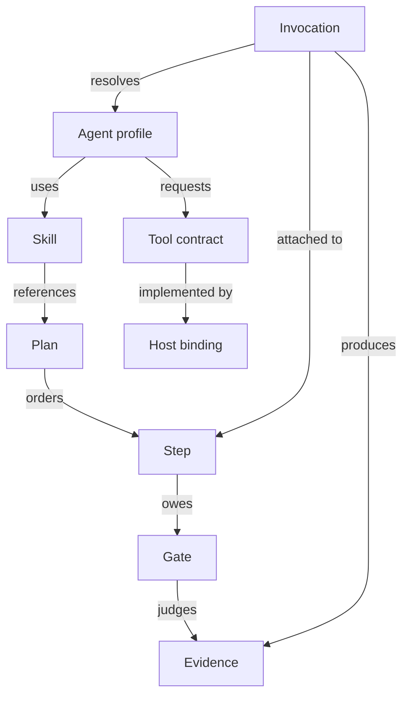
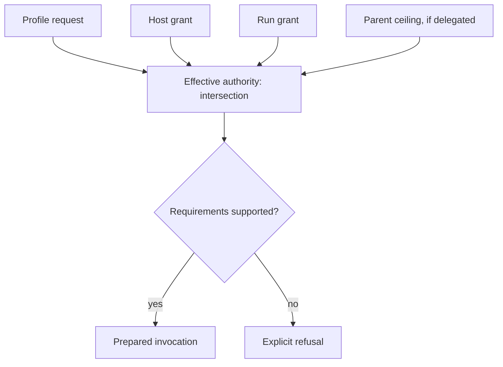

# RFC: Composable tools, gates, skills and agent profiles

## Summary

Let users define tools, gates, skills, plans and agent profiles in their
`.writfold/` configuration. Use TOML for the machine-readable contract and
multiline text for instructions that cannot usefully be structured. A skill
describes reusable knowledge or a procedure; an agent profile describes the
worker configuration that can use it. Their relationship is many-to-many.
Plans remain the single definition of steps, and gates remain the single
definition of evidence obligations.

Writfold resolves these definitions, checks their composition and records
invocations against existing runs and steps. External harnesses execute
models and tools. Tool implementations and provisioning remain replaceable:
Gripsack is one way to supply an environment, with no required dependency.
The [formal appendix](2026-11-25-agent-vocabulary/calculus.md) defines the
proposed algebra, operational calculus, assumptions and counterexamples.
The mathematics is a specification to prove against implementation, not a
claim that new proofs or runtime guarantees already exist.

## Proof obligations first

Proposed pure kernels live under `crates/writfold-core/src/agent/`. Split
them by responsibility, reuse existing gate, policy, packet and plan
decisions, and respect the repository's module size budgets. Names below
are proposals, not claims that modules exist.

| Kernel boundary | Signature sketch | Named obligations |
|---|---|---|
| Composition | `compose(ResolvedDefs, UseSite) -> Result<Composition, Refusal>` | `compose_typed`, `obligations_preserved`, `splice_idempotent` |
| Admission | `admit(Composition, Grants, Support, SnapshotFacts) -> Admission` | `admit_iff`, `capability_non_amplification`, `unsupported_refused` |
| Budgets | `reserve(Ledger, Bound)` / `settle(Ledger, Reservation, Usage)` | `reservation_conservation`, `retry_charged`, `overflow_refused` |
| Applicability | `applicable(Binding, CurrentFacts) -> SameChangedUnknown` | `evidence_bound`, `unknown_not_met`, `judgment_not_mechanical_pass` |
| Record transition | `transition(State, Event, Facts) -> Result<State, Refusal>` | `record_idempotent`, `conflict_not_success`, `record_does_not_advance` |

Prove the decision kernels over their shipped Rust extraction through
Charon/Aeneas before wiring verbs. Run the proofs gate, axiom audit and
mutants; refresh the applicable tauten claims. The appendix gives laws,
premises, mutation targets and the difference between abstract semantics
and finite implementation representations. In particular, do not prove a
second Lean-only implementation and describe the Rust as covered.

Extend existing `RunGraph`/`KbWrite` only where their real protocol changes.
Model the new external-attempt boundary in a proposed
`spec/AgentInvocation.tla`: prepare, reservation, dispatch observation,
result publication, crash recovery and conflicting writers. Do not create
another run state machine. TLC safety checks, fairness-qualified liveness
and expected counterexamples for two independent clones are specified in
the appendix; no claim of distributed exactly-once execution is made.

Tested and unproved: TOML/JSON parsing, source spans, schema loading,
canonical encoders and digest computation, file containment, Git IO,
adapter translation, runtime capability observations and output rendering.
Tests must include malformed, partial, conflicting and missing inputs.
The digest model assumes collision resistance; a digest is not a signature.
A proof about an admitted capability set does not prove a host actually
confined a process to that set.

## Motivation and current baseline

The owner requested structured agent definitions, their relationship to
skills, user-supplied specialist tools and explicit composition laws.
The follow-up clarified that users keep these definitions in `.writfold/`.

At baseline `2b9c9db0ea47b62011c83c8c582e146cefa83151`:

- [Plans](../guide/run-graph.md) already have a finite ordered spine,
  includes, idempotent splicing, bounded loops and recorded step identity.
- [Gates](../guide/gates.md) already bind evidence to subjects and
  definitions, with distinct satisfied, attested, waived, failed and
  unknown outcomes.
- [Skills](../guide/skills.md) are external Markdown instructions.
  Writfold does not parse `SKILL.md`. A skill can ask the harness to splice
  a Writfold plan, including when the harness runs it in a subagent.
- Writfold records what work reached; it does not schedule a model.
  Required steps, strict handoff checks and receiver trust remain
  independent of the agent's chosen profile.

The missing concept is a portable, inspectable worker contract and a typed
way to connect it to that existing machinery. A separate process alone
does not turn a skill into an agent definition. Nor does putting prose in
TOML make it enforceable.

## Vocabulary and boundaries

| Building block | Owns | Composes by |
|---|---|---|
| Tool | Input/output contract and declared effects of one operation | A binding implements it; an agent requests access |
| Binding | Mapping of a tool contract to a host implementation | Native tool, approved executable or protocol adapter; explicit support facts |
| Gate | Judgment of whether particular evidence meets an obligation | Referenced by plan steps and existing operator policy |
| Skill | Reusable instructions/resources, optional IO contract, required tool contracts and optional plan reference | Loaded into a compatible agent or used inline |
| Plan | Ordered steps, includes, bounded loops and gate references | Existing `writfold-plan/1` composition |
| Agent profile | Instructions, skills, requested tools, IO contract, context policy, model configuration and limits | Resolved for a concrete task; may recommend a default plan |
| Invocation | One resolved use of a profile and input at a run/step | Captures bindings and results; a retry gets a distinct identity |
| Evidence | Check result, observation or attributable judgment about a subject | Accepted only under existing gate policy and applicability rules |

Only the first six are reusable configuration concepts. Invocation and
evidence are execution records. "Agent" in user-facing configuration means
the profile; a live worker is an external harness acting on an invocation.

Create a skill when the reusable thing is a method or knowledge. Create an
agent profile when the reusable thing is its combination of instructions,
context boundary, tool access, model settings, limits and result contract.
A procedure useful in both the main conversation and a separate reviewer
stays one skill. A flow-specific profile can be small and local; a new
profile is unnecessary if only the task input changes.

### Composition visual



An agent's `default_plan` is a reference, not another copy of `steps` or
`gates`. Tools do not contain plans; a gate may run an existing checker, but
invoking a tool does not by itself meet a gate. A skill's instructions may
explain a step, but the plan owns ordering and required obligations.

## User configuration and discovery

Proposed project layout; supporting context, model and binding files are
configuration dependencies, not new workflow engines:

| Path under `.writfold/` | Purpose |
|---|---|
| `tools/<id>.toml` | User-authored tool contracts |
| `gates/<id>.toml` | Existing gate definitions |
| `skills/<id>.toml` | New typed skill manifests with inline instructions or a text reference |
| `plans/<name>.toml` | Existing plan templates and `required.toml` |
| `agents/<id>.toml` | New agent profiles |
| `context/<id>.toml` | Selection policy over existing packet/context facilities |
| `models/<id>.toml` | Shared model configuration; no credentials |
| `bindings/<adapter>.toml` | Reviewed portable implementation mappings |
| `schemas/`, `instructions/` | Referenced IO schemas and optional longer text |
| `local/` | Git-ignored machine bindings, environment locations and secret handles |

All user-facing definitions belong to `.writfold/`, as requested. Machine
state can also live there without committing credentials or absolute
machine paths. An invocation retains a redacted description/digest of the
effective binding, never secret values. Runtime credentials come from the
host's existing credential mechanism.

Follow the existing repository-versus-KB lookup rule: a duplicated identity
in both locations is an error, not silent shadowing. Use nominal IDs for
each kind and distinguish an ID from its captured revision/digest. The
proposed new-ID grammar allows lowercase ASCII words separated by `-` or
`.`; existing gate/plan ID rules are unchanged. File stems equal IDs.
A reference resolves to exactly one definition of the expected kind.

Unknown keys, duplicate definitions, unresolved references, wrong kinds
and inconsistent revisions are errors. A schema version is explicit.
References in new manifests are relative to the owning `.writfold/` root;
paths must remain inside that root. Instruction content can be inline or
a referenced file, exactly one of the two. No dynamic shell interpolation,
automatic package fetching or execution happens while reading a definition.

The new namespaces proposed here are `writfold-tool/1`,
`writfold-skill/1` and `writfold-agent-profile/1`. They do not restore the
archived `writfold.agent/1` runtime. Existing gate and plan loaders keep their
current language. Any extension to those grammars, including inline gate
instructions, needs an explicit schema/version decision; do not quietly
reinterpret `instructions`, which currently names a file for gates.

### TOML examples

These examples illustrate the proposed contract. They parse as TOML, but
are not runnable fixtures: referenced schemas, context/model definitions
and tool implementations must be supplied by the later fixture issue.

A tool describes one operation. The host binding must actually implement
its schema and declared effects:

```toml
# .writfold/tools/repo.read.toml
schema = "writfold-tool/1"
id = "repo.read"
version = 1
description = "Read a path from the captured subject repository."
input_schema = "schemas/repo-read-input.json"
output_schema = "schemas/repo-read-output.json"
effects = ["repository.read"]

[scope]
repository = "subject"
paths = ["**"]
```

The first implementation should support a small, explicit effect/scope
grammar and exact schema identity, not arbitrary schema implication or
general code effects. A contract naming `repository.read` cannot turn an
unrestricted shell into a read-only implementation. Declarations are
requirements; support and enforcement need evidence from the chosen adapter
and host.

A skill references the plan once:

```toml
# .writfold/skills/verify-pr-claims.toml
schema = "writfold-skill/1"
id = "verify-pr-claims"
version = 1
plan = "claims-review"
required_tools = ["repo.read", "repo.diff", "evidence.read"]
input_schema = "schemas/review-request.json"
output_schema = "schemas/review-report.json"
instructions = """
Compare each claim in the proposed PR description with the captured diff
and the cited check evidence. Give each claim a supported, contradicted
or unknown judgment, with the evidence and its limits.
Do not describe a model judgment as a mechanical test result.
"""
```

An agent selects this skill and the environment in which it is used:

```toml
# .writfold/agents/pr-claims-reviewer.toml
schema = "writfold-agent-profile/1"
id = "pr-claims-reviewer"
version = 1
skills = ["verify-pr-claims"]
tools = ["repo.read", "repo.diff", "evidence.read"]
default_plan = "claims-review"
input_schema = "schemas/review-request.json"
output_schema = "schemas/review-report.json"
instructions = """
Review only the supplied change and its evidence. Preserve uncertainty.
Return the review report required by the output schema.
"""
# Alternative to instructions, mutually exclusive:
# instructions_file = "instructions/pr-claims-reviewer.md"

[context]
policy = "review-context"
inherit_conversation = false

[model]
profile = "reviewer"

[limits]
max_turns = 8
max_tool_calls = 24
max_output_tokens = 4000
```

A single profile may list several skills. Loading one whose required tools
are not available is refused; loading a skill never expands the profile's
tool grant. For an initial exact-identity implementation, a skill's IO
schemas must match the task/profile schemas or have an explicitly selected,
typed adapter. A knowledge-only skill can omit its IO and plan fields.

The following use existing plan/gate syntax:

```toml
# .writfold/plans/claims-review.toml
schema = "writfold-plan/1"
name = "claims-review"
description = "Review the claims made about a change."
steps = ["check: claim-review"]
```

```toml
# .writfold/gates/claim-review.toml
schema = "writfold-gate/1"
id = "claim-review"
version = 1
class = "attested"
scope = ["**", "!runs/**"]
accept = ["attested"]
instructions = "claim-review.md"
description = "An attributable review of the change's claims."
```

The gate instruction file uses today's gate-relative convention. It defines
what an attestation covers. Recording a report does not automatically write
that attestation, grant the reporter authority, or advance the step.
Mechanical validation of the report's JSON proves its shape only. Any
model judgment remains attributed as such.

A larger flow can reference the same plan:

```toml
# .writfold/plans/review-change.toml
schema = "writfold-plan/1"
name = "review-change"
steps = [
  "implement: quality unit",
  "review: use=claims-review",
  "deliver: deliver:pr",
]
```

This last example assumes the existing `quality`/`unit` gates and `pr`
delivery mode are defined. Required research/reflection policy still applies.
The same `verify-pr-claims` skill can be used inline or through the specialist;
the step identity and its gate obligations are unchanged.

## Behaviour and proposed command surface

Command names and diagnostic identifiers below are proposals for grooming,
not existing CLI capabilities.

1. `writfold kb agent inspect pr-claims-reviewer --json` resolves and
   displays the full closure, origins, digests, required/granted tools,
   model/context configuration and unsupported requirements. Read-only.
2. The caller uses existing `plan set`/`plan use` when a plan needs to be
   adopted. Merely loading a profile does not replace or silently splice a
   plan. An adapter that offers automatic skill splicing must use the same
   explicit idempotent operation and expose its result.
3. `writfold kb agent prepare pr-claims-reviewer --skill verify-pr-claims
   --run RUN --step STEP --input review-request.json --out DIRECTORY`
   validates the input, resolves/snapshots the closure, binds the invocation
   to the existing current step and writes its intent atomically. It emits
   the external harness package; it does not launch a model.
4. The external harness executes only if it can satisfy the declared
   requirements and grants. Launch/usage observations may be attached to
   the same invocation. An outcome whose execution cannot be established
   remains unknown, not implicitly unrun.
5. `writfold kb agent record INVOCATION --report report.json` validates
   schema, identity, completeness and provenance, retains evidence and
   records the outcome. The ordinary gate and `plan advance` paths decide
   what that outcome permits. An exact repeated submission is a no-op;
   conflicting submissions are surfaced.

Use existing exit-code conventions: 0 for a complete inspection or accepted
record operation, 2 for partial/unknown inspection, 3 for refusal, 1 for bad
CLI usage. Exit 0 from record means the record was admitted, not that a
review passed or a plan completed. JSON separates operation status from
the reported outcome and evidence standing.

Example refusal:
`agent.capability-unavailable: verify-pr-claims requires repo.diff;
the effective binding does not provide it; no invocation prepared`.
Other distinct diagnostics cover unresolved references, ambiguous IDs,
schema mismatch, stale prepare inputs, unsupported limits, exhausted budget,
partial context, conflicting output and unknown launch outcome.

New intent/results use Git records within the existing `runs/<run>/`
namespace (candidate directory: `invocations/`), with captured definition
and artifact references. SQLite, if used for lookup, is derived. Reuse the
existing publication/lock/recheck and retained-evidence machinery. A report
may be retained even when stale or late, but it cannot silently complete a
different or already-advanced step.

## Design

### Authority and capability composition

For a selected skill closure, its required tool/effect set must be included
in the effective authority. Authority is the intersection of what the
profile requests, what the host grants and what the run policy grants,
plus the parent invocation's authority if delegated. Root invocations have
no parent restriction; they still require host and run grants. A skill
cannot grant permissions; an imported profile cannot grant host authority.



A runtime can be capable of launching an invocation yet incapable of
enforcing a required limit. Required unsupported restrictions cause refusal,
not a reassuring label. Optional observations can be displayed as reported.
The profile states which requirements are mandatory; the initial examples
treat their listed tools/context/limits as mandatory. A deliberate weaker
profile is a different captured configuration, not a silent fallback.

Keep provenance for "declared", "adapter reports enforcement" and
"enforcement verified by the operator's trusted runner". None becomes a
cryptographic guarantee merely because it is written into TOML. A trusted
receiver uses its own required gates and trust policy (#57/#64).

### Context, configuration and identity

Reuse bounded packets (#109/#123) and Witan-related context work
(#137–#141). Capture the actual packet, source pins, omissions, required
rows and completeness flags, not just the name of the selection policy.
Missing mandatory context blocks admission. Optional missing context is
visible. An instruction asking a model to forget ambient context is not an
isolated-context implementation.

Capture all behavior-affecting inputs: profile and skill text, plan/gate
references where applicable, tool schemas and bindings, model provider and
resolved model identity/settings, adapter/runtime version, context bytes,
task input, effective permissions and limits. Provider aliases can move;
record an unresolved version as such and refuse any requirement for a
stronger pin that the provider cannot supply. A fallback or changed tool
implementation produces a new configuration identity.

Separate source snapshots from normalized configuration identity.
Formatting changes outside prompt material may change source digests
without changing semantic configuration. Instruction strings and ordered
prompt parts retain their order and exact decoded content. Canonicalize only
fields whose semantics are unordered; never sort a prompt or plan.
Identical configuration means comparable inputs, not deterministic output.

Each actual invocation has a fresh identity even with identical inputs;
a retry references its predecessor. Records identify run, step path and
iteration, invocation, configuration digest, input/context/subject pins,
artifact digests and reporter provenance. Clocks are descriptive, not a
replacement for existing event ordering or unique invocation identity.

### Limits, retries and delegation

Model limits are separate from plan-loop limits. A bounded loop does not
bound tokens, cost or tool calls within a round. Account for retries and
children against an explicitly chosen budget scope. Before a concurrent
child starts, reserve its enforceable upper bound; settle measured usage
after completion. Unknown usage keeps the reservation until reconciled.
A deadline or token limit needs enforcement by the runner; merely recording
usage afterwards is observation.

The first implementation can keep a single local admission authority and
omit delegation. Independent clones cannot jointly enforce a shared global
budget without an external authority. Refuse that guarantee when requested.
Use integer units, explicit bounds, checked arithmetic and an explicit
distinction between hard caps and estimates. This RFC does not promise an
exact monetary cap from a provider's approximate billing metadata.

### Gate and evidence composition

A plan step owes its own obligations plus applicable required policy and
the included plan's obligations, at their actual step instances. Agent
selection cannot remove them. Repeating a skill load at the same applicable
splice is idempotent under existing rules; intentional new rounds have new
identities and new obligations.

A gate has both an evidence requirement and its accepted standings. If two
requirements apply to the same obligation, combine acceptance by
intersection. An empty intersection is a configuration conflict. Preserve
whether evidence is mechanical, observed, attested or waived; do not
translate a reviewer's "pass" into a mechanical pass. Unknown, stale,
missing, malformed and untrusted evidence never acquire a passing standing.

Use existing applicability and order rules: a later failure cannot be
ignored by choosing an older passing result, and a report for an older
candidate/subject cannot decide a newer one. Historical completion remains
historical when current evidence becomes stale. Agent profiles do not
replace operator handoff policy or authorize their own waivers.

### Adapters and provisioning

An adapter translates a resolved profile to the target harness and records
the actual mapping. Keep Writfold's model independent of that harness's
file layout. A Claude Code export is one useful first adapter: it must check
actual feature support and preserve typed requirements or refuse, including
cases where a target ignores unknown fields or treats tool settings as
approval hints.

Tool contract, implementation binding and environment provisioning are
separate. Users can supply a local executable, their own service/native
integration or a future protocol adapter, subject to the binding contract.
A Gripsack environment can provision the executable and supply its version
receipt; an already-installed binary or another environment manager can do
the same. No Gripsack key is required in a portable tool or agent profile.
Do not ship every transport in the first slice.

## Compatibility and reversibility

This is pre-alpha design work. Prefer a clean schema over compatibility
shims for archived agent formats (#105/#107); never reuse an old schema name
with different semantics. A KB without profiles keeps its existing
plan/gate/skill workflow, with no model service or Gripsack requirement.
An older binary must not be described as enforcing definitions it ignores.

Removing an unused profile reverses configuration adoption. Definitions
used by an invocation remain available through captured snapshots; deletion
does not erase history. Live-format migrations, if needed, are explicit
and preserve recorded claims and evidence distinctions. This draft changes
no current behavior or website capability claims.

## Alternatives

| Alternative | Assessment |
|---|---|
| Continue with external agent Markdown only | Useful baseline, but cannot validate cross-definition composition or capture a portable resolved contract |
| Put worker configuration and all steps into a skill | Conflates reusable method with context/authority/model choices and duplicates plans |
| Copy a harness's agent schema | Useful export target; insufficient as Writfold's authority, evidence and identity model |
| Build an agent scheduler into Writfold | Adds process/network ownership outside the current mission; unnecessary to record and judge external work |
| Introduce a general workflow DAG or an agent programming language | Existing spine/includes/loops cover the first case; branching, arbitrary recursion and agent inheritance are deferred |
| Require Gripsack for tool installation | Couples a portable contract to one user's provisioning choice; an optional binding is sufficient |

## Evidence and tests

The source talk motivates specialization; its private benchmark claims do
not establish Writfold quality or cost improvements. Evaluate that
separately. The first worked scenario is a PR claims reviewer alongside
existing deterministic delivery checks such as Vale: each retains its own
authority and evidence class.

Required future validation:

- Parser/diagnostic fixtures for inline text, referenced instructions,
  duplicates, cycles, missing files, wrong kinds, ambiguous discovery,
  schema mismatch and unknown fields. No partial successful composition.
- Algebra/property fixtures for sequencing, repeated skill loading,
  nested scopes, incompatible obligations, empty policy, overflow and
  required-steps preservation; a mutant must remove each critical guard.
- Adapter conformance fixtures for missing tools, ignored settings,
  unsupported isolation/limits, runtime drift and substituted models.
  Static export tests alone do not establish runtime confinement.
- Invocation fault tests for source movement between read and publish,
  lost launch acknowledgement, partial artifacts, duplicate/conflicting
  results, late result arrival, retry costs, parallel reservations and
  cross-clone merge conflicts.
- Proofs, quality and unit gates for implementation. Plan/gate integration
  tests must show that importing a valid report does not auto-advance.

The documentation-only RFC needs TOML syntax, diagram syntax, relative-link
and registry checks, not a paid model run. Reuse #112 for a future controlled
comparison of inline and specialist execution: same task/skill, declared
context and tool variants, pinned configurations, independent quality
criteria, latency/cost/completeness and honest unknowns. No new evaluation
pilot is authorized by filing these issues.

## Rollout and linked work

All new work is grouped under `agent-vocabulary`. The tracking issue
[#143](https://github.com/writfold-dev/writfold/issues/143) groups the following
proposed work. Dependencies describe implementation order; schema and formal
design can be groomed together.

| Issue | Deliverable | Depends on |
|---|---|---|
| [#144](https://github.com/writfold-dev/writfold/issues/144) | Typed `.writfold/` configuration and discovery | Schema decisions with #145 |
| [#145](https://github.com/writfold-dev/writfold/issues/145) | Algebra, calculus, Lean proof ledger and TLA+ protocol | Selected representation from #144 |
| [#146](https://github.com/writfold-dev/writfold/issues/146) | Tool contracts, bindings and optional provisioning | #144, #145 |
| [#147](https://github.com/writfold-dev/writfold/issues/147) | Skill/agent composition through existing plans and gates | #144–#146 |
| [#148](https://github.com/writfold-dev/writfold/issues/148) | Captured configuration, authority, context and budgets | #144–#147 |
| [#149](https://github.com/writfold-dev/writfold/issues/149) | Invocation outcomes and retained evidence | #144–#148 |
| [#150](https://github.com/writfold-dev/writfold/issues/150) | One harness adapter and conformance checks | #144–#149 |
| [#151](https://github.com/writfold-dev/writfold/issues/151) | Complete reviewer example, visuals and evaluation protocol | #144–#150; reuse #112 |

Milestones and assignees are intentionally unset until owner grooming;
this request does not start implementation.

1. Settle the minimal schema, effect vocabulary and trust/adapter boundary.
2. Formalize the selected decisions, extract/prove the pure kernels, then
   add read-only discovery and diagnostics.
3. Add portable contracts and one supported host binding; exercise
   composition with existing plans/gates before adding external attempts.
4. Add snapshot preparation, retained results and the crash-tested
   invocation protocol. Keep any delegation/global-budget extension gated
   behind its own supported guarantees.
5. Add one adapter and the complete reviewer example; document unsupported
   features and the optional provisioning recipe.
6. Groom a controlled evaluation separately; change product messaging only
   after capabilities have actually been exercised.

This extends, rather than restarts, #109/#123 (packets), #110 (replanning),
#111 (attempt comparison), #112 (evaluation planning), #116 (checker inputs),
#121/#128 (retained evidence), #57/#64 (handoff/trust), and #137–#141
(context work). Existing issues are neither retagged nor implicitly reopened.

## Unresolved questions for grooming

- Owner: confirm the smallest initial set of effect/scope primitives and
  whether the first binding is an executable wrapper or native harness
  mapping. Avoid pretending arbitrary host tools have known effects.
- Owner: choose the first adapter guarantees that must be enforced. A
  supported projection can be useful before a runtime supports every
  optional feature, but required restrictions cannot disappear.
- Decide the first result envelope and budget scope with #111/#121/#128.
  Keep usage observation useful even where a hard cap cannot be promised.
- Decide whether inline gate text warrants a separately versioned gate
  schema change. New skill/profile prose does not require that migration.
- Specify the initial restricted JSON Schema vocabulary and offline
  reference policy; exact identity is sufficient before subtyping.
- Choose whether default-plan adoption is always explicit or offered as
  a visible adapter action through existing `plan use`. No hidden rewrite.

## Sources

Read as design inputs on 25 November 2026; target runtime behavior must be
checked again against the version used by an adapter:

- [Why Domain-specific Agents Are the Future](https://www.youtube.com/watch?v=wIPr9GmLRaQ).
- [Claude Code subagents](https://code.claude.com/docs/en/sub-agents):
  worker configuration and preloaded skills.
- [Claude Code skills](https://code.claude.com/docs/en/skills):
  reusable instructions and selection of a forked agent.
- [Standard Agent Spec](https://standardagentspec.org/) and
  [packaging](https://standardagentspec.org/0.2.0/distribution/packaging/):
  related portability work; not adopted as Writfold's execution semantics.
- [Writfold mission](../writfold/mission.md), [run graph](../guide/run-graph.md),
  [gates](../guide/gates.md), [skills](../guide/skills.md) and
  [Aeneas assurance boundary](../writfold/aeneas.md).

## Decision log

- 2026-11-25: Owner requested the RFC, composition visuals, algebra/calculus
  and linked tagged issues for later grooming, then clarified that users
  author the configuration in `.writfold/`. The specific grooming instruction
  takes precedence over standing default auto-acceptance and milestone
  assignment. No runtime implementation, proof completion, model evaluation
  or merge is claimed by this proposal.

