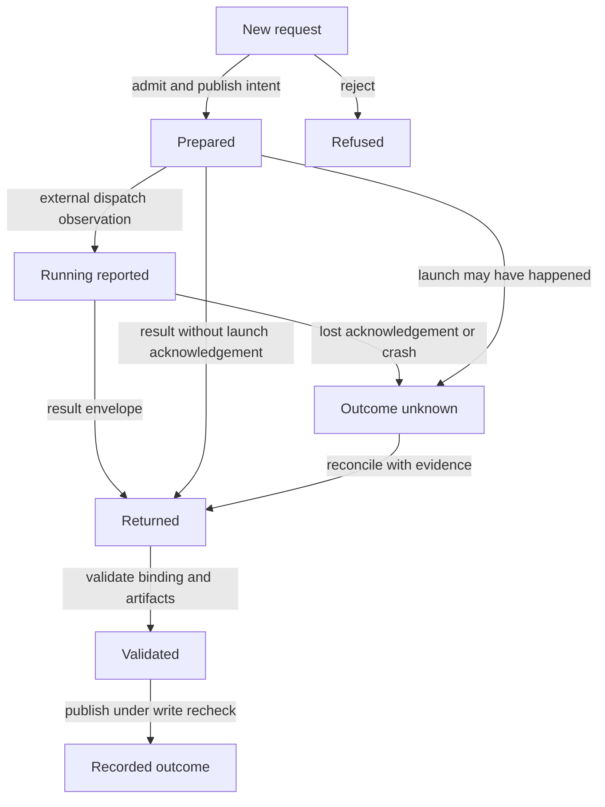

# Agent vocabulary: algebra and operational calculus

Companion to the [RFC](../2026-11-25-agent-vocabulary.md) and
[tracking issue #143](https://github.com/writfold-dev/writfold/issues/143).
This is a proposed mathematical specification. None of the new theorems or
protocol models below is claimed to be implemented or proved.

## 1. Domains, judgments and trust assumptions

Let `Γ` be a finite registry of typed, resolved definitions. References use
nominal pairs `(kind, id)` and resolve to one captured revision. A digest
identifies captured content under a collision-resistance assumption;
identity is not authenticity. Let `σ` contain the subject, source pins,
current run/step, operator policy and completeness facts.

| Symbol | Meaning |
|---|---|
| `t : I → O ! E` | Tool contract: input/output schemas and upper bound on declared effects |
| `s : I ⇝ O [R, P]` | Skill: expected input/output, required capabilities, optional plan |
| `a` | Agent profile: ordered instructions/skills, requested authority, context/model/limits |
| `P` | Existing finite plan expression after bounded include/loop expansion |
| `Ω` | Map of instantiated obligation identities to requirements |
| `C` | Capability predicate over concrete actions |
| `B, U, r` | Budget limit, spent usage and one reservation, in integer units |
| `D` | Resolved configuration, with all behavior-affecting dependencies |
| `ι` | Fresh invocation identity with run/step/round and predecessor references |
| `e` | Retained evidence, with binding, origin and reported outcome |
| `H` | Append-only event/artifact history |

A concrete action includes operation, resource identity and scope-relevant
arguments. Capability predicates denote subsets of the action universe.
The first implementation needs only a finite, restricted representation:
tool IDs, effect atoms, fixed roots and supported path predicates.
Intersection is conjunction of predicates, so it need not solve arbitrary
glob inclusion. A static coverage check must be sound on its supported
grammar; an unprovable inclusion is refused as unsupported, not assumed.
Tool calls outside the effective predicate are refused by the runner.

The judgment `Γ; σ ⊢ a[s] : I ⇝ O ! C ▷ Ω` means the composition has a
well-formed expected contract, authority ceiling and obligations. It does
not say the model terminates, returns `O`, uses only `C`, tells the truth,
or meets `Ω`. Those require output checks, runtime enforcement and
applicable evidence respectively. The pure kernel consumes validated
facts; parsers, file IO and a dishonest runner are outside that theorem.

## 2. Composition algebra

### 2.1 Typed operations and instruction composition

Initial schema compatibility is nominal equality of captured schema
identity. If `t₁ : I → M ! E₁` and `t₂ : M → O ! E₂`, their typed
sequential operation has contract:

$$
t_2 \circ t_1 : I \to O \;!\; (E_1 \cup E_2).
$$

This is a compatibility rule, not a new general tool-pipeline executor.
If the intermediate types differ, composition requires an explicit typed
conversion; there is no prompt-based coercion. Runtime validation is still
necessary because an implementation may violate its declared contract.

An agent's ordered skill instruction sequence concatenates with ordinary
associativity and the empty sequence as identity. It is not commutative:
changing prompt order can change behavior. Requirement-set union is
commutative, but that does not make full skill loading commutative.
A knowledge-only skill has no procedural output requirement or plan;
it still contributes its actual instruction bytes and any required tools.

### 2.2 Plans

Use the existing spine, include and bounded-loop constructs:

$$
P ::= \epsilon \mid \operatorname{step}(k,\Omega)
      \mid P;P
      \mid \operatorname{include}(k,T)
      \mid \operatorname{loop}(k,T,n,\Omega),\quad 1 \le n < \infty.
$$

Here `k` is a step instance path, not just a display name. This grammar
describes the existing model; it does not authorize a second parser or new
unbounded recursion. Include cycles and excessive depth are refused before
publication. Loop expansion uses actual round identities and current gate
semantics.

For the denoted ordered spine, modulo consistent renaming of fresh
instance paths:

$$
(P;Q);R \equiv P;(Q;R),\qquad \epsilon;P \equiv P \equiv P;\epsilon.
$$

In general `P;Q ≠ Q;P`. Equality here concerns the abstract ordered work
and obligations, not identical Git event bytes or identical model output.
No parallel-plan operator is proposed.

If `K` is an existing splice identity at the current step or applicable
ancestor, and the captured template digest is unchanged:

$$
\operatorname{use}(K,\operatorname{use}(K,H))
 = \operatorname{use}(K,H).
$$

This is the current `plan use` rule, not global deduplication by skill name.
A different step, explicit `--again` or new loop round is a different use.
A changed definition is never silently treated as the same captured use.

### 2.3 Obligations

An obligation identity contains the actual step/round, gate identity and
captured definition, subject selector and applicable policy identity.
Its value includes the required evidence predicate and accepted standings.

Define partial combination `Ω₁ ⊎? Ω₂`:

1. Disjoint keys are retained.
2. For a common key, structural identities and subject requirements must
   agree; combine independent evidence requirements with conjunction.
3. Intersect accepted-standing sets.
4. A contradictory requirement or empty accepted-standing intersection is
   a conflict. Do not replace either side or admit a "good" prefix.

For compatible maps, combination is associative, commutative and
idempotent, with the empty map as identity. These laws apply to the
normalized obligation map, not to plan ordering or prompt text.

For `Ω′ = Ω ⊎? Δ` and a fixed evidence environment `σ`:

$$
\operatorname{Met}(\Omega',H,\sigma)
\Longrightarrow \operatorname{Met}(\Omega,H,\sigma).
$$

Adding requirements cannot make a previously unmet obligation met.
Removing evidence, changing a subject or changing policy can invalidate
a judgment; no temporal monotonicity of freshness is claimed.

The empty-map identity does not mean every product operation with no
requirements succeeds. A structural plan step may owe zero gates under
existing rules, while a delivery mode with no checks is blocked by
`empty_never_ready`. Admission and completion retain those separate
well-formedness conditions; never infer readiness from vacuous conjunction.

### 2.4 Authority and specialization

Let `Q` be profile-requested authority, `G_h` the host grant, `G_r` the
run/operator grant and `G_p` the parent ceiling. At a root, set `G_p = ⊤`:

$$
C_{\mathrm{eff}} = Q \cap G_h \cap G_r \cap G_p.
$$

A closed tool list defaults to no unlisted tools. Unspecified optional
parent restriction at a root is distinct from an absent required host or
run grant. Admission needs a sound coverage judgment for each declared
mandatory requirement `R` of the loaded skills/task:

$$
R \subseteq C_{\mathrm{eff}}.
$$

Here a requirement includes its explicitly declared mandatory resource
envelope; the system does not infer needs from prose. Dynamic requests
remain checked against `C_eff`. A narrowed scope may be usable when it
covers the task's declared requirement; it cannot satisfy a larger required
envelope merely because the tool has the same name.

Consequences:

- `C_eff ⊆ G_h`, `C_eff ⊆ G_r` and `C_eff ⊆ G_p`.
- Shrinking any grant cannot enlarge `C_eff`.
- Loading a skill can add requirements and cause refusal; it cannot add a
  grant.
- Delegation cannot amplify authority.

Define a partial specialization order for otherwise compatible profiles:
`a′ ⪯ a` when `Q′ ⊆ Q`, `Ω ⊆ Ω′` under compatible obligation extension,
and `B′ ≤ B` componentwise. This orders authority/obligation/limit
constraints only. It does not establish that a different model or
instruction text is more accurate, cheaper, or behaviorally substitutable.

### 2.5 Budget algebra

Use vectors in `ℕᵏ` with componentwise `+` and `≤`. Coordinates have named
units, for example tool calls or output tokens. Omitted limits, unknown
usage and a zero limit are distinct states. Never add incomparable monetary
or token quantities without an explicit accounting rule.

For one budget authority with limit `B`, spent `U` and live reservations
`Rsv`, admission maintains:

$$
U + \sum_{r \in Rsv} r \le B.
$$

`reserve(r)` succeeds only if adding `r` preserves the inequality.
`settle(r,c)` removes `r` and adds actual usage `c` to `U`, with verified
`0 ≤ c ≤ r`. Retries and child work get their own reservations; each
underlying charge is accounted once. A parent that includes child costs
must not also charge those same costs a second time.

Unknown usage retains its reservation. Release requires evidence that the
unused reservation has no remaining liability; a timeout alone does not
prove the remote worker stopped. If reported usage exceeds its bound,
record a breach and refuse further admission. Do not discard the report
to maintain a fictional invariant. Conservation holds for admitted,
non-breached histories under the runner's bound-enforcement assumption.

Checked integer arithmetic must refuse overflow rather than wrap or
silently saturate. A hard cap needs pre-action enforcement, not only an
after-the-fact ledger. Concurrent children require atomic reservations.
Two disconnected clones do not share this invariant unless they share an
external admission authority; this is an explicit unsupported guarantee
for the first implementation.

### 2.6 Configuration identity

Let `N(D)` normalize only semantically unordered fields, and `encode` be a
versioned deterministic encoding with kind/domain separators:

$$
\operatorname{configId}(D) =
H(\text{"writfold-agent-config/1"} \parallel \operatorname{encode}(N(D))).
$$

`D` includes the captured instructions and loaded skills, tool contracts
and implementations, plan/gate references relevant to the use, IO schemas,
context packet with completeness/source pins, task input, effective grants,
model/settings, runtime/adapter version and limits. Secret values are not
copied; unresolved secret-dependent behavior limits reproducibility.

Keep source-byte digests separately. Parsed TOML formatting may be
irrelevant; instruction text is not. A renderer that supplies raw source
to the model makes those bytes behavior-affecting. Preserve prompt and plan
order. Explicit missing/unknown inputs cannot hash as an empty known value.

Define `invocationId` independently, using a fresh collision-checked nonce
bound to run/step/round. Identical `configId` across two invocations is
allowed. A result retry on the same invocation and identical payload is
idempotent; a new model execution is a new invocation even with identical
configuration. No theorem equates same configuration with same output.

## 3. Evidence judgment

Use existing gate selectors to choose deciding evidence, including sequence,
candidate supersession and withdrawal rules. There is no existential
"some passing receipt exists" shortcut.

For obligation `o`, evidence `e` and current facts `σ` define:

$$
\begin{aligned}
\operatorname{Applicable}(e,o,\sigma) \iff {}&
\operatorname{WellFormed}(e)
\land \operatorname{CompleteRequiredArtifacts}(e)\\
&\land \operatorname{BindingMatches}(e,o,\sigma)
\land \operatorname{Fresh}(e,\sigma)\\
&\land \operatorname{ProvenanceAccepted}(e,o,\sigma).
\end{aligned}
$$

Then `Met(o,H,σ)` requires the existing deciding evidence to be applicable,
its evidence predicate satisfied and its standing included in `o.accept`.
Missing, malformed, stale, conflicting, partial or unverifiable inputs
produce an unmet/unknown result with their reason. They do not acquire a
pass from a default value.

`BindingMatches` checks the relevant run/step/round, subject/candidate,
definition/configuration and input/artifact identities. A historical result
may be correctly recorded while inapplicable now. The record operation
returns that distinction instead of deleting history or advancing a new step.

A schema checker can mechanically establish "this report is valid JSON of
the required shape." It cannot mechanically establish "this model's claims
are true." An attributable model judgment may meet an attested requirement
when receiver policy permits that origin. Its evidence class remains
attested; it cannot self-issue a waiver or choose its receiver's trust policy.

## 4. Small-step invocation calculus

A configuration is `⟨Γ,σ,H,L,A⟩`, with ledger `L` and a finite map `A`
from invocation identities to captured configurations and phases. A
transition is `X —event→ X′`. External execution is an event source, not a
new Writfold scheduler.

Phases are `new`, `prepared`, `running-reported`, `returned`, `validated`,
`recorded`, `refused` and `unknown`. A returned/recorded report has a
separate outcome: completed, failed, partial, cancelled or unknown.
"Validated" describes envelope integrity, not gate success.

### ADMIT / PREPARE

If references/types are well formed, the existing use site is valid, mandatory
context is present, capability coverage and runtime support hold, sources
match their captured snapshot at publication, and reservation succeeds:

$$
\frac{\operatorname{Admissible}(\Gamma,\sigma,D,L)
      \quad \iota\notin\operatorname{dom}(A)}
     {\langle H,L,A\rangle \xrightarrow{\operatorname{prepare}(\iota,D)}
      \langle H+\operatorname{intent}(\iota,D),L',A[\iota\mapsto prepared]\rangle}.
$$

`L′` includes the reservation when a hard aggregate budget is requested.
Required-step/policy checks use the existing authority, not a profile's
self-description. IO rechecks the decision under the write lock and
publishes the complete snapshot/intent atomically through existing
mechanisms. If any premise fails, refuse without a partial invocation,
reservation or exported runnable package. Diagnostic audit output is not a
successful intent.

### DISPATCH / CALL / RETURN

Only an external harness can dispatch. A reported launch changes the
observation phase; its provenance determines what a receiver can rely on.
Before each real tool action a supporting runner checks the input schema,
`action ∈ C_eff` and the relevant remaining enforceable bounds. The
capability theorem is conditional on that check actually guarding all
effectful actions, including aliases, shell escapes and delegated actions.

A return attaches the report to the exact `ι` and captured configuration.
Lack of a launch acknowledgement does not forbid accepting a verifiable
report, nor does it prove no launch occurred. Neither a returned result
nor a reported stop implies a passed gate.

### VALIDATE / RECORD

Validation checks the envelope, binding, expected output schema for its
outcome, required artifact digests and origin. A failure/partial report can
be structurally valid and retained as such. Invalid reports are surfaced
without being promoted to deciding evidence.

Publication rechecks the invocation identity and relevant current write
facts. Retention of a valid historical result does not require it to remain
applicable to the live subject; its standing explicitly records that
difference. For a fixed `ι`:

$$
\operatorname{record}(e,\operatorname{record}(e,H))
 = \operatorname{record}(e,H).
$$

A different result for the same declared result slot is a conflict,
not last-writer-wins success. Later reconciliation uses an explicit linked
event and keeps both observations. Recording never emits a plan-advance
event. `advance` remains the existing independently checked operation.

### UNKNOWN / RETRY / CANCEL

A crash between external launch and durable acknowledgement admits two
worlds: launched and not launched. Record `unknown` and reconcile; do not
automatically rerun a potentially effectful task. A permitted retry creates
a new invocation linked to the old one and consumes a new reservation.
Releasing the old reservation needs evidence about the old worker.

A cancellation request is not an observed cancellation. Preserve
unconfirmed execution/usage as unknown. Late results can be retained after
a step moves, but cannot close a replacement step. Reconciliation adds
evidence; it does not rewrite an earlier uncertain observation into an
event that was known at the time.

## 5. Proof ledger and falsifying mutations

Every theorem is over the actual finite representation and extracted
decision function. Representation lemmas connect it to the abstract sets,
maps and judgments above. Completeness claims are restricted to the
supported grammar; conservative refusal is allowed outside it.

| Proposed Lean theorem | Required claim | Mutant/counterexample |
|---|---|---|
| `compose_typed` | Every admitted reference has the expected kind and compatible schema | Accept a missing reference or mismatched output schema |
| `obligations_preserved` | Composition retains every compatible required obligation and acceptance restriction | Drop the last required gate; union acceptance sets |
| `splice_idempotent` | Repeated eligible use at one digest adds no second instance | Allocate a fresh splice for an accidental reload |
| `capability_non_amplification` | Effective authority is below every applicable grant | Union host and requested authority |
| `unsupported_refused` | An unsupported mandatory guarantee cannot be admitted | Convert unsupported isolation to an ignored warning |
| `admit_iff` | Admit exactly when all supported-representation predicates hold | Ignore partial context or a moved prepare input |
| `reservation_conservation` | Reserve/settle preserve the inequality under bounded-usage premises | Give two children the same unreserved remainder |
| `retry_charged` | A new execution cannot reuse another invocation's charge/reservation | Deduplicate executions by configuration digest |
| `overflow_refused` | Arithmetic overflow cannot yield an admissible budget | Wrap the usage sum to zero |
| `evidence_bound` | Deciding evidence matches the required binding and freshness facts | Accept another round's or older candidate's report |
| `unknown_not_met` | Unknown/incomplete evidence cannot satisfy a required gate | Parse absent usage/report as successful zero/empty |
| `judgment_not_mechanical_pass` | A model judgment preserves its evidence class | Turn JSON validity into mechanical claim correctness |
| `record_idempotent` | Exact duplicate publication does not add a second result or charge | Append again on a retry of the same submission |
| `conflict_not_success` | Conflicting payloads for a result slot cannot become an unqualified success | Pick whichever filename sorts last |
| `record_does_not_advance` | Result admission changes no step completion fact | Auto-complete the current step on valid JSON |

Reuse an existing proved lemma if its exact premises cover the new path;
link the new result to that lemma rather than copy its logic. Do not
silently expand the assurance claim of the currently tested-only plan
fold. If proving composition needs that fold, coordinate with #17.

## 6. Protocol model and evidence plan

The proposed `AgentInvocation` model composes with `KbWrite` and
`RunGraph` at their actual publication points. Include a bounded number of
writers, invocations, resources, payload choices and external dispatch
outcomes. Model crash/restart before and after snapshot write, intent
publication, external launch, launch acknowledgement, artifact write,
result publication and budget settlement.

Check these invariants:

- `NoRunnableWithoutIntent`: no successful export/dispatch authorization
  exists without the captured admitted intent.
- `NoPartialPublishedEvidence`: an accepted required artifact set is
  published completely or not admitted.
- `NoAdmissionOnStaleRead`: a racing write causes re-evaluation/refusal
  before admission.
- `SingleResultOrConflict`: duplicate identical results coalesce;
  conflicting results are visible.
- `NoBudgetOvercommit`: reservations under one authority obey the budget;
  bounded-runner usage is an explicit model premise.
- `UnknownDoesNotComplete` and `ResultDoesNotAdvance`.
- `AuthorityDoesNotGrow` across delegation, if delegation is implemented.
- `HistoricalBindingsStable`: later profile/subject edits cannot rewrite
  captured invocation identities.

Mutation models remove each associated recheck/guard. Also retain expected
counterexamples: two disconnected clones cannot enforce one shared budget;
retrying after an ambiguous launch can duplicate an external effect;
recording a stop request does not prove the worker stopped. Those are
boundaries to expose, not failed tests to hide by reducing the state space.

Liveness is conditional: under eventual IO success, availability of
required observations, and fair scheduling by the external harness, a
valid submitted result can reach a recorded outcome. No assumption makes
a model finish or guarantees a remote service will acknowledge. A
permanently unknown attempt is a permitted honest result.

TLC checks bounded protocol instances. Lean covers the selected pure
decisions over their stated domains. Integration/fault tests check the
implementation's IO correspondence. None by itself proves semantic review
quality, provider determinism or arbitrary executable confinement.
