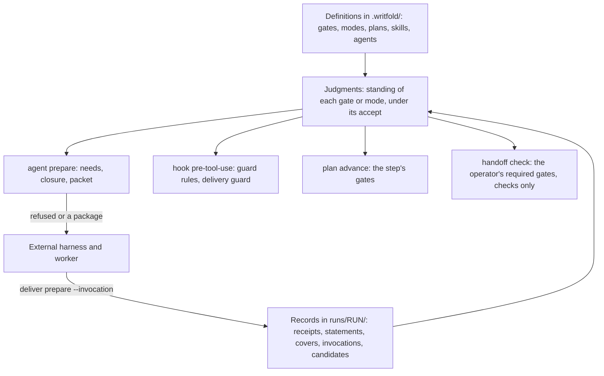

# RFC: Evidence-governed execution

Groomed on 25 November 2026 with the
[agent vocabulary RFC](2026-11-25-agent-vocabulary.md). The first draft
proposed typed obligations, issuer roles, use phases and an evidence graph.
The [grooming review](2026-11-25-agent-vocabulary/grooming.md) (rows E1 to
E20) found that Writfold already judges evidence at three of the four
places the draft named, with proved kernels, and that the fourth is
`agent prepare` from the vocabulary RFC. This RFC now records that mapping,
adds one small thing, and says what is not built and why. The shared
algebra is the [calculus](2026-11-25-agent-vocabulary/calculus.md).

## Summary

Prose cannot show that a required skill reached a worker, that a
prerequisite held before an action, or that a report belongs to the inputs
that were checked. Writfold answers with records and gates, not with more
prose.

Decisions:

1. **No new evidence type.** There is no obligation record, issuer role,
   use phase, `derived` gate class or rule language. An obligation is a
   gate or a delivery mode, as today.
2. **Four use sites, one set of judgments.** Evidence is consulted before
   a worker is set up, before a tool call, before a step is done and
   before a candidate is accepted elsewhere. The last three are shipped.
   The first is `agent prepare`.
3. **One addition: `needs`.** A skill or an agent profile may list gates
   that must be met now, when a worker is set up. A step that was done
   earlier and has since gone stale does not count.
4. **An observation is a statement.** What a harness says it did (sent
   these bytes to a model) is recorded with `deliver attest`, shown as
   attested and never as a passed check.
5. **Three tiers of trust, in the words Writfold already uses:** recorded,
   guarded, received. Only the receiver resists a worker that does not
   cooperate.

## Proof obligations

One kernel changes. `invoke::prepare_check` (vocabulary RFC) gains a last
input, the requirement facts of the closure's `needs`:

- `prepare_check(facts: &Prepare, needs: &[guard::Fact])
  -> Result<(), PrepareRefusal>`. After its six existing checks, in their
  order, it refuses with `Needs(i)`, where `i` is the first fact that is
  not `Met`.
- Each fact is `guard::require::gate_fact(read, defined, met)`, the
  shipped function behind a guard rule's `gate:<id>`: unknown unless the
  gates were judged, then met only for a defined gate that is met.

`proofs/Writfold/Invoke.lean` proves:

- `prepare_check_spec` and `prepare_ok_iff`, restated with the seventh
  condition: admitted exactly when the six hold and every need is `Met`.
- `needs_unknown_refused`: an `Unknown` need is never admitted.
- `needs_first`: the refusal names the least index that is not met.
- `no_needs_unchanged`: with no needs, the decision is the vocabulary
  RFC's, so a profile without the key behaves as before.

Mutants:

| Mutant | Change | Breaks |
|---|---|---|
| `prepare-skips-needs` | the needs are not consulted | `prepare_check_spec` |
| `needs-unknown-met` | `Unknown` counts as met | `prepare_check_spec` |

Reused as they stand: `gate_fact_met_iff`, `gate_fact_unknown_iff`,
`unknown_never_passes`, `decide_pass_iff`, `advance_facts_ok_iff`,
`guard_allow_iff`, `strict_accepted_iff`, `statement_never_passes`,
`run_current_met_iff`.

**Tested, not proved:** parsing `needs`; judging each named gate for the
run and subject, which is the code a guard rule already uses; the
diagnostics.

The first draft listed ten properties. Their resolution is in the
[calculus](2026-11-25-agent-vocabulary/calculus.md#51-the-drafts-obligations-resolved):
four are shipped theorems, four need one theorem for a new kind of record
(owned by #148, #149 and #156), one is `bound_pass_iff`, and "a record
does not advance" is a test and a TLC invariant.

## Motivation

The owner asked that an agent should not be able to omit a skill, skip
prose-defined research, or claim completion without evidence that the
required work was set up and done. A skill today is text a harness loads.
Nothing records whether it was handed over.

## What each kind of evidence shows

| Evidence | What it shows |
|---|---|
| An agent prints a hash | The agent wrote a string |
| The closure digest in an invocation record | Writfold resolved these definitions and wrote this package |
| `invocation.bound` passes | This report names that record, at this step, and the definitions have not moved |
| A harness attests "submitted" | Someone stated that the package was sent. Recorded as given |
| A check of the report passes | The report has the property that check tests |
| A reviewer attests the report | Someone read it against the gate's instructions |

None shows that a model understood or obeyed its instructions. A proof
about a kernel is a proof about a decision over recorded facts, not about
an event in the world.

## The four use sites

| Site | Verb | What is judged | Kernel | Shipped |
|---|---|---|---|---|
| Before a worker is set up | `agent prepare` | the closure, the plan, the packet, `needs` | `invoke::prepare_check` | no: #148, and `needs` here |
| Before a tool call | `hook pre-tool-use` | the rule's requirements: `run.current`, `step.met`, `gate:<id>`, `gates.met`; for a posting command, the candidate's bytes | `guard::decide`, `delivery::guard` | yes |
| Before a step is done | `plan advance` | every gate of the step, each under its `accept` | `plan::advance` | yes |
| Before a candidate is accepted elsewhere | `handoff check` | the operator's required gates at the operator's policy revision, checks only | `handoff::checked` | yes |



At every site an unknown answer refuses, and an empty set of obligations
is not "all met" (`unknown_never_passes`, `gates_fact_met_iff`,
`empty_never_ready`, `strict_spec`).

An exit gate cannot undo work done out of order. That is why a
prerequisite is judged again where it is used: `needs` at prepare, a guard
rule before a command. A step once done can read `!stale` and the current
step does not move back, so "the step is done" is not "the gate holds now".

## Behaviour

```toml
# .writfold/skills/kb-consistency.toml
schema = "writfold-skill/1"
id = "kb-consistency"
description = "Compare related KB records for conflicts."
tools = ["kb.read"]
plan = "kb-consistency"
needs = ["related-scope"]        # gate ids, judged when a worker is set up
instructions_file = ".claude/skills/kb-consistency/SKILL.md"
```

`needs` is a list of gate ids, on a skill or an agent profile. A name that
is not a defined gate is `ref.undefined` when the file is linted.

```text
$ writfold kb agent prepare kb-reviewer --input units.json --out /tmp/inv
refused: skill kb-consistency needs gate related-scope, which is [stale] (the KB moved since its receipt); next: writfold kb gate run related-scope
```

Exit 3, nothing written. When the gates cannot be judged (the run or a
definition does not read), the refusal says `unknown` and names what did
not read.

An existing setup notices nothing: a profile or skill without `needs`
behaves as the vocabulary RFC says (`no_needs_unchanged`).

## Observations are statements

The draft separated "context prepared", "request submitted" and "result
returned". Two of those survive:

| Level | Who knows it | How it is recorded |
|---|---|---|
| prepared | Writfold, first hand: it wrote the package | the invocation record |
| submitted | the harness | `deliver attest --check <name> --by adapter:<name>@<version>` on the report |

A mode that wants the stronger level lists an attestation, for example
`attest = ["context.submitted"]`, and decides with `waivable` whether a
waiver may stand in for it. A harness that cannot observe its own request
leaves the obligation open, and the report is not ready. Nothing is
weakened without a visible waiver.

A harness's own receipt may be the basis of such a statement only for what
it means. "Queued" or "stored" is not "submitted". The statement's text
says what was observed.

There is no circular requirement. The package exists before the worker
starts; the statement is made after.

## Trust

| Tier | What is in it | What it resists |
|---|---|---|
| Recorded | everything under `runs/<run>/`: receipts, statements, invocations, candidates | mistakes. A cooperating agent cannot skip a step by accident. Anyone who can write the run can write these files |
| Guarded | guard rules in a harness hook | an agent using the tool calls the hook sees. "A guard, not enforcement" |
| Received | `handoff check` on another machine, at the operator's policy revision, accepting checks only | a worker that edits its plan, its gates, its profile or its statements |

Consequences the first draft did not draw:

- No kernel takes an "authenticated issuer". Nothing in a product with no
  server and no signing can produce that fact. `--by` is recorded as
  given, and the Git author is the record of who wrote a file.
- A harness's statement is never a pass at a receiver
  (`statement_never_passes`). A receiver that wants to rely on what
  happened on another machine needs signed observations. That is the
  second part of
  [#64](https://github.com/writfold-dev/writfold/issues/64), after
  independent re-execution, and not part of this RFC.
- The definitions a run's modes name are pinned with the run's policy
  (vocabulary RFC). An agent that edits its own profile makes the run read
  `policy moved`. That is detection in the recorded tier and refusal in
  the received tier.

## The run a worker belongs to

The draft asked for a deterministic bootstrap, a task-entry owner and a
strict run binding. What exists covers the cooperative case:

- The current run is decided per session and work tree (`pointer`,
  `session_decides`, `other_session_undisturbed`).
- A guard rule can require `run.current` before a governed command
  (`run_current_met_iff`), so a session whose start hook never ran is
  refused at the command, not at the start.
- `agent prepare` takes its run and step, re-checks both under the write
  lock, and writes them into the invocation record. A report is judged
  against that record, not against whichever run is current when it
  arrives.

Not built: a host that fails closed when a hook is missing. Hooks are best
effort by design ([hooks](../guide/hooks.md)), and Writfold is not on the
path of a tool call it is not shown.

## Models and harnesses

The owner requires that different models and harnesses stay usable. The
boundary is small and has no harness in it:

- in: the package directory `agent prepare` writes (`invocation.json`,
  `instructions.md`, `input`, `packet.md`);
- out: `deliver prepare --invocation`, and optionally `deliver attest`.

Any harness with a shell can use it. A model name is a hint recorded in
the invocation and judged by nothing. Changing the model or the harness is
a new invocation; the KB, the run and every report that is still bound
stay. No judgment depends on an event format, so there is nothing to
normalize. MCP is not offered: the CLI is the interface (owner,
15 November 2026).

What a harness can add is listed per operation, by the adapter that
claims it (#150): it can attest submission, or it cannot. A claim is a
statement, like any other.

## Conformance cases

The draft's seventeen cases, each with the slice that owns it.

| Case | Expected | Owner |
|---|---|---|
| A correct hash is copied with no invocation | `invocation.bound` fails: the candidate names no invocation | #149 |
| The skill text changed after prepare | `invocation.bound` fails, or reads stale after a pass | #149 |
| Prepared, never delivered | the invocation reads `prepared`; the step owes its delivery | #148 |
| A report is attached to another step's invocation | `invocation.bound` fails | #149 |
| A report from before a retry is delivered again | the newer candidate decides; two payloads for one invocation never pass | #149 |
| A harness says "queued", the mode asks for "submitted" | the attestation stays open | this RFC, #150 |
| A search stops at its work limit | the scope gate fails (`truncated_never_complete`) | #155 |
| A search crashes or times out | the scope gate is unknown (`outcome_pass_iff`) | shipped |
| Two of ten units have no row | the checklist owes them, by name | #156 |
| A related record is added | the scope gate is stale; the universe is absent until it is run again | #155, #156 |
| A model judgment is offered as a check result | it can only be attested (`statement_never_passes`, `standing_satisfied_iff`) | shipped |
| The agent edits a gate or its profile | `policy moved`; a receiver judges its own revision | shipped pins, #57 |
| The subject changes between check and use | re-check under the lock (`still_stands_spec`); `needs` at prepare | shipped, this RFC |
| The same report is delivered twice | no judgment changes | #149 |
| Two different reports for one invocation | neither passes until one is withdrawn | #149 |
| A forged statement or a recomputed digest | accepted in the recorded tier; refused by a receiver that takes checks only | out of scope here, #64 |
| A command bypasses the hook | not seen. Writfold does not claim otherwise | out of scope |

## Not built, with the reason

| Draft item | Reason |
|---|---|
| Issuer roles and authenticated issuer facts | no component can produce them; see [Trust](#trust) |
| `class = "derived"`, `[[requires]] predicate = …`, a finite rule language, Datalog later | a general evaluator that derives "met" from grounded premises is the assessed gate removed on 21 November (#54) |
| An evidence dependency graph | references are leaves; pins already stop evidence holding when a premise moves (`unheld_never_holds`) |
| Receipt rule "some eligible receipt exists" | the newest bound record decides (`state_spec`); the old rule let a stale pass outvote a new failure |
| Hoare triples and a frame rule | the sequencing rule is false unless the precondition is judged again; nothing consumes triples; there is no effect system |
| Context epochs | one invocation is one package. Inline use in a long session is #123 and #141 |
| A strict bootstrap and a protected binding table | a resident component on the product path |
| Single-use effect permits | no effect is performed by Writfold; a cross-clone permit needs an authority Writfold does not have |

## Sources read

- [Formal Policy Enforcement for Agentic Systems](https://arxiv.org/html/2602.16708v4):
  adopted, the separation of a policy's correctness from the faithfulness
  of observations. Declined, its runtime and a Datalog evaluator.
- [in-toto](https://www.usenix.org/system/files/sec19-torres-arias.pdf)
  and [SLSA verification](https://slsa.dev/spec/v1.2/verifying-artifacts):
  the model for signed observations, with #64.
- [Proof-Carrying Plans](https://arxiv.org/pdf/2008.04165): read; its
  triples are not adopted
  ([calculus §3.8](2026-11-25-agent-vocabulary/calculus.md#38-use-sites-and-why-a-postcondition-must-be-judged-again)).
- [CONTINUITY](https://arxiv.org/pdf/2609.05269): a source of test cases.
- [Oh My Pi hooks](https://github.com/can1357/oh-my-pi/blob/main/docs/hooks.md)
  and its
  [message-receipt discussion](https://github.com/can1357/oh-my-pi/issues/14212):
  an example of "handed off" being weaker than "received".

## Compatibility and reversibility

`needs` is a new optional key. A file without it has the digest and the
behaviour it had. Removing the key removes the feature.

## Alternatives

| Alternative | Why it lost |
|---|---|
| A new phase-aware evidence kernel shared by three sites, as drafted | Three of the sites already have proved kernels over the same judgments |
| Put prerequisites only in the plan order | Order says a step was once done. It does not say its gate holds now |
| Let `needs` name any guard requirement (`step.met`, `gates.met`) | `step.met` is about the step being worked on, so it is false while that step's worker is being set up. Gate ids are enough |
| A resident runner that mediates every call | A server on the product path |

## Evidence and tests

- Unit and property tests for `prepare_check` with needs; the proofs gate
  with the two mutants.
- In `fixtures/kb/kb-consistency/` (#157): prepare refused while the scope
  gate is open, stale and unknown, then admitted.
- The [ten dry runs](2026-11-25-enforcement/dry-runs.md) are kept as the
  record of the design exercise, with each scenario mapped to this design.

## Rollout

After the vocabulary RFC's steps 0 to 6.

| Step | Issue | Ships |
|---|---|---|
| 1 | [#154](https://github.com/writfold-dev/writfold/issues/154) | `needs`, proved, wired into `agent prepare`; the use-site table in the guide |
| 2 | [#155](https://github.com/writfold-dev/writfold/issues/155), [#156](https://github.com/writfold-dev/writfold/issues/156) | [KB research contracts](2026-11-25-kb-research-contracts.md) |
| 3 | [#157](https://github.com/writfold-dev/writfold/issues/157) | the KB-consistency fixture with two differently shaped fake harnesses |
| later | [#150](https://github.com/writfold-dev/writfold/issues/150), [#64](https://github.com/writfold-dev/writfold/issues/64) | one adapter that attests submission; signed observations at a receiver |

## Unresolved questions

None blocks acceptance.

- Owner: is the recorded tier enough for your daily use, with the
  receiver (#64) as the only boundary against a worker that does not
  cooperate? Default: yes. A stricter in-product boundary would need a
  resident process, which AGENTS.md rules out.

## Decision log

- 2026-11-25: Prepared at the owner's request. Separated input delivery,
  procedural coverage and semantic correctness.
- 2026-11-25: Owner said different models and harnesses must remain
  usable. Added the portable boundary.
- 2026-11-25: Ten synthetic protocol flows exercised (43 assertions) in a
  Python model; task entry, binding and effect ownership made explicit.
- 2026-11-25: The first draft's rendered diagram,
  [execution.png](2026-11-25-enforcement/execution.png), is kept as the
  picture of the model before grooming. It still names trusted issuers,
  which this RFC no longer has. The diagram under
  [The four use sites](#the-four-use-sites) replaces it.
- 2026-11-25: Groomed with the vocabulary RFC. Outcomes: the algebra
  moved to the shared calculus; three of four use sites recognised as
  shipped; `needs` kept as the one addition, with three new theorems, two
  restated and two mutants; observations are statements; issuer roles, the `derived` class,
  the rule language, the evidence graph, epochs, triples, strict bootstrap
  and the MCP mention removed, each with its reason above. Status left
  `draft` for the main session to accept.
- 2026-11-25: Accepted at the owner's request with the agent vocabulary
  RFC, which owns the shared calculus. Implementation (#154) is the
  v0.6.0-dev.23 milestone and starts after the dev.22 slice ships
  `agent prepare`.
