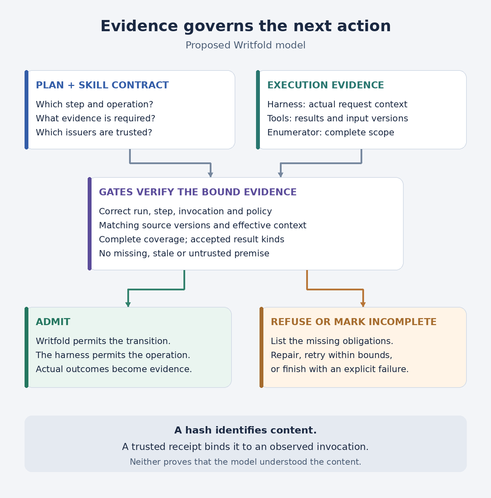

# RFC: Evidence-governed execution

Prose instructions cannot establish that a required skill reached the model, that a prerequisite ran before an action, or that a report belongs to the checked inputs. Make those observable requirements explicit and refuse the corresponding operation when its evidence is missing or stale.

This owner-requested planning set is for later grooming. It does not authorize implementation, merge, or model evaluation. It extends [the agent-vocabulary proposal in PR #152](https://github.com/writfold-dev/writfold/pull/152), with [KB research contracts](2026-11-25-kb-research-contracts.md) as the first worked application. [Tracker #153](https://github.com/writfold-dev/writfold/issues/153) owns the set.

Repository observations below are pinned to `2b9c9db0ea47b62011c83c8c582e146cefa83151`; the agent-vocabulary draft was read at `a3a686e2cc31d5a7fe3c07d30de0b7719c777c03`. Proposed names and schemas are not claims about shipped interfaces.

## Pure kernels and proof boundary

Place the new pure decisions in `crates/writfold-core`, reusing current plan, gate, policy and packet kernels. Final module/function names are a grooming choice; these are the required interfaces:

| Decision | Inputs | Output |
|---|---|---|
| Evidence applicability | Typed receipt, authenticated issuer facts, required bindings, current basis and admitted trust policy | Eligible, ineligible or unknown, with reasons |
| Obligation evaluation | Complete obligation inventory, finite verified evidence/dependency graph and phase | Per-obligation judgments and missing evidence |
| Admission | Existing graph state, operation/phase, approved policy, judgments and protected-state basis | Admit or refuse/unknown; never an external effect |
| Obligation composition | Two typed obligation maps and authority restrictions | Compatible conjunction/intersection, or a conflict |

Authentication facts enter from tested adapters; an arbitrary `issuer` string is not an authenticated fact. The kernel must not perform network IO, read mutable files or invoke an LLM. Proofs establish implications under the explicit input/trust model.

## Proof obligations before implementation

The following are proposed properties, not existing theorem names. Prove the pure decision functions over their shipped Rust through Charon/Aeneas before wiring them into verbs.

| Property | Required meaning |
|---|---|
| `admission_requires_evidence` | An admitted operation has evidence for every instantiated obligation of the selected policy and phase. |
| `evidence_bound_to_use` | Evidence from the wrong run, step, attempt, subject, policy, source version or context epoch cannot satisfy a use that requires those bindings. |
| `context_submission_bound` | A result needing a skill is accepted only when its producing invocation is linked to a trusted submission observation for the required effective context. |
| `incomplete_never_complete` | Unreadable inventories, unexhausted pagination, cut traversal, missing artifacts and unknown observations cannot establish completeness. |
| `coverage_requires_universe` | Universal review coverage is evaluated over a declared, verified manifest; an absent manifest cannot become an empty successful review. |
| `dependencies_preserved` | Derived evidence is supported by an acyclic, valid dependency graph and cannot survive an invalidated required premise. |
| `obligations_not_weakened` | Skill composition, delegation and permitted replanning preserve mandatory obligations and issuer restrictions. |
| `judgment_not_promoted` | Checking a model report's structure cannot turn its semantic judgment into a mechanical proof. |
| `record_does_not_advance` | Storing a result does not itself mark a plan step done. Advancement is a separate checked transition. |
| `unknown_not_success` | Ambiguous dispatch, timeout, cancellation and repair exhaustion cannot become successful completion. |

These theorems are conditional on the facts entering the kernel. Parsing, hashing, signatures, source enumeration, request serialization, host instrumentation and confinement need their own tests and explicit trust assumptions. A proof about a monitor cannot establish that an uninstrumented host obeys it.

### Falsifying mutants and tests

| Removed or weakened guard | Property that must fail |
|---|---|
| Issuer authorization or effective-context binding | `context_submission_bound`, `evidence_bound_to_use` |
| Complete required inventory | `admission_requires_evidence`, `incomplete_never_complete` |
| Required premise or current source basis | `dependencies_preserved`, `evidence_bound_to_use` |
| Obligation/authority intersection | `obligations_not_weakened` |
| Evidence-kind distinction | `judgment_not_promoted` |
| Separate record/advance or unknown dispatch state | `record_does_not_advance`, `unknown_not_success` |

Extraction drift, `lake build`, axiom audit and mutants must pass before verb wiring. Test parser rejection, canonical encodings, hashing/signatures, manifest retention, actual request serialization, host bypasses and protected-state rechecks separately. Extend the real `RunGraph`/`KbWrite` and invocation protocol models under #145; bounded TLC exploration and tested IO are not Lean proof coverage of a deployed host.

## Recommendation

Make Writfold's existing run graph advance, and its adapters authorize governed operations, only from typed obligations supported by verified evidence. The plan owns ordering; gates judge evidence; the harness observes model/tool execution and mediates actions. Record the evidence dependencies inside existing runs. Do not add a second workflow scheduler or an agent-controlled checklist of claimed compliance.

A gate can require evidence that a skill was supplied to the model. A skill hash alone is insufficient: it identifies content, but says nothing about loading. Require a receipt from an authorized harness that binds the effective skill content to the actual model request that produced the relevant result. Even this establishes input delivery, not understanding or obedience.

For prose such as “search all related KB references for inconsistencies”, specify a bounded, explicit research contract: enumerate a declared reference universe, construct review units, supply those units to an attributed reviewer, retain a result for each, and disposition the findings. Keep scope completeness, process coverage and semantic correctness separate.

## What Writfold already has

The proposal should reuse these components rather than duplicate them:

| Existing component | Current behavior | Extension needed |
|---|---|---|
| [Plan kernel](https://github.com/writfold-dev/writfold/blob/2b9c9db0ea47b62011c83c8c582e146cefa83151/crates/writfold-core/src/plan.rs) | `advance` checks the current node and its supplied gate facts. | Bind invocation and use-time prerequisites to the same step; verify the completeness of the supplied obligation inventory. |
| [Gates](https://github.com/writfold-dev/writfold/blob/2b9c9db0ea47b62011c83c8c582e146cefa83151/docs/guide/gates.md) | Evidence is bound to definitions and subjects; retained artifacts, unknown outcomes, acceptance policies and freshness already exist. | Typed execution observations, authorized issuers, dependency manifests and derived predicates. |
| [Run graph](https://github.com/writfold-dev/writfold/blob/2b9c9db0ea47b62011c83c8c582e146cefa83151/docs/guide/run-graph.md) | An ordered plan spine, includes, splices, bounded loops and historical done records. | Use the existing identities and transitions. The evidence graph is provenance, not another scheduler. |
| [Skills](https://github.com/writfold-dev/writfold/blob/2b9c9db0ea47b62011c83c8c582e146cefa83151/docs/guide/skills.md) | External Markdown; Writfold does not verify that it was followed. | Resolve required skill bundles before invocation; bind the effective request context. |
| [Packet kernel](https://github.com/writfold-dev/writfold/blob/2b9c9db0ea47b62011c83c8c582e146cefa83151/crates/writfold-core/src/packet.rs) | Required rows and unreadable inputs affect completeness. | Carry this distinction through the adapter into the actual model request, including after compaction. |
| [Hooks](https://github.com/writfold-dev/writfold/blob/2b9c9db0ea47b62011c83c8c582e146cefa83151/docs/guide/hooks.md) | Optional, best-effort integration; configured routes can check exact delivery bytes. | A conforming adapter must mediate every operation for which it claims enforcement. |

The documented `research.backfilled` check establishes that a record or citation was written within the step window. It does not establish that every relevant reference was considered. Historical done steps can become stale without moving the plan backwards; preserve that history while refusing new uses that depend on invalid evidence.

## Research foundations and choices

### Policy queries over execution provenance

[Formal Policy Enforcement for Agentic Systems, arXiv 2602.16708v4](https://arxiv.org/html/2602.16708v4), originally introduced as PCAS and now describing FORGE, is the closest architectural reference. It evaluates Datalog policies over an execution dependency graph and mediates proposed actions. Its guarantee assumes complete mediation and faithful observations. It also explicitly separates policy correctness from the correctness of a natural-language translation.

Adopt that separation and the relational model. Do not immediately add its full runtime, instrumentation stack or a general-purpose Datalog service to Writfold. Start with a small finite predicate language in the pure kernel: bound identities, approved issuers, exact digests, reachability, complete inventories and universal coverage of a manifest.

### Compositional plans

[Proof-Carrying Plans: a Resource Logic for AI Planning, PPDP 2020](https://arxiv.org/pdf/2008.04165) gives a plan logic drawing on Hoare, linear and separation logic, with an Agda formalization and soundness relative to planning semantics. It supports reasoning about composition from action contracts. It does not make natural-language action descriptions or real-world observations automatically true.

Use pre/postconditions for skills and tools, and resource accounting for invocation permits and budgets. Model an LLM step as nondeterministic: its successful result must be checked; success is not an assumed postcondition.

### Authenticated evidence about a process

[in-toto, USENIX Security 2019](https://www.usenix.org/system/files/sec19-torres-arias.pdf) separates an approved workflow layout from signed link metadata binding steps, actors, inputs and products. [SLSA 1.2 verification](https://slsa.dev/spec/v1.2/verifying-artifacts) checks trusted producer identity, artifact binding and expected execution parameters. These provide a useful model for execution receipts. Signing authenticates a statement from a trusted producer; it does not prove the producer's implementation or the adequacy of its checks.

### Preserving context across boundaries

[CONTINUITY, September 2026 preprint](https://arxiv.org/pdf/2609.05269) studies failures when authority, provenance and action identity are lost or changed across components. It proposes assume-guarantee contracts, authenticated context and effect-bound permits. Treat it as design and test-case inspiration; its reported evaluations and conditional theorem do not establish Writfold's implementation correctness.

### Optional later algebra

Database provenance offers a way to record which premises jointly support a result and which alternative derivations exist. The [ProvSQL Lean provenance documentation](https://provsql.org/lean-docs/Provenance.html) is a candidate reference for later formal work. No dependency or compatibility decision is proposed here. An explicit evidence DAG suffices initially; semantic negation and missing-data reasoning need more care than positive dependency tracking.

## Who owns each responsibility

| Component | Responsibility |
|---|---|
| Tool definition | Typed operation, declared effects, input/output contracts and replaceable implementation binding. |
| Skill definition | Instructions, required tool contracts, context requirements and a reference to one existing plan. |
| Agent profile | Worker configuration and permitted capabilities; it does not choose which mandatory requirements to discard. |
| Plan | Steps, dependencies expressed by existing includes/order, repetitions and gate use sites. |
| Gate | A pure judgment about whether specified evidence is sufficient for an obligation. |
| Adapter/harness | Actual context assembly, model/tool dispatch, observations and interception of governed operations. |
| Runtime/receiver trust policy | Which issuers and policy revisions are authoritative, and which effects require admission. |

An obligation and a receipt are internal semantic concepts, not necessarily two more top-level user-authored entities. Users continue to configure tools, gates, skills, agents and plans under `.writfold/`.

## Rendered composition and execution visual



The diagram is a committed PNG so it remains readable in clients that do not render Mermaid.

## What a skill hash does and does not establish

| Evidence | Defensible claim |
|---|---|
| Agent prints a hash | The agent supplied a string. |
| Resolver verifies the skill bundle digest | These are the selected source files and definitions. |
| File-read observation | A tool read those bytes; the result may still have been omitted or truncated before generation. |
| Trusted request-submission observation | The adapter submitted the declared content in the request associated with this invocation. |
| Observed action/result plus checked obligations | This observable behavior satisfied the specified checks. |
| Formal proof term checked by a proof kernel | The encoded proposition follows from its formal premises. |

None of the first four proves that the model understood the skill. A proof term cannot prove that an external event occurred unless the model includes an appropriate trusted premise about that event.

Use two content identities: a source-bundle root covering the resolved skill and behavior-relevant dependencies, and an effective-context digest covering what was actually rendered for this invocation. Dynamic text, tool descriptions, selected bindings, instruction ordering and transformations must be captured where they affect the contract. A hash of `SKILL.md` alone misses these inputs.

Receipts should be issued by the component capable of observing the claim. The model can propose a result and cite receipt IDs; it cannot mint a trusted “skill supplied” or “tool succeeded” fact by writing JSON.

### Illustrative context-submission receipt

The schema below is a proposal. Digest and ID values are abbreviated for readability and are not valid fixture values.

```json
{
  "schema": "writfold-execution-receipt/proposal",
  "kind": "model.request-submitted",
  "run": "run-42",
  "step": "review#1/inspect",
  "attempt": "attempt-3",
  "invocation": "inv-7",
  "context_epoch": 2,
  "policy_digest": "sha256:POLICY",
  "adapter_digest": "sha256:ADAPTER",
  "skill_bundle_digest": "sha256:SKILL",
  "effective_context_digest": "sha256:CONTEXT",
  "request_digest": "sha256:REQUEST",
  "input_manifest_digest": "sha256:MANIFEST",
  "parents": ["receipt-context-prepared-7"],
  "issuer": "trusted-harness",
  "observation": "submitted",
  "required_omitted": 0,
  "authentication": {"method": "deployment-selected"}
}
```

The verifier obtains identity from authenticated transport or a verifiable signature, not the `issuer` string. It checks the producer's authorization for this receipt kind. Retain the necessary manifests and source references; a bare root hash cannot later demonstrate which items were included. Avoid retaining credentials or unnecessary private transcript bytes. Redacted manifests must state the resulting verification limits.

## Invocation lifecycle without circular evidence requirements

Do not require a submitted-request receipt before that same request can be sent.

1. **Resolve:** the runtime selects a task contract under the approved policy and pins the skill/configuration closure. A model may suggest a workflow; it does not get to remove baseline obligations through classification.
2. **Prepare:** the adapter constructs the actual request, proves mechanically that required content is present under the selected serialization, and obtains admission for that exact request identity.
3. **Dispatch:** the adapter submits it and records what it observed. A local request submission is not a claim about provider-internal attention or hidden transformations.
4. **Associate:** output and tool proposals are associated with that invocation by the adapter. The agent cannot rebind output from another request.
5. **Check:** gates judge reports, tool observations and derived evidence against the step's contract.
6. **Advance or act:** a separate graph transition or effect admission rechecks the applicable obligations under the current protected state.

A crash between dispatch and recording creates an unknown attempt, not evidence of a completed or unstarted invocation. Reconcile it or perform a separately identified retry; do not assume an effectful action is safe to repeat.

After compaction, delegation or a changed effective context, create a new context epoch. Each relevant model invocation needs valid current context evidence; a session-start load receipt is insufficient for the rest of the session. A host that cannot expose the actual request boundary can report a weaker observation, but cannot satisfy a contract requiring the stronger one.

## Gate evaluation and graph enforcement

Use the same gate evaluator at three distinct use sites:

| Use site | Typical requirement |
|---|---|
| Before model invocation | Approved skill/configuration, prepared required context, usable input scope and admitted budget. |
| Before a governed effect | Current operation authority and any prerequisites that must already hold before the effect occurs. |
| Before advancement/completion | Required outputs, valid producing-invocation evidence, coverage and accepted outcome. |

Some requirements are maintained throughout a step: read-only authority, current context identity or a fixed source snapshot. Recheck them at the operations they constrain. An exit gate alone cannot undo work already executed out of order.

The model may perform arbitrary internal deliberation. Writfold governs observable operations and accepted artifacts. Evidence edges should mean concrete relations such as `input-to-request`, `output-of-invocation`, `checked-against` and `derived-from`. They do not claim to reveal what the model internally relied on.

### Minimal calculus

Let `P` be the admitted policy, `G` the existing plan state, `E` verified evidence, `B` the applicable source/context basis, and `a` a proposed operation at node `n`.

An obligation has a typed predicate, bound arguments, accepted evidence kinds, authorized issuer roles and a use phase. Write `E ⊢[B] o` when the verifier establishes obligation `o` from valid evidence on basis `B`.

Admission requires all of:

```
Enabled(G, n, a)
CompleteRequiredInventory(P, n, a)
for every o in Need(P, n, a): E ⊢[B] o
CurrentProtectedStateMatches(B, a)
```

Only then may the host perform `a` or the graph record the corresponding transition. Missing inventories are unknown, not empty sets. Boolean truth is computed only after the validity/completeness checks; absence of a receipt is not a trusted negative fact about the world.

For a coverage predicate, let `U` be the manifest's required unit set:

```
Coverage(U, E) := ManifestComplete(U)
                  and for every u in U:
                      EligibleReportFor(u, E)
```

Eligibility includes the required invocation and input bindings, report validator, issuer restrictions and accepted outcomes. If policy requires conclusive assessments, `uncertain` does not discharge that additional requirement. Coverage and conclusiveness are distinct predicates.

Use finite, range-restricted rules. Positive reachability over finite evidence is useful; negation/“none missing” must be evaluated over a complete declared inventory. Do not put arbitrary scripts, network IO or LLM calls inside the pure policy evaluator. Such operations first produce typed observations with explicit uncertainty.

### Composition and reuse

Combine obligation maps by retaining every requirement, conjoining compatible predicates and intersecting accepted evidence/issuer sets. Reject contradictory bindings. Capabilities intersect. Ordered skill composition uses pre/postcondition compatibility; a frame rule is justified only when declared effects preserve the framed facts.

The appropriate partial-correctness claim is: if the monitored skill finishes successfully, its checked postconditions hold. It cannot guarantee that an LLM eventually produces a satisfactory answer.

Evidence is usually persistent and reusable when its bindings still match and policy permits reuse. Invocation identity, context epochs, budget reservations and single-use effect permits have different lifetimes. Do not make every receipt consumable, or treat an old context receipt as reusable everywhere. Cross-clone global permit consumption requires an authoritative receiver; disconnected Git histories cannot provide distributed exactly-once effects.

## Algebra and small-step rules

These are proposed definitions to refine into the extracted Rust proof ledger, not completed proofs. Let a binding basis be

$$B=(run,step,round,attempt,invocation,epoch,policy,inputs,scope,context).$$

An obligation $o=(k,p,b,K,I,\phi)$ has key $k$, a finite typed predicate $p$, required bindings $b$, accepted evidence kinds $K$, authorized issuer roles $I$, and phase $\phi$. Individual predicates specify which coordinates of $B$ matter; a snapshot review need not become stale merely because an unrelated invocation exists.

Write $E\vdash_B o$ for derivability from authenticated, applicable observations and their valid premises. A receipt rule has this shape:

$$
\frac{e\in E\quad Auth_P(e)\quad Kind(e)\in K\quad Role(e)\in I\quad Match_b(e,B)\quad PremisesValid(e,E,B)\quad Check_p(e,B)}{E\vdash_B o}.
$$

`Check` is a deterministic predicate for the stated evidence kind. For a model assessment it establishes the attributed assessment, not the truth of the assessment's proposition. Dependencies must be finite and acyclic; no circular self-supporting pass.

For compatible obligations sharing a key and phase, define partial composition:

$$
(p_1,b_1,K_1,I_1)\sqcap(p_2,b_2,K_2,I_2)
= (p_1\land p_2,\operatorname{unify}(b_1,b_2),K_1\cap K_2,I_1\cap I_2).
$$

Keep distinct keys/phases as separate requirements. Reject incompatible bindings or an empty required evidence/issuer intersection; do not drop the obligation. Under a canonical predicate conjunction and compatible bindings, combination is associative, commutative and idempotent up to semantic equality. This is a partial meet, not concatenation of executable steps. Step sequencing remains ordered and generally noncommutative.

Let $O_2\preceq O_1$ mean that every evidence set satisfying $O_2$ also satisfies $O_1$: $O_2$ is at least as restrictive. A composed contract must be below both inputs. Authority combines by set intersection; the same monotonicity prevents a skill from granting capabilities by being loaded.

For state $\sigma=(G,E,B,L)$, where $L$ holds local reservations/permits, the checked transition rule is:

$$
\frac{Enabled(G,a)\quad Complete(Need_P(G,a))\quad
\forall o\in Need_P(G,a),\ E\vdash_B o\quad Current(B,a)\quad Resources(L,a)}
{\sigma\xrightarrow{admit(a)}\sigma'}.
$$

The host must enforce admission at the effect boundary. The logical rule alone cannot prevent a bypassing host. Preparation consumes no fabricated submission evidence; submission is a later observed event. A `record(e)` transition changes the retained evidence state but leaves $G$'s progress unchanged. Advancement is a separate transition using the rule above.

For sequential skills, use partial-correctness triples:

$$
\{P\}\ S_1\ \{Q\},\quad \{Q\}\ S_2\ \{R\}
\quad\Longrightarrow\quad \{P\}\ S_1;S_2\ \{R\}.
$$

The triple means successful monitored completion implies the checked postcondition. An LLM can fail, time out or propose an inadmissible result. There is no theorem that it eventually succeeds. Frame reasoning requires effect-disjointness or explicit preservation of the framed premises. Persistent evidence and linear reservations/single-use permits have different resource rules; disconnected clones cannot provide global linearity without an authoritative consumption boundary.

## Enforcement and trust boundaries

Offer accurately scoped adapter guarantees:

1. **Record validation:** Writfold can check the records and bindings supplied to it. Locally editable checksums offer integrity checking, not authentic execution provenance against a malicious writer.
2. **Observed execution:** an authorized adapter supplies protected observations about actual requests and tool calls. The guarantee is conditional on that adapter and its trust boundary.
3. **Mediated execution:** every operation covered by the policy passes through admission before its effect. The adapter refuses a contract it cannot mediate.

A deployment can implement protected observations with an isolated runner and authenticated process boundary; signatures are useful for portable receipts. The signing key must not be available to the agent's shell. Storing a public receipt in Git is fine if its authorization is verified; storing policy and receipts in an agent-writable directory without an external trust root is not enforcement.

Pin the approved policy and checker implementations outside the agent's authority for the attempt. The agent can propose configuration edits for later admission, but cannot weaken the active contract or mint a waiver identity by setting `--by`. Protect generic shell, network, browser and alternate tool paths where they could bypass governed effects. Complete mediation is always relative to the explicitly enumerated operations and host support.

This does not require a Writfold server or a new resident companion. The binary can remain a Git-native decision/recording tool. An external harness invokes its admission/checking interfaces and owns execution. Gripsack may provision the environment, but provisioning is not evidence that the harness honored the contract.

### Delivery modes are one instance

Bind the delivery mode, target/channel constraints and exact final bytes to the approved check. Admission occurs before the send or accepted export, and the sender uses the same immutable bytes. Any edit creates a new artifact identity and requires a new check. A host that lets the model emit final user-visible text or send through an unchecked alternate path cannot claim that path is enforced. Requirements about tone or meaning remain attributed judgment unless encoded in a deterministic check; the gate's result must preserve that distinction.

## Implementation slices and ownership

| Deliverable | Owner |
|---|---|
| New phase-specific evidence/admission kernel | [#154](https://github.com/writfold-dev/writfold/issues/154) |
| Formal ledger and actual invocation protocol | Existing [#145](https://github.com/writfold-dev/writfold/issues/145) |
| Existing plan/skill composition | Existing [#147](https://github.com/writfold-dev/writfold/issues/147) |
| Actual request/context binding and post-compaction delivery | Existing [#148](https://github.com/writfold-dev/writfold/issues/148), [#123](https://github.com/writfold-dev/writfold/issues/123) |
| Retained outcomes, duplicate/conflict semantics | Existing [#149](https://github.com/writfold-dev/writfold/issues/149) |
| One adapter and protected acceptance | Existing [#150](https://github.com/writfold-dev/writfold/issues/150), [#64](https://github.com/writfold-dev/writfold/issues/64) |
| KB scope and review coverage | [#155](https://github.com/writfold-dev/writfold/issues/155), [#156](https://github.com/writfold-dev/writfold/issues/156) |
| Deterministic adversarial end-to-end fixture | [#157](https://github.com/writfold-dev/writfold/issues/157), reusing [#151](https://github.com/writfold-dev/writfold/issues/151) |

These are ownership boundaries, not duplicate implementations. Existing #109 has delivered packet work; use its follow-up #123. Retained artifacts and bound checker inputs remain #121/#128/#116. The Python precursor can use the same fixture and record/decision boundary around a controlled model-call wrapper; that does not transfer Lean proof coverage to Python.

## Required conformance cases

These are implementation acceptance fixtures, not a claim that tests were run during this research.

| Counterexample | Expected result |
|---|---|
| Agent copies a correct skill hash without a request observation | Required context evidence remains unmet. |
| Skill source is correct but rendered request omitted a required section | Invocation admission refused. |
| A request was prepared but never dispatched | No submitted/executed claim; later output cannot borrow the prepared record. |
| A skill was loaded after the report was produced | No causal binding to that report's invocation. |
| Old receipt used after compaction, delegation or a new attempt | Refused when its required bindings do not match. |
| Retrieval returns ten hits with another page or inaccessible store | Coverage partial, not complete. |
| Search crashes and returns no usable rows | Unknown, not successful empty scope. |
| Two of ten pair units lack eligible reports | Coverage gate lists the two missing IDs. |
| A new related record appears without changing old records | Corpus/scope basis changes; current completeness must be re-established. |
| Agent writes a fake signed-by-harness field or recomputed checksum | Authentication/issuer check fails. |
| Valid report schema contains a plausible but incorrect interpretation | Structural checks can pass; semantic correctness is not thereby claimed. |
| Model-produced assessment submitted as a deterministic checker result | Evidence-kind or issuer mismatch. |
| Agent changes the active gate definition or checker code | Approved-policy binding rejects the replacement for this attempt. |
| Source changes between checking and a governed operation | Recheck under the appropriate lock/snapshot or refuse. |
| Duplicate receipt is submitted | Idempotent record; no duplicate work/budget charge. |
| Conflicting receipts or uncertain external effect after a crash | Preserve conflict/unknown; require reconciliation. |
| Alternate shell/browser/network path bypasses the guard | Adapter cannot claim enforcement for that operation until the path is mediated. |

TLA+ should cover the actual prepare/admit/dispatch/record/advance protocol, concurrency, crash recovery and stale-use windows. Extend existing `RunGraph`/`KbWrite` or the proposed invocation model according to the real protocol boundaries. State fairness assumptions for any progress property. No mathematical guarantee of an LLM finding every contradiction or eventually completing the task is proposed.

## First milestone recommendation

Make one complete, provider-neutral example work: a trusted adapter submits a pinned consistency-review skill with a small fixed KB scope, produces attributable reports, and Writfold refuses advancement for missing context, incomplete coverage, stale inputs or untrusted evidence. A deliberately noncompliant fake agent should exercise these failures without paid model calls. This demonstrates the general mechanism before broadening the authoring language or supporting additional hosts.

The user-facing diagnostic should name the actual missing condition: “cannot conclude: review units B–D and C–E have no eligible result”, or “invocation 7 omitted the required consistency-review instructions”. It should not ask the model to explain retrospectively why it ignored prose.

## Compatibility, rollout and alternatives

This proposal is pre-alpha. Choose a coherent new typed schema and remove superseded experimental paths when implementation is accepted; do not add compatibility layers for these illustrative proposal schemas. Changes to shipped formats must be explicit in the implementing RFC notes and changes guide, never silently reinterpreted.

Start with a finite built-in predicate vocabulary and one controlled adapter. A general Datalog runtime, broad autonomous scheduler and third-party enforcement stack are optional later decisions. More prose, a model-authored compliance checklist, or a bare hash cannot provide the proposed guarantees. A fully semantic proof of arbitrary prose comprehension is outside scope.

Required work is selected from an approved contract, not a fallible model's decision about whether a skill seems relevant. For explicitly selected workflows this is deterministic; ambiguous task classification must retain baseline obligations and expose the ambiguity. Natural-language-to-policy authoring remains a reviewed translation, not a proved interpretation of the user's intent.

## Decision log

- 2026-11-25: Prepared at the owner's request as RFCs and related issues for later grooming. Recorded the difference between input delivery, procedural coverage and semantic correctness; retained the existing run graph and external-harness boundary. No new proof, runtime behavior or model evaluation is claimed.
