# Agent integration benchmarks: Evidence Stack

Research and plan adopted on 5 November 2026 at Tarek's request. **No agent
benchmark or token-saving result has been executed by this plan.** The goal is to
find integration defects first, then measure whether the tools help on complete
engineering tasks. A negative or inconclusive result is a useful result.

Use **Evidence Stack** as a descriptive working label for **Writfold + Weft +
Splicery**, not a new product, namespace, company, trademark claim or replacement
agent host. Writfold owns retained evidence, contexts and admitted execution;
Weft owns its language/proof artifacts; Splicery owns its edit language and pure
kernel. The ordinary agent host orchestrates them. A valid Weft report or
Splicery recipe is not Writfold edit authority. See [the shared-client contract](shared-client-references.md).

## Research decisions

| Source, checked 5 November 2026 | Finding | Decision for this evaluation |
| --- | --- | --- |
| [Terminal-Bench release inventory](https://www.tbench.ai/benchmarks) and [4.0 announcement](https://www.tbench.ai/news/terminal-bench-4-0) | Version 4.0 changed task resources, removed tasks and repaired verifiers. Resource or environment changes require rerunning trials. | Use a pinned, reviewed 4.0 subset as a secondary external comparison; never combine scores from different releases or claim a subset is the full leaderboard. |
| [Harbor](https://harborframework.com/docs/running-tbench) | Containerized agent/task execution is an existing evaluation interface. | Prefer a thin adapter to an exact Harbor release for external tasks, not a new general agent framework. Local Compose remains the build/qualification boundary. |
| [OpenAI's February audit](https://openai.com/index/why-we-no-longer-evaluate-swe-bench-verified/) | The reported 59.4% defective-task figure applies to an audited 138-task difficult subset, not all SWE-bench Verified. The audit also found contamination. | Do not use Verified as the headline proof of usefulness or claim it is uncontaminated. |
| [OpenAI's July audit](https://openai.com/index/separating-signal-from-noise-coding-evaluations/) | The authors estimate about 30% of the reviewed SWE-bench Pro public split is broken and retract their earlier recommendation. | Pro is not an automatic replacement. Use only independently audited, license-compatible cases if it adds coverage; report official scoring separately from any explicitly versioned local correction. |
| [Inspect metrics](https://inspect.aisi.org.uk/metrics.html) and [errors/limits](https://inspect.aisi.org.uk/errors-and-limits.html) | Repeats, error handling and clustered uncertainty need explicit treatment. | Pair arms within each task, retain failures and compute task/family-clustered intervals, not one independent observation per tool call. |
| [OpenAI cache accounting](https://developers.openai.com/api/docs/guides/prompt-caching), [Responses usage](https://github.com/openai/openai-python/blob/main/src/openai/types/responses/response_usage.py) | Current APIs distinguish cache reads and writes; write pricing is not an additional charge on top of ordinary input. Reasoning is an output subset. | Pin the actual API/usage adapter and pricing snapshot. Do not reuse an older prompt-minus-cache formula blindly. |
| [Anthropic caching](https://platform.claude.com/docs/en/build-with-claude/prompt-caching), [usage](https://github.com/anthropics/anthropic-sdk-python/blob/main/src/anthropic/types/usage.py), [thinking detail](https://github.com/anthropics/anthropic-sdk-python/blob/main/src/anthropic/types/output_tokens_details.py) | Input/cache-read/cache-write categories are additive; optional thinking detail is inside inclusive output and can differ slightly from exact reasoning generation. | Preserve raw fields, their availability and provider-specific meanings. Never add reasoning to output twice or assume all providers expose the same categories. |

These URLs are research references, not dependency pins. Before running a suite,
retain exact benchmark/harness commits, licenses, task/image hashes, API schema
and pricing snapshots. Public task histories may already be in model training;
new held-out cases reduce exposure but cannot prove absence of contamination.
No public leaderboard measures our exact citation, authorization or edit-safety
contract. Those need our own adversarial cases and real service traces.

## Questions and experimental arms

Primary questions, in order:

1. Can the complete integrated workflow preserve evidence/authority and produce
   the correct artifact, including refusals and recovery?
2. At matched model/resource budgets, does it improve task success, findings
   precision/recall or evidence correctness?
3. At that measured quality, does it reduce total model tokens, cost or latency?
4. Which component causes an observed improvement or regression?

| Arm | Tools and information | Purpose |
| --- | --- | --- |
| A: competent conventional baseline | Same agent host, model, task instructions, public skill guidance, shell/Git/search/edit/test tools and authorized source material; no new stack APIs | Primary baseline, not a deliberately weak prompt or an agent deprived of tests/search/history |
| B: complete available stack | A plus the actually admitted Writfold/Weft/Splicery interfaces and their required instructions | Primary paired intervention; all setup, tool-schema and follow-up model costs count |
| K: kctx baseline | A plus the exact retained kctx interface where the task is representable | Secondary stronger legacy comparison; separately label feature-incompatible tasks rather than inventing capabilities |
| Ablations | B minus one usable component at a time; Writfold-only is the first useful intermediate arm | Attribute changes after the primary comparison, not a factorial explosion before integration works |

Do not call a Writfold-only run the full stack. Both primary arms receive the same
underlying authorized corpus and task evidence; B may deliver it differently but
must not receive hidden labels, a richer source corpus or extra approvals. Both
may use the same allowed delegation topology. Tool-specific instructions are
necessarily different and are recorded as part of the intervention. A separate
experiment may compare authored skills or dynamic delegation; do not confound
those with the tool-stack comparison.

Freeze the model's resolved provider/model revision, reasoning/temperature and
output settings, context limit, host version, tool set, time/token/dollar budgets,
subagent cap, cache policy and human-intervention policy. Record provider backend
identity where exposed; a routing alias is not an exact model identity. Isolate
sessions, worktrees, stores, caches and prior transcripts between task trials.
Interleave randomized A/B order within task/repetition blocks to reduce time and
provider-load confounding. Record randomization seeds; a model seed does not
promise deterministic output.

## Primary task portfolio

Start with synthetic/public, redistributable fixtures. Keep production/private
corpora a separately authorized scope. Use at least four repository families and
two application domains in the eventual held-out campaign. Split by repository
or incident family, not nearby variants of one bug.

| Family | Complete task | Independent outcome oracle |
| --- | --- | --- |
| Evidence-backed investigation | Resolve conflicting historical/current records, identify an incident cause or explicitly abstain | Exact retained sources/roles/selectors plus adjudicated conclusions and required contrary evidence |
| Review | Find known seeded defects and avoid plausible but false findings | Hidden behavior tests, independently reviewed defect inventory and finding-to-defect matching |
| Local repair | Investigate, propose, apply and test a change; report exact affected scope | Fail-before/pass-after behavior, regression checks and worktree diff outside-scope checks |
| Cross-repository change | API, SDK and CLI change with a strict old consumer, dependency update and independent review | Actual integration tests and exact producer/consumer revisions; not self-reported completion |
| Handoff and reuse | Compact/reconnect or transfer a task; change an indirect dependency or revoke a grant | Stable references, stale-result refusal, honest read cut and retained operation identities |
| Adversarial safety/recovery | Copied citation text, denied material, missing history, wrong kind/realm, stale preconditions, lost effect acknowledgement | No wrong attachment or unauthorized effect; Unknown stays unresolved until qualified reconciliation |

Each task has a versioned manifest: source and environment pins, visible request,
allowed evidence, initial state, expected final state/refusal, grading contract,
known defect opportunities, permitted edits/effects, positive control and a
semantic negative control. A grader must accept behaviorally equivalent fixes;
it must not require an unstated helper name or incidental wording. Run the
unmodified failing state, reviewed positive solution and meaningful bad solution
before admitting a task. Audit ambiguous failures blind to arm; record dissent.
LLM annotations may triage cases, but do not let the evaluated agent grade its own
success. Behavioral oracles and blinded independent adjudication govern subjective
findings; retain disagreements and reviewer agreement rather than replacing them
with a model-generated confidence score.

The staged corpus sizes below are **design choices, not executed results or a
power guarantee**:

- Debug pilot: 12 development tasks, two arms, two repeats = 48 task trials for
  one model. Use this to repair instrumentation/grading, never as the final
  held-out headline. An unsupported required capability blocks its task family.
- Confirmatory draft: 48 new held-out tasks, eight per family, two arms, five
  repeats = 480 task trials per model. A second independently pinned model makes
  a separate 480-trial campaign, not an excuse to pool incompatible token units.
- Freeze final sample size after a development-only variance/power analysis and
  a dollar/resource estimate. Obtain an explicit campaign budget before paid
  calls. If the supported surface cannot cover all families, report a named
  narrower pilot, not a completed full-stack campaign.
- External comparison: review and freeze a Terminal-Bench 4.0 subset separately.
  Honor its original resources; its published eight-hour task timeout is not our
  default local budget. Reduced budgets create a separately labelled profile.

## Repeated sessions and the cost of rebuilding context

This is a **primary realistic workload**, not an extrapolation from a compact
response-size demo. Measure entire task episodes across new chats/processes,
not only one warm retrieval. An episode is one continuing engineering objective,
its changing source state and all sessions/agents used to complete it.

| Continuity condition | State available after a switch | Interpretation |
| --- | --- | --- |
| F: fresh reconstruction | Current task/source/worktree and original authorized corpus, but no saved task notes or conversational state | Explicit from-scratch cost; a useful lower-continuity comparison, not the primary competent baseline |
| A: conventional persistence | Same source/corpus plus agent-authored notes, saved plans, file citations, Git history and artifacts | Primary baseline; do not delete its notes to manufacture a Writfold benefit |
| B: Writfold persistence | Same underlying evidence plus its actually retained, queryable bindings, citations, relationships and applicable task/run state | Candidate; exact scope/access/freshness still rechecked, never an automatic restoration of authority |

The first session starts from the same admitted initial material. Give A and B
equal opportunity and budget to save context; count those writes, summaries,
captures and model calls. Also run a separate **matched-information retrieval**
experiment with equivalent pre-existing factual material in conventional files
and Writfold. This separates better access/reuse from simply collecting more
information. Prepopulating B alone with an expert-curated answer is prohibited.

For this Writfold-specific A/B comparison, hold Weft/Splicery availability and
versions constant in both arms (initially disabled in both if their integrated
paths are unavailable). Run the full Evidence Stack contrast separately; do not
attribute the combined intervention's savings solely to Writfold persistence.

Predeclare episode schedules with 1, 3, 5 and 10 sessions (0, 2, 4 and 9 switches)
on development fixtures, then freeze applicable schedules for held-out episodes.
Use externally specified semantic checkpoints, not an arm's convenient stopping
point. Failure to reach a checkpoint remains a failure. A separately labelled
interruption test may use resource/time triggers; do not mix those estimands.
Enforce one total episode budget, not a fresh unlimited allowance per session.
Each repetition gets a fresh episode state; persistence is intentional only
within that episode. Cluster statistical resampling by episode/task family,
never treat its individual sessions as independent samples.

A bounded development pilot is two episodes × three continuity conditions ×
two schedules (1 and 3 sessions) × two repeats: 24 episodes, 48 sessions. This
is additional to the ordinary task pilot, not included in its 48-trial total.
Select the confirmatory episode count from that development variance and an
approved all-session cost estimate; neither count is an executed measurement.

At every switch close the old host, start a new session without hidden chat
history, and record exactly what the new agent receives. Vary clean restart,
same-model session replacement, subagent handoff and explicit compaction in
separate strata. Cross-model handoff is a separate model-pair profile. Prevent
provider session memory or warm caches from leaking state into only one arm.

Include both unchanged and changed worlds: a source revision advances, evidence
is corrected, a grant expires, an alias table is unavailable, a dependency changes
or an external outcome is still Unknown. Retained evidence must avoid rediscovery
without silently making stale conclusions current. Historical resolution and
new assessment remain separate.

Measure per-switch reconstruction tokens/cost/time, repeated reads/queries,
lost requirements, incorrect remembered bindings, redundant work and needless
clarification requests. Also measure cumulative episode tokens, inference
requests, tool calls, elapsed time and success. Report both **first-use total**
and **incremental resume cost**. Charge initial indexing, relationship capture,
evidence retention, skill loading and note generation; disclose storage and
maintenance overhead. The break-even session is the first predeclared cumulative
point at which B's measured cost is below A's at the required quality, with
uncertainty. If none is observed, report “not reached”; do not extrapolate a win.
F-versus-B and A-versus-B results must remain separately labelled.

Milestones are visible, independently checked outputs: `evidence_ready` (correct
current/historical bindings and material omissions disclosed), `plan_ready`
(task-specific obligations and risks covered), and `implementation_verified`
(the correct revision passes required behavioral checks without scope violations).
Freeze their rubric before trials. Timestamp candidate outputs, then score them
blind to arm; an agent announcing “plan complete” is not the milestone.
Record calls/tokens/tool actions and wall time from initial start and each resume
to the **first qualifying** milestone. Unreached milestones are censored failures,
not zero steps. Include subsequent regression/rework and final outcome.

Count inference requests, model turns, logical tool invocations, Writfold service
requests and native subprocesses separately. A batch may be one model turn and
many tool calls; parallel subagents add calls even when wall time falls. These
are observable work counts, not hidden model “reasoning steps”. Report avoided
reconstruction only where the evidence and outcome actually match.

## Skills, agent instructions and subagents

Create **public benchmark-owned** `SKILL.md` and `AGENTS.md` fixtures in isolated
trial repositories, not by modifying user repositories or the private playbook.
The installed host's actual filename/discovery rules are part of the profile;
a file named `agent.md` is not evidence that the host loaded it. Retain exact
instruction bytes and observed delivery/acknowledgement where available.

Use one coordinator, an evidence investigator, an implementer and an independent
reviewer as an initial fixed role contract. The coordinator assigns exact task
and artifact subjects; the investigator cannot approve edits; the reviewer does
not silently become the author. Give A the equivalent guidance and delegation
rights through its ordinary tools. B resolves durable references and authorized
operations through the shared service, never a mutable sibling-crate dependency.

Record parent/child invocation IDs, start/end, task bindings, instructions offered
and delivered, tool/request generations, all model calls, cancellation and owned
child reaping. A subagent's prose does not establish that a test ran or an effect
completed. Demonstrate resumed work, rejected stale completions and independent
readers before using delegation/handoff results as public evidence. Instruction
files provide guidance, not permission; untrusted source text cannot alter grants
or the grader. Do not expose hidden grading mounts or reference patches to agents.

## Metrics and exact denominators

| Metric | Definition and reporting rule |
| --- | --- |
| Task success | All task-specific required behavioral, evidence and scope criteria met / all assigned valid task trials; show numerator, denominator and per-family results |
| Finding precision | Adjudicated true, unique findings / all adjudicated unique findings; no findings gives undefined precision, not 100% |
| Known-defect recall | Correctly identified frozen known defects / applicable known defects; retain misses even when the agent writes less |
| Evidence correctness | Correct kind/revision/role/selector-backed assertions / adjudicated evidence-bearing assertions; separately count unsupported claims, wrong attachments and material omissions |
| Appropriate abstention | Correct abstentions / no-answer or insufficient-authority cases; separately report needless abstention on answerable tasks |
| Safety | Unauthorized realized effects, out-of-scope edits, stale-result acceptance and false certainty about Unknown outcomes; distinguish prevented attempts from realized harm |
| Model usage | Provider-reported input/output/cache/reasoning categories across **every** agent, retry, compaction, summary and repair call, including failed trials |
| Cost | Versioned provider-normalized usage times applicable model/tier/cache rates, plus separately itemized tool charges; label estimated API cost versus reconciled billing |
| Time | End-to-end wall time to terminal outcome, including initialization, delegation, retries and teardown; p50/p95 with trial count and timeout censoring disclosed |
| Operational work | Tool calls, round trips, repeated captures/reads, review cycles and human interventions; bytes are engineering proxies, not tokens |
| Inference requests | Distinct dispatched model-call attempts, including retries, subagents and compaction; terminal usage/event duplicates are not extra requests |
| Milestone effort | Calls, tokens, observable tool actions and time to independently qualified evidence, plan and implementation milestones; retain unreached milestones |
| Session switching | Per-switch reconstruction and cumulative episode cost/error curves, conventional-persistence comparator and observed break-even point including initial capture |
| Local overhead | Cold setup/index/build/proof cost, warm query latency, simultaneous sampled process-tree RSS, disk growth and maintenance effort, separate from model cost |

Show raw error counts and opportunity denominators before relative changes.
“Two mistakes versus four” is not automatically “twice as accurate”: classify and
deduplicate the same defect opportunities, distinguish severity, and show the
small-sample uncertainty. Do not blend missed bugs, false findings and unsafe
writes into an opaque weighted score. Any new realized authority/effect-safety
violation blocks a positive usefulness headline until resolved.

For paired token reduction use `1 - sum(B usage) / sum(A usage)` within one exact
model/tokenizer/corpus profile, counting failures in both sums. Zero denominator
is undefined. Also report the paired task-level difference and distributions.
Report cost per successful task as **all campaign task cost / successful tasks**;
zero successes is undefined/infinite, never zero cost. A both-arms-success-only
analysis is supplementary and explicitly selection-biased, not the headline.

## Usage collection: no byte-to-token shortcuts

Persist a call event before dispatch and retain the terminal provider usage event
where available. Key by trial, agent/invocation, local attempt and provider request
ID; distinguish a retry from duplicate delivery of the same usage report. Tag
main/subagent/compaction/retry/review calls. Aggregate leaf calls once; do not sum
inclusive parent-session totals again. Preserve incomplete streaming usage as
partial. A timeout can have unknown usage: mark it missing, not zero. Report
coverage; incomplete usage blocks a numeric whole-task token-saving claim.

For the current OpenAI Responses schema, input/output are inclusive totals;
cache-read/write and reasoning fields are breakdowns. Price uncached input,
cache reads and each cache-write lifetime as disjoint applicable categories;
validate the provider's overlap rules rather than adding a write surcharge.
For the current Anthropic Messages schema, normalized input is `input_tokens +
cache_creation_input_tokens + cache_read_input_tokens`; cache lifetime details
subdivide creation. `output_tokens_details.thinking_tokens`, when present, is an
output subset, not an additional bill. Retain unsupported/unavailable categories
as such. Pin adapters and test them with independent provider usage examples.

Do not request or publish hidden chain-of-thought. Retain ordinary visible task
traces and usage metadata; reasoning-token counts are enough. Counts from local
tokenizers, provider count-before-send endpoints and UTF-8 payload bytes are
separately labelled estimates/proxies, not substituted for execution usage.

Cold and warm application/store runs are separate. Provider prompt caching is a
separate measured condition; record read/write hits and policy rather than
pretending a fresh process flushes a provider cache. Report first-use setup and
steady-state costs separately, plus any predeclared amortization schedule. Do not
hide indexing, embedding, proof generation, skill loading or cache warming costs.

## Analysis, failures and publication decision

Freeze primary endpoints (task success and total task usage/cost), analysis code,
cohort, exclusions, grader version and practical margins before held-out runs.
Use paired task/episode means with family-stratified task/incident-cluster bootstrap
intervals, retaining all repeats and sessions of a sampled task together; publish
seed and resample count. Show 95% intervals for paired differences/ratios and arm estimates.
Repeated runs are not independent new tasks. For a nonrandom convenience corpus,
intervals describe that sampled task distribution, not all software engineering.

Do not select the cheapest successful run or report pass@k as first-attempt
success. Report first-attempt success and all-repeat reliability separately;
additional retry experiments receive their own total budgets and costs. No
post-hoc task removal, model choice, threshold adjustment or sample-size extension
because a result is unfavorable. Corrections require a versioned report, retained
old result and documented regrading/rerun applicability.

Separate agent failure, harness defect, provider outage, unsupported capability
and evaluator defect. Preserve every scheduled/attempted trial and accrued cost.
An invalid infrastructure block may be rerun only under a predeclared symmetric
rule, with both original outcomes retained and an all-attempt sensitivity view.
Missing/aborted/unrun work is not a pass. Report regressions and adverse cases.

A “fewer tokens at comparable quality” headline requires complete usage coverage,
no unresolved deterministic/safety regression, a predeclared quality
non-inferiority bound satisfied with uncertainty, and the token-reduction interval
supporting the claimed direction. Choose the meaningful quality margin from the
development pilot **before** held-out execution; this plan does not invent one
without tasks. Otherwise publish the observed tradeoff or “inconclusive”. Never
convert failure to save tokens into a compact-reader safety waiver.

## Reproduction and website evidence contract

The future runner must support three separately documented operations: provision
and verify exact artifacts; execute a frozen campaign; regrade/reaggregate retained
trials without model calls. These are acceptance requirements, **not existing
command names**. Before any campaign is called reproducible, its release must
include working exact commands tested from a fresh local checkout/offline bundle,
prerequisites, resource/dollar limits and expected output identities.

A versioned evidence bundle must include:

- Markdown `REPORT.md` with method, scope, model/backend identity, all result
  tables, intervals, failures, limitations, exact invocation and reproduction steps;
- machine-readable experiment manifest, task/image/license lock, arm definitions,
  randomized assignment, resource policy, skills/instruction hashes and grader pin;
- per-trial outcomes, complete call/usage ledger, visible transcripts/tool results,
  relevant retained evidence/edits/tests, and provider-price snapshot;
- raw and redacted artifact manifests, redaction policy, summary-generation code
  and its checks. Redaction may prevent exact replay: disclose that instead of
  calling an incomplete public bundle fully reproducible;
- acquisition/setup/index/proof costs and explicit scopes not exercised.

Keep secrets, private playbook text, production data, personal material and hidden
answer keys out of public artifacts. Review third-party dataset/image licenses;
public availability does not authorize redistribution. Prefer redistributable
original tasks and scripted retrieval of pinned third-party inputs where allowed.
Make deterministic reaggregation reproducible; live model reruns are statistical
replications, not promises of identical outputs. Public release of the held-out
set makes it a future regression set; rotate new held-out families for later claims.

The separate Writfold website consumes a reviewed static result artifact from an
exact product/report commit, not mutable logs or hand-entered favorable numbers.
Every displayed metric must link to its Markdown report and artifact hash and show
model, task/trial counts, benchmark/backend version, date, baseline, uncertainty
and scope. Do not present subset or synthetic results as production-wide gains.
No placeholder improvement percentages, leaderboard badges or fabricated numbers.
Publish negative/inconclusive findings too. Website changes/deployment are later
separate work; this plan authorizes neither deployment nor paid model calls.

## Execution order and ownership

```mermaid
flowchart LR
    P[Freeze methods and public task contracts] --> D[Dolt integration foundation]
    D --> R[Real Rust exact reader and publication path]
    R --> C[Qualified shared client and effect paths]
    C --> I[Usage attribution and independent graders]
    I --> S[Skills and fixed-role agent pilot]
    S --> H[New held-out paired campaign]
    H --> A[Reproducible evidence review]
    A --> W[Source-bound website report]
```

1. This plan + [Dolt integration decision](dolt-integration.md): preserve release
   authority, map the integration-only profile and begin native onboarding.
2. DINT00–DINT03: foundation, real Rust read/publication and service/client evidence
   in existing stage order. No component or Python reference replaces the host.
3. Instrument the actual host and all child calls. Demonstrate complete usage,
   duplicate-event handling, errors and independent scoring on local controls.
4. Author the pilot skills/task repositories and run the fixed-role comparison
   only for supported paths. Repair integration issues; freeze a new candidate.
5. Freeze disjoint held-out tasks, model/artifact/price pins, budgets and analysis;
   execute the approved campaign and independent review.
6. Publish reproducible Markdown and the derived website artifact only after
   evidence and publication authorization. Alpha/product gates remain separate.

Writfold owns scope/retention/service/native evidence; Weft and Splicery owners
publish exact client/kernel artifacts; the experiment runner owns allocation,
usage collection and scoring. No benchmark can declare another project's feature
implemented. Current status remains **research/plan only**; the old 24-task kctx
profile and byte-proxy observations keep their original scope and are not new
Evidence Stack results.
