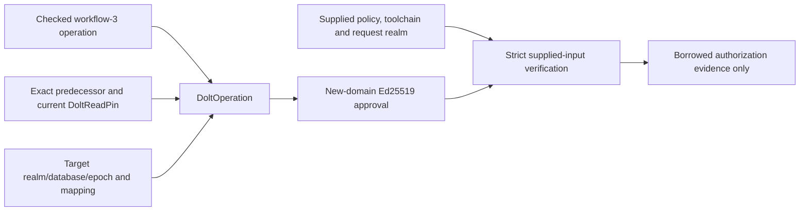

# Dolt-backed Rust integration profile

## Decision and authority

On 5 November 2026, Tarek authorized using Dolt to test Writfold's real Rust
integration flow without waiting for Omnigraph, after the benchmark research/plan.
This is the explicit scoped design revision **WF-STORAGE-003**, profile
**`writfold-dolt-integration/1`**. Its objective is earlier discovery of integration
bugs, not a second shipping database or an automatic fallback.

The retained Omnigraph branch-relocation failure is the reason for this deviation;
see [the source-bound blocker](omnigraph-foundation.md#separate-epochs-and-native-relocation-blocker).
Do not rerun it merely to confirm it. A working kctx/Dolt implementation is useful
compatibility evidence, not qualification of a new Rust adapter. No upstream
remedy is claimed. Omnigraph remains the intended release backend under revision
5; its foundation and dependent release gates remain blocked/open.

This supplement permits **separate disposable local integration realms** to use
one deliberately selected Dolt backend, with profile-specific evidence. It does
not change immutable handovers, activate deferred revision-9 policies or reduce
required proof/safety obligations. The active inventory remains 25 stages,
WF00–WF31, 37 V/M entries, E01–E12 and 148 scenarios. DINT milestones below are
supplemental development acceptance scopes, not renamed WF gates or release passes.

## Invariants retained

- One backend binding and one Writfold writer/coordinator per integration realm.
  No dual writes, live backend switch, migration of user data, or retry through
  another backend after an uncertain write.
- The real Rust domain/kernel/wire/protocol/application path owns decisions.
  Python may orchestrate qualification fixtures; it may not serve as the product
  store, invoke kctx workflows on behalf of Rust or fabricate an agent E2E pass.
- Preserve exact realm, kind, revision, context, source and profile identities.
  A Dolt commit is not an Omnigraph graph commit. Existing `LegacyDoltPin` stays
  historical inspection data; it is not silently reinterpreted as a new writer.
- Before enabling a Rust integration writer, freeze a distinct typed integration
  pin/release/storage-operation profile, signing domain and positive/negative
  vectors. Original signed bytes, schema namespaces and `refs/kctx/*` do not change.
- Retain the completed Git release CAS as the application visibility point.
  A Dolt commit, SQL transaction, branch or fixture row is not publication,
  authentication, current authority or an EngineeringLedger.
- Current grants/preconditions and exact subject/effect identities still govern
  effects. Unknown outcomes require reconciliation, not blind replay. Read-only
  Scribes remain separate from effect adapters; process ownership survives cancel.
- Context/execution/learning remain semantic graphs. Corpus and activity families
  remain distinct representations; validated ledger heads select execution and
  activity cannot authorize effects. In this profile, declare corpus/activity
  tables and independent immutable schema-epoch databases before their first use;
  do not mechanically rename GQ/graph identifiers as SQL identities.
- Keep destructive GC disabled. Retain native history, query/schema/profile
  material and all source/approval objects required by a pin or active reader.

## Native boundary and first onboarding scope

Reuse the already admitted **Dolt 2.6.1** executable and exact tool image in
[`toolchains.lock.json`](../../toolchains.lock.json), not an ambient installation
or moving latest release. The executable SHA-256 is
`ea866d85a8d38fad303268589b56a4766e05e72c9869556c0da60a0f819726b2`.
The [profile](../../qualification/dolt-integration-profile.json) binds the exact
candidate, isolation and required initial campaigns. Do not repeat kctx's repaired
version-warning or private-reader bugs as new product work.

**DINT00** is a stopped/exclusive **native CLI foundation campaign**, not a Rust
store or end-to-end agent workflow. It uses network-disabled Compose, an existing
admitted storage binding, an immutable locally present tool image, a private HOME,
a fresh out-of-tree attempt and no user database/credentials. It performs real
Dolt initialization, mutations, commits, retained branches, exact pinned reads,
transaction rollback and native backup/restore. It does not claim SQL-server
lifecycle, concurrent writers, power-loss durability or performance qualification.
Native preparation/restore run as the operator UID/GID. Full-tool observation
alone uses container root to read root-owned proof artifacts in the admitted
image; it retains the read-only root, dropped capabilities and no network, with
HOME/cwd on bounded `/tmp` tmpfs instead of the operator-private evidence directory.
It never mounts a database or changes tool permissions.

Required DINT00 observations:

1. Exact executable digest/version and tool-image identity; a mismatched identity
   refuses before native mutation.
2. Full ordered rows preserve Unicode, CRLF/binary payloads, null versus empty,
   case-distinct identifiers and a mathematical integer outside native 64-bit
   range through a declared exact decimal-text representation. This is a fixture
   fidelity check, not the complete semantic codec/refinement proof.
3. Old commit reads remain exact after current and side branches advance. Bind
   commit IDs and native branch roots explicitly; missing history refuses rather
   than becoming a latest/empty success.
4. SQL transaction rollback and a stale conditional **row** update preserve full
   expected working state. A SQL row predicate is not native branch CAS or the
   Writfold publication protocol.
5. Use supported `dolt backup sync-url` / `dolt backup restore`, not selected live
   file copies or logical export disguised as history backup. After quiescence,
   inventory the whole backup and transfer only that closure and its pin manifest
   to a separate container. Original database roots are not mounted or accessible.
6. Independently restore all selected commit/branch states and compare complete
   rows. A changed backup file fails input-integrity admission. Preserve failures,
   source/tool/fixture identities, bounded raw logs and process exits.

The current command for this component is introduced by this onboarding slice:

```sh
python3 scripts/writfold_dolt_probe.py \
  --receipt "$HOME/.local/share/writfold/evidence/dolt-integration-new.json"
```

Use a new external receipt path for each attempt. The runner does not pull/install
images, alter storage floors, prune resources, open network ports or modify user
realms. A successful supplemental receipt cannot satisfy `scripts/gate
release-required`; exact exercised status is indexed in
[`qualification/status.json`](../../qualification/status.json).

## Exercised onboarding evidence

`~/.local/share/writfold/evidence/dolt-integration-20261105-006.json` records a
passing DINT00 campaign: eight preparation checks, four restore checks and five
host/admission checks, with 105 actual Dolt command executions. Three distinct
seed/side/main commits and their retained branches match complete expected rows
after independent native restore. The original database path is absent. Changed
backup bytes, a wrong executable identity, stale row preconditions and missing
history exercise their named refusals; a matching row update is the positive
conditional-write control.

`dolt-onboarding-controls-20261105-002.json` retains 14 positive/refusal controls
for CLI receipt paths and native-report admission. The misattributed-failure
control first exposed an admission hole: a different failing command could be
labelled as the missing-history negative. The host now checks the exact command,
refusal kind and exit, and every DINT00 run calibrates that boundary.
`dolt-onboarding-interruption-20261105-003.json` separately confirms that SIGTERM
after an actual container-ready signal kills/reaps the Docker client and removes
the still-running owned container before returning. This is process cleanup,
not native write-crash or power-loss durability evidence.

Earlier attempts remain retained. Attempts 001/002 failed tool-observer access
under the restricted container user/HOME; no native database was qualified.
Attempt 003 expected a lower-level hash error rather than the observed SQL
`target commit not found` refusal. Attempt 004 exposed clean-room restore's
requirement for author configuration. Restore now installs synthetic author
metadata only in the fresh private `DOLT_ROOT_PATH`, never the operator's state.
Attempt 005 passed the earlier 16-check native scope; 006 adds calibrated receipt
attribution. The first interruption controller's exception-class mismatch also
remains a failed attempt, with its successful replacement separately recorded.

The mutable status index binds hashes and source applicability. Later prose/index
changes do not renew a whole-tree receipt. These observations complete only the
listed DINT00 native fixture component. The separate typed Rust reader below has
its own code, contracts and evidence; service/agent integration remains open.

## Typed Rust exact reader (DINT01)

`writfold_store::dolt::read_snapshot` is now an actual read-only Rust boundary over
the qualified stopped/exclusive CLI profile. It returns typed **inventory and
navigation** nodes/relationships, not admitted knowledge, citation lineage or an
authenticated completed release. No corpus method is added to `writfold serve`.

The [reader profile](../../qualification/dolt-reader-profile.json) maps these owners:

| Owner | Implemented responsibility |
| --- | --- |
| `domain::dolt` | Distinct current Dolt commit/database/tool and graph identities, complete read pin and typed projection |
| `protocol::dolt::admit_read` | Complete expected/observed realm, KB, database, commit, epoch/schema/query, profile and actual-tool consistency |
| `wire::dolt` | Closed bounded pin envelope and native scalar/row decoding; exact ordering, cardinality and null representation |
| `runtime::dolt` | Descriptor-pinned ELF/database/HOME, existing-only coordination lock, closed SELECT templates and native process execution |
| `runtime::process` | Shared Git/Dolt ownership: kill, drain and reap adopted descendants before releasing the reserved leader |
| `store::dolt` | One total deadline and lease, retained-root checks around all queries, typed decoding and relationship endpoint closure |

```mermaid
flowchart LR
    P[Exact supplied pin and admitted tool] --> V[Supported schema and query profile]
    V --> L[Existing stable exclusive read lease]
    L --> R[Exact retained root and native metadata]
    R --> N[Bounded pinned nodes and edges]
    N --> C[Typed ordering and endpoint closure]
    C --> F[Final root, lease and deadline checks]
    F --> S[Complete typed snapshot]
```



The canonical JSON envelope uses namespace `writfold-dolt-read`, schema `1`, kind
`pin`, and realm/KB/database/commit/epoch/schema/query/profile/producer identities.
`DoltIntegrationCommitId` is distinct from historical `DoltCommitId`;
`StoragePin::LegacyDolt` and old signed bytes/codecs are unchanged. A structurally
valid pin is not authority. Writer/release/signing envelopes remain DINT02 work.

Physical tables are `wf_reader_meta`, `wf_nodes` and `wf_edges`. Exact compiled
`SCHEMA_SQL` and `QUERY_CONTRACT` bytes define their SHA-256 profile identities.
Queries use the requested immutable commit, never HEAD/WORKING or caller SQL.
The retained branch `wf-retained/<commit>` must resolve to that commit before and
after the read group. Nodes and edges are strictly ordered by binary UTF-8 ID;
duplicates, dangling endpoints, malformed/partial data and row/byte overflow refuse.
Native `IS NULL` is a JSON **boolean**. Null and empty home-path strings remain
distinct; home paths are returned locators, not automatically opened filesystem paths.

The caller supplies existing owner-only DB/HOME/coordination roots and a regular,
singly-linked `coordination/database.lock`. Reads never create that lock or
initialize/migrate/check out a database. Native Dolt can create private bookkeeping,
including an empty `.dolt/config_global.json`: the runtime admits only an absent
file or a bounded empty JSON object with JSON whitespace, not settings, credentials
or malformed content. It never clears a nonempty configuration to continue.
Global profile/credential locations and native SQL-server discovery markers refuse.
Local native metadata remains administratively controlled; this is not a hostile
same-user filesystem sandbox or a claim that SELECT causes no native cache writes.

The supervisor is now `writfold_runtime::process::ProcessSupervisor`; Git callers
were migrated without an alias or a second process runner. ELF hashing streams
the binary rather than retaining a full executable copy. Fixed schema/query hashes
are lazily cached. Failed reads expose no complete/partial success packet, and
the lease outlives command cleanup. Fatal owner crashes, SQL-server ownership,
power loss, live grants/publication and model-refinement bridges remain separate.

Reproduce the supplemental native campaign with a new external receipt:

```sh
python3 scripts/writfold_dolt_reader.py \
  --receipt "$HOME/.local/share/writfold/evidence/dint01-reader-new.json"
```

It builds and retains the actual static-musl `writfold-store` example through
admitted offline Compose, then compares complete typed rows/pins against native
fixtures. The development consumer supports `--schema`, `--query-contract` and
`DOLT DB PRIVATE_HOME PIN_JSON` plus explicit row/byte/deadline/cancellation
options; it is not an installed product command. Its refusal diagnostics contain
typed JSON `kind` and a separate human message, so qualification does not pin
incidental error prose.

The first source-bound native success is
`dint01-native-20261106-002.json`: 41 native campaign checks, including 27 named
refusals, plus four host/build checks. The same source passed 295 workspace tests.
Retained failures include a test's incidental classification of canonical `-0`,
test lint/size violations, and the original overstrict empty-global-config
refusal. The native regression and configuration-transition tests preserve that
failure/fix evidence. Current quality/Verus receipts and applicability are indexed
in `qualification/status.json`; this prose does not relabel older evidence.

The selected Verus contract is the actual complete-pin/actual-tool decision and
its nominal conversion boundaries. Commit, epoch/query and producer guard mutants
calibrate it. This is not a proof of the native engine, codecs, store orchestration,
authenticated release selection, M01/M03/M11 refinement or full V15.

## Signed-input prerequisite for DINT02

The distinct [Dolt operation and approval boundary](signed-operations.md#dolt-integration-approval-boundary)
is implemented before a native writer. It binds the unchanged workflow operation,
expected realm, exact predecessor/read pin, target database/schema/query/profile,
producer and any migration mapping in new canonical/signature domains. Historical
and Omnigraph approvals remain separate; an old signature cannot be replayed as
Dolt integration approval.



The [qualification profile](../../qualification/dolt-approval-profile.json)
maps requirements to the real Rust codec/signature functions and independent
fixtures. `scripts/writfold_dolt_approval.py` builds and runs the static-musl
consumer, including original-domain transplant, retained-commit/producer replay,
wrong-realm/toolchain and missing-mapping refusals. Exact receipts and retained
failed attempts are indexed under `dolt_approval_admission` in
`qualification/status.json`.

This completes only DINT02's signed-input prerequisite. Actual target/tool and
live-policy admission, authenticated candidate preparation, retained release
closure, completed Git CAS, conflict and lost-response/crash recovery remain
open. The authorization value cannot perform IO, publish or turn a read pin into
a completed release. No full V15/M11, WF10/WF11/WF14 or DINT02 pass is claimed.

The separate [toolchain smoke scenarios](../../fixtures/qualification/toolchain-smoke.yaml)
exercise currently available control and local artifact boundaries. They do not
skip these publication prerequisites or enable a corpus/effect service.

## Work after native onboarding

| Milestone | Existing owners and affected obligations | Exit evidence before moving on |
| --- | --- | --- |
| DINT00: native candidate | P01/P06 component; analogous native requirements from WF01/WF09/WF14, but not those full gates | Exact pins/rows, retained branches, rollback/refusal and genuinely independent native restore |
| DINT01: Rust exact store/read boundary | P02/P04/P05/P06, WF03, V07–V10/V15 and M01–M06/M11 mappings | Distinct integration profile and canonical envelopes, real static-musl caller, exact multi-query reads, injection/budget/identity/ownership refusals and qualified retention roots |
| DINT02: authoritative integration | P07/P08/P08D/P10, WF10/WF11/WF14 and applicable proof/model bridges | Actual approved candidate preparation, complete retained closure, Git CAS conflict, lost-response/crash recovery and preserved historical interpretation |
| DINT03: ordinary clients and engineering | P09/P14–P19 and shared Weft/Splicery contracts | Real stdio corpus/evidence/artifact operations; qualified ledger/skills/effects before writes; two readers, reconnect, stale generation, revocation and exact host-kernel replay |
| DINT04: agent episodes and benchmarks | P11 evaluation component; [benchmark plan](agent-integration-benchmarks.md) | Real supported skill/subagent workflows, complete usage attribution, independent graders and frozen paired multi-session reports |

DINT01 starts conservatively with serialized, bounded native CLI operations under
an owned Writfold coordination boundary. This is a deliberate integration profile
with potentially high cold-process cost, not a claim of an optimized SQL service.
An authenticated SQL-server/read-replica optimization needs separate ownership,
transport, cancellation and native evidence before adoption. Do not copy kctx's
reader implementation wholesale or assume its proof/evidence transfers.

Before each production boundary, update the current requirement → theorem → Rust
caller → model action → fixture mapping. Models must bind the **Dolt** operation's
actual atomic/durable/unknown boundary; passing Omnigraph or historical Dolt labels
cannot be relabelled. Preserve all open native/compiler/codec assumptions and
full E/V/M/bridge obligations. Initial integration development may use this
profile after its own prerequisites pass; it does not unblock Omnigraph release
aggregation by aliasing a gate or suppressing its blocker.

No source/configuration change in Weft or Splicery, public forge write, installation
into a user realm, website deployment or paid model campaign is implied. Service
initialization continues to advertise only implemented qualified capabilities.

## Compatibility, retirement and public claims

Keep Dolt integration data in disposable fixture realms, never old kctx or live
Omnigraph roots. The normal release/backend configuration is unchanged by this
onboarding. If a future decision makes Dolt a shipping backend, it requires an
explicit release-design revision and complete applicable admission—not a rename
of these milestones. Do not preserve an unused generic multi-backend framework.

When Omnigraph has a supported remedy, qualify its exact package and full native
foundation separately, replay the same semantic/integration scenarios, and compare
observations. Recreate disposable Dolt fixtures under the new profile; any retained
user-like data needs an explicitly accounted migration and independent restore.
Unknown effects and request identities must never disappear in a switch.

Benchmark reports must identify the actual storage backend and include its cold,
warm, setup and maintenance costs. A Dolt-backed Evidence Stack result is not an
Omnigraph performance or durability result. The [website evidence rules](agent-integration-benchmarks.md#reproduction-and-website-evidence-contract)
require a source-bound report and reproducible artifact; no public benefit numbers
exist merely because this plan or a native fixture passes.

References: retained revision-5 [storage decision](../../handovers/revision-5/writfold/plan/15-storage-decision.md),
[storage/publication obligations](../../handovers/revision-5/writfold/plan/16-omnigraph-storage-contract.md),
and [Dolt CLI backup contract](https://docs.dolthub.com/cli-reference/cli#dolt-backup).
Live documentation is guidance; execution must bind the admitted 2.6.1 bytes and
observed command behavior.
