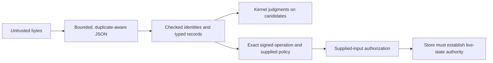

# Rust domain boundary

`crates/writfold-domain` is an IO-free representation of the immutable reference
`src/kctx/domain/ids.py`, `src/kctx/semantics/model.py`, and
`src/kctx/semantics/workflow_models.py`. It does not replace the calculus or claim
that a candidate is well formed, authenticated, fresh, or publishable. The
semantic version remains `2.0.0`, semantic schema remains `2`, and workflow schema
remains `3`. These constants are separate axes.

## Construction and ownership

Identifiers have private storage, checked `TryFrom<String>` and `FromStr`,
`as_str`, `Display`, and ownership-preserving `into_string`. There is no default,
unchecked `From<String>`, serde implementation, trimming, case folding, or Unicode
normalization. Grammar checks are direct byte checks; parsing does not compile a
regular expression. `TryFrom<String>` reuses the supplied allocation.

Records have private fields, a typed `new` constructor in reference field order,
and borrowed accessors named after their fields. Ordered Python tuples are
ordered Rust vectors, never sets or maps. Constructors enforce structural typing,
not kernel predicates: duplicate claims, missing referenced evidence, negative
semantic time, invalid lifecycle combinations, and mismatched context snapshots
remain representable candidate inputs for judgment. There are no mutable field
accessors. Formula, witness, dependency, TTL, and outcome alternatives are closed
enums; TTL seconds are present exactly for `ExpireAfter`.

`Claim::claim_ref` creates an owned reference; `matches_ref` compares without
allocating. `find_claim` and `find_observation` retain the reference's first-match
behavior. `member_formula` retains member order and its final truth conjunct.
`narrower` retains the exact project/empty-selector relation.

## Exact identifier grammars

All ASCII grammars below match the entire string. Opaque values are any nonempty
UTF-8 string, including whitespace, newlines, and NUL; provider codecs own any
additional external syntax constraints.

| Grammar | Types |
| --- | --- |
| Token: `[A-Za-z0-9][A-Za-z0-9_.:-]*` | ObservationId, ClaimId, ClaimRevision, CitationId, RuleVersion, OperationId, SnapshotId, DerivationId, RunId, GateId, TicketId, AuthorityKeyId, AttestationId, EnumerationId, CorrectionId, ReceiptId, PolicyId, ContextId |
| Slug: `[a-z0-9](?:[a-z0-9-]*[a-z0-9])?` | AssetId, EvidenceId, SignatureId |
| Slugs joined by exactly `__` | RelationshipId |
| Token or exactly two slugs separated by `/` | ProposalId |
| Token or `[0-9]{4}/[0-9]{4}-[0-9]{2}-[0-9]{2}-<slug>` | InvestigationId; date digits are not calendar validation |
| Exactly 64 lowercase hexadecimal digits | PlanId, SourceCaptureId, ContentDigest, PolicyDigest |
| Exactly 40 or 64 lowercase hexadecimal digits | ReleaseId, GitRevision |
| Exactly 32 digits from `0-9a-v` | DoltCommitId |
| Nonempty opaque | CheckerId, SourceId, SourceRevision, ContentId, ProjectId, ActorId, ProposalMaterialRevision, TargetRevision |

New architecture names choose explicit grammars without changing old ones:

- `InstanceId`, `SessionIncarnation`, `CatalogRevision`, `SchemaRevision`, and
  `KeyId` use the token grammar.
- `KbId` and `PolicyRevision` preserve the authority-policy envelope's opaque
  text rather than silently imposing the semantic `PolicyId` token grammar.
  Policy admission separately rejects blank identities and validates new
  bootstrap's semantic snapshot/policy projection; historical bytes are not trimmed.
- `AuthoredRevision`, `FileRevision`, and `DesignRevision` use the opaque grammar.
  `DesignRevision` is nominally distinct from legacy `ProposalMaterialRevision`
  and implementation `TargetRevision`. `writfold_sources::material::material_revision`
  implements the workflow-selected legacy or `design-v3:<sha256>` projection.
  The semantic candidate domain still preserves the reference's other nonempty
  revision spellings; a nominal value alone does not authenticate a material hash.
- `ToolDigest` and `PlanDigest` use the 64-lowercase-hex grammar and are distinct
  from `ContentDigest` and `PolicyDigest` even when their bytes match.
- `GitObjectId` carries `GitObjectFormat::Sha1` or `Sha256` with exactly 40 or 64
  lowercase hex digits respectively. `new(format, hex)` checks agreement;
  string parsing infers the format from the exact length.

Logical `ContentId`, `SourceId`, and `SnapshotId` are not storage digests. The
historical `PlanId` retains its digest grammar rather than being changed to a
logical token. OS paths, monotonic clock origins/deadlines, operational snapshot
handles, and production authority capabilities belong to their owning adapters
or application/protocol layers, not invented baseline semantic records here.

## Semantic integers versus runtime quantities

Every reference Python `int` field is `Integer`, a private `num_bigint::BigInt`
newtype. This includes observation/correction/context/gate/binding times,
receipt expiry, TTL seconds, and authored alternative counts. Parsing and
primitive construction preserve negatives and arbitrarily large values.
`as_bigint`/`into_bigint` expose mathematical values; addition and subtraction of
borrowed integers produce unbounded integers. `to_u64`/`to_i64` return `None`
instead of truncating or saturating.

Runtime `ByteCount`, `WitnessDepth`, `EpochSeconds`, and `DurationSeconds` admit
`0..=u64::MAX`; `RowLimit` and `PageSize` admit `1..=u64::MAX`. Their checked
constructors and `TryFrom<&Integer>` reject out-of-range values. They do not
constrain the semantic model. Unit-to-semantic conversion is explicit; no
inter-unit conversion is implicit. An evidence timestamp is not an OS timestamp
or monotonic deadline.

`RequestGeneration` remains isolated in `src/request_generation.rs`. `first()` is
zero, `get()` returns its value, `from_u64()` explicitly represents any counter
state, and `checked_next()` returns `None` exactly at `u64::MAX`, otherwise the
exact successor. Its executable contracts and the protocol live-set transition
are verified directly; the caller still owns session lifetime and the complete
live-generation set.

The identity grammar, borrowed/owned admission, tagged Git-object construction,
primitive integer construction and checked unit conversion bodies now carry
Verus contracts. `WF-TCB-001` explicitly trusts the pinned num-bigint primitives;
that dependency's arithmetic is not mechanically verified. The only admitted
external specifications live in `integer/primitive_specs.rs`, are absent from
ordinary builds, and are hash-bound by `qualification/trusted-boundaries.json`.

## Complete model and authority distinction

The public modules are `ids`, `integer`, `units`, `request_generation`, `language`,
`evidence`, `knowledge`, `admission`, `authored`, and `workflow`; their public
values are also re-exported at crate root. Formula/witness/dependency Python
wrapper classes map to the corresponding Rust enum alternatives. All reference
record fields remain represented, including workflow-3 context families,
ordered assignments and retirements, portfolio selection journals, authored gate
history, resolved landed records, expected design proposals, binding, and reopen
commands. `ImplementationBinding.design_revision` uses the distinct
`DesignRevision` type; authored v2 material fields retain their legacy type.

The reference's four trusted approval wrappers are intentionally named
`ModelApproval`, `ModelSelectionApproval`, `ModelPortfolioApproval`, and
`ModelPortfolioSelectionApproval`, mapping respectively from
`VerifiedApproval`, `VerifiedSelectionApproval`, `VerifiedPortfolioApproval`,
and `VerifiedPortfolioSelectionApproval`. They contain the exact model plan and
are constructible pure reference inputs. They grant no publication or IO
capability. Production opaque approvals must instead be constructed only by the
concrete authenticated crypto/current-policy application adapter. There is no
public verifier trait or boolean factory allowing callers to mint that authority.

Acquisition outcome, four-valued support, applicability, freshness, validation,
contestation, availability, usability, authored lifecycle, authority inputs, and
commit outcome remain independent values. In particular, `AuthoredStatus::Verified`
is not release authentication, and a positive support value does not silently
set freshness or publication status.

## Qualification status

The source-bound P02 campaign requires 258 named domain solver successes, exact
coverage of overloaded constructors, 348 domain obligations and the retained
generation protocol checks. Six semantic mutation families and eleven independent
evidence-admission controls per mutation passed in `p02-verus-003.json`.

A static musl consumer exercised 56,656 identity/numeric scenarios against the
pinned Python grammar and mathematical boundary oracle with zero mismatches.
Both borrowed and owned identity constructors retained exact original bytes.
The executable ran with `PATH=/nonexistent`; ELF inspection found no interpreter
or needed shared libraries. These are component results, not an installed
product, a whole-kernel proof or a Lean-to-Rust refinement theorem.

