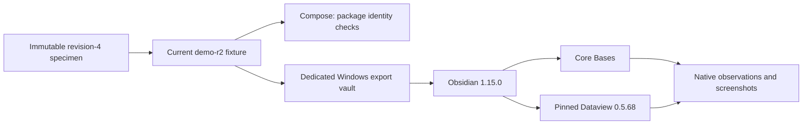

# Obsidian: exercised synthetic reading profile

The installed Windows Obsidian **1.15.0**, installer **1.15.0**, is reachable from WSL through `~/AppData/Local/Programs/Obsidian/Obsidian.com`. It was exercised against the separately registered **Writfold Preview** vault at `C:\Users\owner\Writfold Preview`. The personal `Notes` vault was not used for content, plugin installation or settings changes.

This is a native reader smoke of synthetic data, not a Rust view renderer, authenticated export, production publisher, or full P09V/WF22/WF23 pass. No knowledge approval is inferred from the view.



## Current specimen and discovered fixes

The source-controlled current specimen is [`fixtures/views/obsidian-vault`](../../fixtures/views/obsidian-vault/README.md). The immutable handover sample stays unchanged. Its original `demo-r1` is also retained in the dedicated vault; the current `Writfold/Home.md` points to `demo-r2`, with the same synthetic semantic data and assessment time.

Native rendering exposed unescaped `|` alias separators inside Markdown table cells. Obsidian split the original dashboard into incorrect columns and literal wikilink fragments. The new generation escapes those separators in the dashboard, overview and service evidence tables. The corrected dashboard's actual native DOM preserves `Checkout / Needs evidence / Ownership gap` and `Inventory / Supported / Dependency only` as separate cells, including with Dataview disabled.

Dataview 0.5.68's actual setting keys are `enableDataviewJs` and `enableInlineDataviewJs`, not the handover profile's descriptive labels. The current profile uses both actual keys with `false`, verified against the pinned `main.js` defaults and handlers. A harmless negative-control DataviewJS block was refused by the running plugin; ordinary DQL results supplied the positive control. Separate inline-JavaScript execution calibration was not run.

The optional scoped snippet keeps metadata in a 12rem scrollable panel. All properties remain reachable and warning callouts remain visible. It does not replace the user's theme. The dedicated vault received only the verified Dataview assets and this scoped snippet; its trust prompt was explicitly accepted after digest verification. No community plugin was installed into the personal vault.

## Actual native observations

- Core Bases returned exactly `svc-checkout` (`needs-evidence`) and `svc-inventory` (`supported`) under `demo-r2`.
- Dataview's attention table returned only `svc-checkout`; the evidence table returned exactly `writ-contract` and `writ-test`. Both retained generations were present, but the returned links all named `demo-r2`.
- Initial Dataview rows were empty during startup. The native console then reported 21 files indexed, and subsequent rendered results matched the expected identities. Index completion is separate from command success or knowledge authority.
- Corrected static-table fallback worked with Dataview disabled; the pinned plugin was re-enabled afterward.
- Native backlinks identified the current-generation source pages. The observed unresolved-link query reported none.
- Desktop screenshots and a 390-CSS-pixel emulated viewport were inspected in light and dark system preferences inside the actual Windows app. The sidebar must be collapsed for narrow desktop reading; viewport/media overrides were cleared afterward. This is not a mobile installation claim.
- A temporary JavaScript control note was removed after its exact bytes were checked. Both generation inventories remained unchanged after the smoke, except for the deliberately updated Home pointer.

Exact command outputs, CLI/EXE/app archive hashes, plugin/fixture identities and 11 retained screenshots are in:

`~/.local/share/writfold/evidence/obsidian-profile-001/receipt.json`

The receipt retains the original broken-table observation, startup zero rows, an exit-0 CLI error, missing/virtualized DOM observations, and a diagnostic timeout. It is not a gate-schema receipt.

## Native CLI use

Always supply the admitted vault explicitly and exact paths. For this local installation:

```sh
"~/AppData/Local/Programs/Obsidian/Obsidian.com" \
  "vault=Writfold Preview" open "path=Writfold/Home.md"

"~/AppData/Local/Programs/Obsidian/Obsidian.com" \
  "vault=Writfold Preview" base:query \
  "path=Writfold/Generations/demo-r2/Assets.base" view=Services format=json

"~/AppData/Local/Programs/Obsidian/Obsidian.com" \
  "vault=Writfold Preview" plugin id=dataview
```

These are native reader commands, not a Writfold product CLI. An `open` acknowledgment does not prove the requested page has painted. One `plugins:restrict off` attempt returned an error with exit code zero during setup; the dedicated GUI trust flow was used instead. An optional CDP mouse-wheel diagnostic timed out after 60 seconds. Official URI navigation to an exact heading subsequently exercised the corrected fallback successfully. Do not promote exit zero, a stale screenshot or a requested navigation into a visible-activation receipt.

Maintainer DOM/CDP diagnostics were used for this smoke only. Production view channels must not expose arbitrary `eval`, CDP, generic commands or plugin administration to documents/renderers. Plugin execution permissions are setup capabilities, separate from normal read capabilities.

## Compose versus the desktop app

Keep preparation, pure rendering and package integrity checks in the admitted Linux Compose/BuildKit flow. The existing network-disabled, read-only-checkout service successfully checked all 11 current managed-file digests and the DQL-only profile settings; that scoped observation is retained at `~/.local/share/writfold/evidence/view-fixture-compose-001/receipt.json`. It does not establish Obsidian rendering.

Use the installed Windows application and its admitted `.com` bridge for the actual WSL-to-Windows reader campaign. Obsidian's CLI controls the desktop application; copying a command into a headless build container would not test this installed reader or its Windows filesystem/watcher behavior. No GUI app was installed into the existing tool image, and no display socket, personal vault or credential store was mounted into Compose. A separate Linux Obsidian GUI profile would need its own admitted installation, runtime closure, display and native qualification; it is not required to exercise the supplied Windows installation.

## Remaining gate scope

WF22/WF23 remain unrun as complete gates. The Rust prepared-document pipeline, grants/redaction and hostile-input admission, owned publication/CAS/recovery, V14/M10 proofs, complete watcher/stale-index/cancellation campaigns, edited-file conflict handling, installer/offline closure, and timed user acceptance have not been qualified by this smoke. The synthetic fixture and plugin queries must never become an alternative source of knowledge authority.
