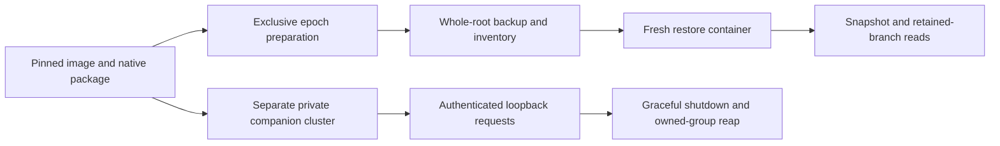

# Omnigraph foundation: source-pinned native campaigns

These are reproducible **P01O progress campaigns**, not WF24 admission or a production Writfold storage adapter. Omnigraph remains the intended primary backend. Dolt 2.6.1 is used only as the isolated supplied comparator; no fallback or dual writer is introduced. The immutable revision-4 handover remains unchanged.

**The released 0.14.0 profile remains blocked; the exact PR #1235 source candidate now passes the scoped relocation/restore campaign.** The historical failure is retained, not rerun or relabelled. Neither result completes P01O/WF24 or admits a production Writfold storage adapter.

Tarek subsequently paused Dolt-specific alpha expansion and authorized
[PR #1235](https://github.com/ModernRelay/omnigraph/pull/1235) at
`1a856292c569e214333ab16b1d1af4d0e2de4ac2` as an isolated development unblocker.
The earlier [Dolt integration-only decision](dolt-integration.md) and its evidence
remain historical scope, not a fallback. A supported upstream remedy is preferred
before public alpha; a source-candidate pass is not release admission.

## Reproduce an exact source-candidate campaign

Set `OMNIGRAPH_SOURCE` to a dedicated checkout at the exact commit below.
The builder checks committed file bytes/modes, rejects extra ignored inputs and
escaping symlinks, and verifies the source closure again after compilation.
Select fresh absolute receipt paths outside both checkouts:

```sh
build_receipt="$HOME/.local/share/writfold/evidence/omnigraph-source-new.json"
python3 scripts/writfold_omnigraph_source.py \
  --source "${OMNIGRAPH_SOURCE:?select the exact dedicated checkout}" \
  --expect-source 1a856292c569e214333ab16b1d1af4d0e2de4ac2 \
  --receipt "$build_receipt"

python3 scripts/writfold_omnigraph_probe.py --campaign all \
  --profile "${build_receipt}.attempt/profile.json" \
  --archive "${build_receipt}.attempt/omnigraph-linux-x86_64.tar.gz" \
  --receipt "$HOME/.local/share/writfold/evidence/omnigraph-candidate-new.json"
```

Each receipt and sibling `.attempt` directory must be new. Failed attempts are
retained and cannot be overwritten. Both wrappers use the operator's actual
storage preflight. The source builder explicitly provisions a derived BuildKit
image and fetches locked dependencies online, then compiles offline with network
disabled. The probe neither provisions nor downloads implicitly. Neither changes
storage bindings, prunes resources or modifies the admitted base image.

The default probe profile still selects historical 0.14.0. Do not rerun its known
relocation failure merely to confirm it. `--profile` explicitly selects the new
source-build receipt and exact archive; `--campaign companion` selects only the
authenticated lifecycle scope and never waives restore or other WF24 obligations.

Prerequisites:

- Linux/WSL x86_64 host, Python standard library, Docker Compose and the existing `ci-infra` storage binding used by `scripts/writfold_preflight.py` (including its reserve/resource policy).
- The exact locally present admitted `toolchains.lock.json` image and matching retained tool observation. Mutable tags and ambient native binaries are not accepted.
- An exact source checkout and the generated archive/profile/build receipt for candidate runs. The successful archive is 194,021,218 bytes. Preserve enough space for binaries, graphs and all failed/successful logs.
- Source compilation uses Rust 1.97.1, two Cargo jobs and the declared eight-CPU/12-GiB ceiling. Native smoke containers use two CPUs, 4 GiB RAM without additional swap, 256 processes and 256 MiB temporary storage. These are containment limits, not performance SLOs.

The historical archive was obtained from the [v0.14.0 release](https://github.com/ModernRelay/omnigraph/releases/tag/v0.14.0), retained at the default path with `release.json` and `provenance.json`, and SHA256-checked against the handover. Its exact bytes remain a historical reference, not the candidate selected above. Never replace a mismatched retained artifact silently.

## Identity and containment

`qualification/omnigraph-profile.json` freezes the source commit, archive digest, all three observed regular member digests and supplied fixture hashes. Archive SHA256 is `02bde3e3a2c6c8cf50dc9739a8b1041df87cfeaa6ab59f620e1d8e32acffd4d9`; CLI SHA256 is `978e200a412e7b0db46657417d348569f97529c18b47e64687132e565d19dc64`. Server SHA256, independently streamed from the retained archive member, is `01720242435da9b2709dc62bfe703e1fd23a4b271f9b6bb093f1f1fbb4bb9aef`. This is package observation, not server admission. Source provenance is the handover/upstream release association, not a claim that these binaries were independently rebuilt.

Extraction accepts only the exact regular-file member allowlist, rejects links/special files/path traversal/duplicates, verifies every member, and mounts the package read-only. `compose.omnigraph.yaml` uses the admitted image, a read-only checkout and root filesystem, a fresh private writable scratch directory, no external network, dropped capabilities and the host UID/GID. No user graph, Docker socket, shared engine cache or existing database is mounted. The host holds an exclusive attempt lock.

The supplied CLI probes and epoch preparation run first, with no server. Independent restore runs in a fresh container whose writable mount contains only copied `backup.tar` and `backup.json`; original native roots are not mounted. The companion uses a different fresh cluster, stopped/exclusive CLI bootstrap and an exact-ID ownership handoff before the sole server starts. No direct graph CLI is used against that serving cluster.



The wrapper observes the actual CLI JSON version, Python/libc/OS identity and ELF loader-resolved dependency paths and hashes for each packaged executable inside the admitted image. It checks the Python and Dolt bytes against the admitted observation. The image digest binds the remaining runtime filesystem. `ldd` establishes the observed ELF dependency closure, not every possible dynamically loaded module, remote provider or production configuration.

The pinned [server entry point](https://github.com/ModernRelay/omnigraph/blob/60bfd19db780fdff3a5178f959c1204143420114/crates/omnigraph-server/src/main.rs) does not declare a version flag. The runner retains actual `--help` output and the expected exit-2 `--version` refusal. It records `server_reported_version: null`, rather than presenting the CLI version as an observed server version. Neither command starts a serving lifecycle.

## Evidence and limits

The source-bound supplemental receipt records the full source snapshot, admitted image/lock, actual preflight, archive/profile/fixture identities, command timings/exits and retained output hashes. It refuses success if source changes during execution. Runtime observations are retained in `.attempt/work/runtime.json`. Historical fixtures remain immutable. For a source candidate, `writfold_omnigraph_fixtures.py` derives external copies by AST-constrained replacement of exactly one version literal and one CLI digest literal per Python probe; all semantic assertions remain unchanged. `fixture-derivation.json` binds original/derived bytes. Interrupted Docker clients trigger forced container removal before ownership is released; failure to remove is itself a failed attempt.

A supplemental `status: pass` applies only to its `selected_campaign`. The receipt always keeps `wf24: not_run`; successful bounded subscopes use `scoped-smoke-pass`, never full-gate status. It is not a gate-schema receipt. The separate current ledger records the known foundation blocker. A host/container crash may leave only reserved logs, not a final receipt; that is not success.

`writfold_omnigraph_epochs.py` adds separate physical graphs, complete canonical node/relationship comparisons, old reads after head advancement, retained branch roots and a complete quiesced backup. Independent restore validates every archived byte and requires every declared snapshot and retained branch to remain readable with original locations unavailable. The historical 0.14.0 failure and source-candidate pass below remain distinct. `writfold_omnigraph_companion.py` exercises actual authenticated transport and lifecycle, not a production supervisor.

Signed Writfold migration/CAS, complete semantic codecs, concurrent publication and writer replacement, uncertain-write recovery, crash/power-loss behavior, retention/GC, formal bridges, offline installation and frozen workload/SLO campaigns remain unqualified.

## Executed local evidence — 2 November 2026

`~/.local/share/writfold/evidence/omnigraph-0.14.0-001.json` records a successful
Compose run on the admitted WSL/Linux tool image: 12 comparison assertions and
6 versioned-schema assertions passed. The CLI reported source
`60bfd19db780fdff3a5178f959c1204143420114`, HTTP contract `0.14`, storage writes
`16`, and serves `[14, 16]`. The observed runtime was Ubuntu glibc
`2.39-0ubuntu8.9`; exact loader-resolved dependency hashes are in that receipt.

`~/.local/share/writfold/evidence/omnigraph-invalid-001.json` retains the expected
`Archive digest/size mismatch` refusal. Reusing the successful receipt path also
refused with `Receipt exists; choose a new attempt`, without overwriting it.
The immutable supplied fixtures and the first successful source snapshot remain
identified in the original receipt; later documentation/license changes do not
renew or broaden its scope.

## Separate epochs and native relocation blocker

`omnigraph-foundation-003.json` retains successful preparation of two separate immutable-schema graphs, complete record/mapping checks, old reads after head advancement and supported branch retention roots. Backup inventories include the entire native roots, schemas, queries, mapping and all three declared pins. Restore ran in a separate container with only copied backup inputs. Its archive and original-root absence checks passed, as did the first old snapshot's complete node/relationship reads.

Reading that old pin through `retained_seed` failed with `code: internal` and `disposition.effects: none`. The missing object was under the original `evidence/epochs/payload/epoch1.omni/__manifest/data/...lance`, despite the query target being `/evidence/restore/relocated/epoch1.omni`. This is not an incomplete-file-copy result: the exact whole-root inventory had already matched. The old explicit snapshot's success is not a substitute for retained-branch portability.

The pinned [storage contract](https://github.com/ModernRelay/omnigraph/blob/60bfd19db780fdff3a5178f959c1204143420114/docs/user/concepts/storage.md) treats the graph root as a unit and prohibits direct dataset edits. [Native branch creation](https://github.com/ModernRelay/omnigraph/blob/60bfd19db780fdff3a5178f959c1204143420114/crates/omnigraph-core/src/lance_clone.rs) delegates to Lance's branch operation. Location-dependent clone-origin references are an inference from the native failure and source, not an engine proof. No history-preserving relocation/rebinding command was found in the pinned [CLI surface](https://github.com/ModernRelay/omnigraph/blob/60bfd19db780fdff3a5178f959c1204143420114/crates/omnigraph-cli/src/cli.rs).

The blocker is retained in `~/.local/share/writfold/evidence/omnigraph-relocation-blocker-001.json`. A supported native remedy or a separately admitted fixed release is needed. Metadata rewriting, aliases that conceal the missing original root, skipping branch checks, logical export presented as native-history backup, and automatic Dolt fallback are not accepted remedies.

### Upstream report and reduced reproduction

[Omnigraph issue #1233](https://github.com/ModernRelay/omnigraph/issues/1233)
records the failure with a standalone, synthetic CLI reproducer. It was filed
on 2 November 2026 and observed open with `needs-triage`; maintainer acceptance
and a supported remedy remain outstanding.

The reduction uses one node and one retained branch, with no schema migration,
concurrent writer, cleanup or server. After every CLI exits, it copies the
complete root, compares every relative file's SHA256, and renames only its own
original root so the original pathname is absent. The relocated snapshot returns
the exact original row and graph commit. The retained-branch read exits 1 and
requests `original.omni/__manifest/data/...lance`, despite targeting
`relocated.omni`. This smaller case does not replace the earlier fresh-container
restore campaign: its source bytes remain retained at a different pathname.

The executed script, command logs and failed receipt are retained under
`~/.local/share/writfold/evidence/omnigraph-relocation-issue-001/`. The public
issue includes the script and exact output, not private reference material.
The latest published release checked during filing was still 0.14.0; newer
source was not executed. Location-bound clone metadata remains a hypothesis.
The report asks whether whole-root relocation is supported and, if not, for
the supported history-preserving restore procedure. P01O/WF24 remains blocked.

On 3 November, [ragnorc's contributor analysis](https://github.com/ModernRelay/omnigraph/issues/1233#issuecomment-6592078609)
reported independent reproduction on 0.14.0 and main `b68f367`, including a
child branch and branch-only snapshot lookup. It traces the dependency to
Lance clone `base_paths` and proposes graph-internal origin resolution without
rewriting retained manifests. These are attributed upstream findings, not a
locally executed fixed build.

Tarek supplied the [authorized fork](https://github.com/tknawara/omnigraph).
Following the [implementation offer](https://github.com/ModernRelay/omnigraph/issues/1233#issuecomment-6592350631),
upstream [accepted the bug as size L and took ownership of its RFC and code PR](https://github.com/ModernRelay/omnigraph/issues/1233#issuecomment-6594527176).
The issue is `needs-rfc`, not ready for a competing code PR. Any candidate must preserve exact
history/manifest identity, leave genuinely external bases and Blob URIs alone,
refuse missing copied closure without consulting the old tree, and cover the
still-present/divergent-original case. Fork availability is not backend
admission; independent Writfold implementation continues meanwhile.

Upstream's linked prototype rebinds in-memory catalog bases after checkout
without modifying retained manifest bytes or the native format stamp. Their
planned work includes centralized coverage of all catalog checkouts, explicit
legacy-fork and mismatched-base rules, relocated cleanup, RustFS/Azurite
evidence, and RFC 0029/0064 amendments. These are upstream plans/prototype
observations, not local admission. Retain the end-of-week fallback review and
test the exact accepted artifact against Writfold's closure/restore campaign.


## Authenticated companion evidence

`~/.local/share/writfold/evidence/omnigraph-companion-005.json` passes 19 scoped checks. The server binds only `127.0.0.1` inside a network-disabled container, uses private synthetic bearer credentials and an applied read/write policy, and reports readiness through an authenticated named query. Actual responses include 401 for absent/wrong credentials, 403 for a reader's mutation, and 400 for an unsupported HTTP contract.

The writer seeds nine synthetic entities and performs one named mutation. Complete rows and traversal responses match the expected old/new states, and old pinned reads survive the write. SIGTERM completes with exit zero, drained bounded logs, a reaped process, no surviving process group and a refused endpoint; no forced kill was needed. A bounded connection-refused readiness attempt is retained before readiness succeeds. This does not qualify crash/restart, lost-write responses or the entire production lifecycle.

The final `omnigraph-companion-006.json` adds a current-HEAD read after the denied mutation, checking that both the native pin and complete fixture state remain unchanged before the authorized writer runs. All 20 scoped checks pass. `omnigraph-foundation-007.json` exercises the final default/full dispatch and still refuses the independent retained-branch restore; selecting the independent companion scope has not waived that requirement.

`omnigraph-foundation-002.json` preserves the first fixture parser failure: the pinned CLI's root/lock diagnostic format differed from the initial source-derived expectation. `omnigraph-companion-004.json` preserves a Python `Path.open(opener=...)` setup error. The parser now checks the actual pinned diagnostic and complete/converged apply response; private token creation uses the supported exclusive built-in `open` API. Neither failed attempt was overwritten.

Upstream archive attestation verification was also attempted, but the installed host `gh` does not expose `attestation`. `native/omnigraph/0.14.0/attestation-attempt-001.json` under the external Writfold data directory records that blocker. Executable/archive byte checks still apply; no cryptographic upstream-attestation verification or independent rebuild is claimed.

## Executed PR #1235 source-candidate trial

The retained root is
`~/.local/share/writfold/native/omnigraph/source-1235-u_eol09m/`.
`build-004.json` passes at exact unmodified source
`1a856292c569e214333ab16b1d1af4d0e2de4ac2`; before/after source manifests match.
The binary reports `0.15.0` and a null source commit: commit provenance comes from
the source/build receipt, not an invented embedded version field. Archive SHA256:
`6c336006edec1952550e3a06859e656c502d07107c2bdc963f592d158e106506`.
CLI SHA256:
`ae26ae21b6b7dbaa3556256e0a9887281caea8cd0094c2b12f640353a8704994`.
Server SHA256:
`aeeac98eab27ca76c37e0a661430a81876f74f469949e38a8b8fff9727714fab`.
The receipt also binds the azure helper, derived image, tool observations and
loader-resolved ELF dependencies. Byte-reproducible rebuilding is not claimed.

`campaign-002.json` passes the comparison and versioned-schema probes (12 and
6 assertions), epoch preparation (187), independent restore (149), authenticated
companion lifecycle (21 checks), and relocation adversaries (1,302 assertions
across 116 native commands). The restore container mounted only copied backup
inputs: both original native roots were unavailable. Snapshot and retained-branch
reads preserve exact old/new rows and pins across both schema epochs.

The seven relocation cases cover a minimal retained branch, a child of a written
branch, branch-only historical lookup with an unwritten sibling, a divergent
original, an absent original, same-path restore, and a missing copied object.
The last case refuses without consulting the still-present original. These are
native root/history checks, not Writfold authority or uncertain-write recovery.

Earlier source-build attempts retain the committed-symlink admission, local
BuildKit base-resolution and rustup cross-mount-rename failures. Campaign 001
retains the old fixture version/digest refusal; candidate derivation corrected
only those exact literals. `source-closure-tests.json` records five exercised
admission regressions for hidden byte changes, committed link containment,
ignored extra inputs, executable-mode drift and wrong source commits.

All receipts retain `wf24: not_run`. The later bounded development campaign below
adds native failure/ownership, frozen workloads and fixed-URI managed restore.
Uninstrumented in-flight/mid-commit boundaries, the complete native/runtime
admission, Rust adapter and composed release acceptance remain open. Later
V14/V15 and M10/M11 obligations are separate; P01O itself lists no V/M obligation.
The unchanged 0.14.0 profile is not silently replaced by this candidate.

The independent restore above covers **standalone graph roots**. The candidate's
[cluster deployment boundary](https://github.com/ModernRelay/omnigraph/blob/1a856292c569e214333ab16b1d1af4d0e2de4ac2/docs/user/clusters/index.md#deployment-boundaries)
does not admit importing existing managed roots, and PR #1235 explicitly leaves
managed-root adoption at a new location unsupported. The later managed restore
below keeps the canonical URI while using independent physical storage. It does
not qualify location adoption or replace standalone relocation checks; no native
metadata rewrite, original-tree alias or logical export is used.

The [review of this exact head](https://github.com/ModernRelay/omnigraph/pull/1235)
also warns that main's planned `0.15.0` release may precede this fix. A version
string is not fix provenance. Keep the exact source/archive/member identities
above; do not substitute a same-version release or infer that the draft is merged.

## Bounded native development contract

[`omnigraph-development-contract.json`](../../qualification/omnigraph-development-contract.json)
freezes the same source/archive/member identities, two-CPU/4-GiB containment,
seven failure cases, 10k/100k typed graphs, sample counts and premeasurement
budgets. It remains a development qualification input, not backend admission.
Every request uses the actual authenticated native server; no mock store,
Python product path, second normal writer or write retry is introduced.

```sh
python3 -B scripts/writfold_omnigraph_probe.py \
  --campaign faults \
  --profile qualification/omnigraph-development-contract.json \
  --archive "$OMNIGRAPH_CANDIDATE_ARCHIVE" \
  --receipt "$HOME/.local/share/writfold/evidence/native-faults-new.json"

python3 -B scripts/writfold_omnigraph_probe.py \
  --campaign managed-restore \
  --profile qualification/omnigraph-development-contract.json \
  --archive "$OMNIGRAPH_CANDIDATE_ARCHIVE" \
  --receipt "$HOME/.local/share/writfold/evidence/native-workload-restore-new.json"
```

Select the exact retained candidate archive above and fresh receipt paths.
`managed-restore` first executes both workload scales, then backs up their
quiescent complete managed roots and restores only copied inputs in a fresh
container. `workload` selects measurement alone. With this explicit development
profile, `all` also selects these campaigns after the earlier native scopes.
The hard 2700-second host-command and 2600-second workload-process caps apply
in addition to individual SLOs; incomplete budget-limited runs cannot pass.

### Executed evidence

Under `~/.local/share/writfold/evidence/omnigraph-development-nli27nt8/`:

- `faults-002.json`: seven cases and 365 case checks pass. Stale/malformed
  conditions refuse without an unconditional fallback; concurrent same-base
  writes have one winner; a second native owner refuses; the one-shot relay
  withholds a real successful response and independent history finds exactly
  that original effect. A disconnected request without observed admission stays
  `Unknown`, with its original request identity and no replay. SIGKILL/reopen is
  after acknowledged publication, not an invented mid-commit fault point.
- `workload-restore-003.json`: 2,026 workload checks and 920 independent managed
  restore checks pass. Both scales have complete node/edge inventories, native
  keyed identities/endpoints, strict scalar/null handling, retained branches,
  immutable epoch mapping and exact old/new pin reads.
- `harness-regressions-001.json`: 13 source-closure, nullable-projection and
  archive containment/integrity regressions pass.

| Assets per epoch | Worst warm p95 query (ms) | Worst process-cold query (ms) | Peak native RSS (bytes) | Maximum observed native allocation (bytes) | Epoch mapping (s) |
| ---: | ---: | ---: | ---: | ---: | ---: |
| 10,000 | 64.013 | 66.226 | 334,311,424 | 7,299,072 | 4.001 |
| 100,000 | 1,499.864 | 1,450.995 | 636,776,448 | 94,367,744 | 505.648 |

These are one source-bound synthetic run, not a comparative improvement or agent
benchmark. Each of four queries in each epoch/scale has 20 warm and five
fresh-process samples. Readiness itself performs an absent point query; OS caches
are uncontrolled. Native warnings/errors and complete client request/response
bytes are retained; workload INFO telemetry is disabled by the frozen profile.
RSS is the owned Linux child's final `wait4` high-water observation, including
exit, not aggregate concurrent-process RSS. Disk observations are not transient
peak estimates. Fuzzy/vector retrieval remains unqualified.

The managed restore preserved each canonical URI but used distinct mount/root
identities, with original native roots absent from the restored container's
mounts. URI boot used no deployment source bundle, init/apply, migration or
logical re-import. Complete original/advanced snapshots, retained branches and
current heads matched; native file inventories were unchanged after serving and
shutdown. This does **not** claim that a managed cluster can move to a new URI.

### Retained harness failures

`faults-001.json` preserves the incorrect sent-request⇒admitted-write oracle and
the resulting INFO-log overflow. The corrected oracle retains `Unknown` when
only an unchanged read cut is observed; it never asserts no-effect. Read-only
observation cadence is bounded without suppressing warnings or weakening the
complete-log check. The unmeasured constant proxy-byte counter was removed;
actual client EOF/reset and the withheld native response remain the evidence.

`workload-restore-001.json` retains the invalid source-branch scope on a
`branch_create` policy; the actual contract requires a target-branch scope.
`workload-restore-002.json` retains the rejected omitted nullable cell. The
corrected decoder follows the existing epoch probe: require the complete
explicit column contract, map only missing declared-nullable `note` cells to
null, and reject missing required or extra fields. Raw native responses remain
unchanged. No measured SLO was loosened.
