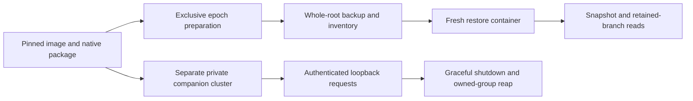

# Omnigraph foundation: source-pinned native campaigns

These are reproducible **P01O progress campaigns**, not WF24 admission or a production Writfold storage adapter. Omnigraph remains the intended primary backend. Dolt 2.6.1 is used only as the isolated supplied comparator; no fallback or dual writer is introduced. The immutable revision-4 handover remains unchanged.

**P01O/WF24 is blocked at the tested 0.14.0 pin:** a whole-root native backup restores old snapshot rows after relocation, but a retained branch still requests a Lance file at its original, unavailable path. The authenticated companion smoke passes independently. Do not weaken the restore check or convert either scoped result into backend admission.

The later [Dolt integration-only decision](dolt-integration.md) authorizes separate
disposable development realms and its own evidence. It does not change these
Omnigraph campaign results, waive WF24 or introduce fallback into this runner.

## Run once from the checkout

After concurrent source edits finish, select a new absolute receipt path outside the checkout:

```sh
python3 scripts/writfold_omnigraph_probe.py --campaign all \
  --receipt "$HOME/.local/share/writfold/evidence/omnigraph-foundation-new.json"

python3 scripts/writfold_omnigraph_probe.py --campaign companion \
  --receipt "$HOME/.local/share/writfold/evidence/omnigraph-companion-new.json"
```

The receipt and its sibling `.attempt` directory must both be new. Failed attempts are retained and cannot be reused. A subsequent attempt needs a new name. Do not delete failure evidence to retry. The wrapper performs actual existing operator-storage preflight before Docker inspection/execution. It does not build, pull, install, relocate, prune, or update the admitted tool image.

`all` is the default and currently fails the retained-branch relocation requirement before the companion phase. `companion` explicitly selects only the independent authenticated lifecycle smoke; it leaves epoch/restore scope unrun in that receipt and does not waive the failing foundation requirement.

Prerequisites:

- Linux/WSL x86_64 host, Python standard library, Docker Compose and the existing `ci-infra` storage binding used by `scripts/writfold_preflight.py` (including its reserve/resource policy).
- The exact locally present admitted `toolchains.lock.json` image and matching retained tool observation. Mutable tags and ambient native binaries are not accepted.
- The retained upstream archive at `~/.local/share/writfold/native/omnigraph/0.14.0/omnigraph-linux-x86_64.tar.gz`. Use `--archive /absolute/path/to/omnigraph-linux-x86_64.tar.gz` to select another retained copy of the same bytes. The runner deliberately does not download implicitly.
- Space for the 192,187,663-byte archive, approximately 540 MB of fresh extracted binaries per attempt, graphs and retained logs. The container allocation is two CPUs, 4 GiB RAM without additional swap, 256 processes and 256 MiB temporary storage. These are smoke containment limits, not product performance SLOs.

The archive was obtained from the [v0.14.0 release](https://github.com/ModernRelay/omnigraph/releases/tag/v0.14.0), retained at the default path with `release.json` and `provenance.json`, and SHA256-checked against the handover. If provisioning another host, download the [exact archive URL](https://github.com/ModernRelay/omnigraph/releases/download/v0.14.0/omnigraph-linux-x86_64.tar.gz) into a new retained file; the runner checks its size and digest before extraction. Never replace a mismatched retained artifact silently.

## Identity and containment

`qualification/omnigraph-profile.json` freezes the source commit, archive digest, all three observed regular member digests and supplied fixture hashes. Archive SHA256 is `02bde3e3a2c6c8cf50dc9739a8b1041df87cfeaa6ab59f620e1d8e32acffd4d9`; CLI SHA256 is `978e200a412e7b0db46657417d348569f97529c18b47e64687132e565d19dc64`. Server SHA256, independently streamed from the retained archive member, is `01720242435da9b2709dc62bfe703e1fd23a4b271f9b6bb093f1f1fbb4bb9aef`. This is package observation, not server admission. Source provenance is the handover/upstream release association, not a claim that these binaries were independently rebuilt.

Extraction accepts only the exact regular-file member allowlist, rejects links/special files/path traversal/duplicates, verifies every member, and mounts the package read-only. `compose.omnigraph.yaml` uses the admitted image, a read-only checkout and root filesystem, a fresh private writable scratch directory, no external network, dropped capabilities and the host UID/GID. No user graph, Docker socket, shared engine cache or existing database is mounted. The host holds an exclusive attempt lock.

The supplied CLI probes and epoch preparation run first, with no server. Independent restore runs in a fresh container whose writable mount contains only copied `backup.tar` and `backup.json`; original native roots are not mounted. The companion uses a different fresh cluster, stopped/exclusive CLI bootstrap and an exact-ID ownership handoff before the sole server starts. No direct graph CLI is used against that serving cluster.



The wrapper observes the actual CLI JSON version, Python/libc/OS identity and ELF loader-resolved dependency paths and hashes for each packaged executable inside the admitted image. It checks the Python and Dolt bytes against the admitted observation. The image digest binds the remaining runtime filesystem. `ldd` establishes the observed ELF dependency closure, not every possible dynamically loaded module, remote provider or production configuration.

The pinned [server entry point](https://github.com/ModernRelay/omnigraph/blob/60bfd19db780fdff3a5178f959c1204143420114/crates/omnigraph-server/src/main.rs) does not declare a version flag. The runner retains actual `--help` output and the expected exit-2 `--version` refusal. It records `server_reported_version: null`, rather than presenting the CLI version as an observed server version. Neither command starts a serving lifecycle.

## Evidence and limits

The source-bound supplemental receipt records the full source snapshot, admitted image/lock, actual preflight result, archive/profile/fixture identities, command timings/exits and hashes of retained attempt files. It refuses success if source changes during execution. Runtime observations are retained separately in `.attempt/work/runtime.json`. Unmodified supplied `compare.py` and `versioned_schema.py` run under Compose; their own assertions, commands, stdout/stderr, graphs and receipts remain under `.attempt/work/compare` and `.attempt/work/versioned-schema`. Wrapper logs survive failures, including supplied-probe exceptions. Interrupted Docker clients trigger forced container removal before ownership is released; a removal failure is itself a failed attempt and requires operator inspection of the recorded container name.

A supplemental `status: pass` applies only to its `selected_campaign`. The receipt always keeps `wf24: not_run`; successful bounded subscopes use `scoped-smoke-pass`, never full-gate status. It is not a gate-schema receipt. The separate current ledger records the known foundation blocker. A host/container crash may leave only reserved logs, not a final receipt; that is not success.

The supplied comparison and versioned-type probes remain unchanged. `writfold_omnigraph_epochs.py` adds separate physical graphs, complete canonical node/relationship comparisons, old reads after head advancement, retained branch roots and a complete quiesced backup. Restore validates every archived byte and requires every declared snapshot and native root to remain readable with original locations absent. The first retained-branch read currently fails; subsequent restored pins remain unrun. `writfold_omnigraph_companion.py` exercises actual authenticated transport and lifecycle, not a production supervisor.

Signed Writfold migration/CAS, complete semantic codecs, concurrent publication and writer replacement, uncertain-write recovery, crash/power-loss behavior, retention/GC, formal bridges, offline installation and frozen workload/SLO campaigns remain unqualified.

## Executed local evidence — 2 November 2026

`~/.local/share/writfold/evidence/omnigraph-0.14.0-001.json` records a successful
Compose run on the admitted WSL/Linux tool image: 12 comparison assertions and
6 versioned-schema assertions passed. The CLI reported source
`60bfd19db780fdff3a5178f959c1204143420114`, HTTP contract `0.14`, storage writes
`16`, and serves `[14, 16]`. The observed runtime was Ubuntu glibc
`2.39-0ubuntu8.9`; exact loader-resolved dependency hashes are in that receipt.

`~/.local/share/writfold/evidence/omnigraph-invalid-001.json` retains the expected
`Archive digest/size mismatch` refusal. Reusing the successful receipt path also
refused with `Receipt exists; choose a new attempt`, without overwriting it.
The immutable supplied fixtures and the first successful source snapshot remain
identified in the original receipt; later documentation/license changes do not
renew or broaden its scope.

## Separate epochs and native relocation blocker

`omnigraph-foundation-003.json` retains successful preparation of two separate immutable-schema graphs, complete record/mapping checks, old reads after head advancement and supported branch retention roots. Backup inventories include the entire native roots, schemas, queries, mapping and all three declared pins. Restore ran in a separate container with only copied backup inputs. Its archive and original-root absence checks passed, as did the first old snapshot's complete node/relationship reads.

Reading that old pin through `retained_seed` failed with `code: internal` and `disposition.effects: none`. The missing object was under the original `evidence/epochs/payload/epoch1.omni/__manifest/data/...lance`, despite the query target being `/evidence/restore/relocated/epoch1.omni`. This is not an incomplete-file-copy result: the exact whole-root inventory had already matched. The old explicit snapshot's success is not a substitute for retained-branch portability.

The pinned [storage contract](https://github.com/ModernRelay/omnigraph/blob/60bfd19db780fdff3a5178f959c1204143420114/docs/user/concepts/storage.md) treats the graph root as a unit and prohibits direct dataset edits. [Native branch creation](https://github.com/ModernRelay/omnigraph/blob/60bfd19db780fdff3a5178f959c1204143420114/crates/omnigraph-core/src/lance_clone.rs) delegates to Lance's branch operation. Location-dependent clone-origin references are an inference from the native failure and source, not an engine proof. No history-preserving relocation/rebinding command was found in the pinned [CLI surface](https://github.com/ModernRelay/omnigraph/blob/60bfd19db780fdff3a5178f959c1204143420114/crates/omnigraph-cli/src/cli.rs).

The blocker is retained in `~/.local/share/writfold/evidence/omnigraph-relocation-blocker-001.json`. A supported native remedy or a separately admitted fixed release is needed. Metadata rewriting, aliases that conceal the missing original root, skipping branch checks, logical export presented as native-history backup, and automatic Dolt fallback are not accepted remedies.

### Upstream report and reduced reproduction

[Omnigraph issue #1233](https://github.com/ModernRelay/omnigraph/issues/1233)
records the failure with a standalone, synthetic CLI reproducer. It was filed
on 2 November 2026 and observed open with `needs-triage`; maintainer acceptance
and a supported remedy remain outstanding.

The reduction uses one node and one retained branch, with no schema migration,
concurrent writer, cleanup or server. After every CLI exits, it copies the
complete root, compares every relative file's SHA256, and renames only its own
original root so the original pathname is absent. The relocated snapshot returns
the exact original row and graph commit. The retained-branch read exits 1 and
requests `original.omni/__manifest/data/...lance`, despite targeting
`relocated.omni`. This smaller case does not replace the earlier fresh-container
restore campaign: its source bytes remain retained at a different pathname.

The executed script, command logs and failed receipt are retained under
`~/.local/share/writfold/evidence/omnigraph-relocation-issue-001/`. The public
issue includes the script and exact output, not private reference material.
The latest published release checked during filing was still 0.14.0; newer
source was not executed. Location-bound clone metadata remains a hypothesis.
The report asks whether whole-root relocation is supported and, if not, for
the supported history-preserving restore procedure. P01O/WF24 remains blocked.

On 3 November, [ragnorc's contributor analysis](https://github.com/ModernRelay/omnigraph/issues/1233#issuecomment-6592078609)
reported independent reproduction on 0.14.0 and main `b68f367`, including a
child branch and branch-only snapshot lookup. It traces the dependency to
Lance clone `base_paths` and proposes graph-internal origin resolution without
rewriting retained manifests. These are attributed upstream findings, not a
locally executed fixed build.

Tarek supplied the [authorized fork](https://github.com/tknawara/omnigraph).
Following the [implementation offer](https://github.com/ModernRelay/omnigraph/issues/1233#issuecomment-6592350631),
upstream [accepted the bug as size L and took ownership of its RFC and code PR](https://github.com/ModernRelay/omnigraph/issues/1233#issuecomment-6594527176).
The issue is `needs-rfc`, not ready for a competing code PR. Any candidate must preserve exact
history/manifest identity, leave genuinely external bases and Blob URIs alone,
refuse missing copied closure without consulting the old tree, and cover the
still-present/divergent-original case. Fork availability is not backend
admission; independent Writfold implementation continues meanwhile.

Upstream's linked prototype rebinds in-memory catalog bases after checkout
without modifying retained manifest bytes or the native format stamp. Their
planned work includes centralized coverage of all catalog checkouts, explicit
legacy-fork and mismatched-base rules, relocated cleanup, RustFS/Azurite
evidence, and RFC 0029/0064 amendments. These are upstream plans/prototype
observations, not local admission. Retain the end-of-week fallback review and
test the exact accepted artifact against Writfold's closure/restore campaign.


## Authenticated companion evidence

`~/.local/share/writfold/evidence/omnigraph-companion-005.json` passes 19 scoped checks. The server binds only `127.0.0.1` inside a network-disabled container, uses private synthetic bearer credentials and an applied read/write policy, and reports readiness through an authenticated named query. Actual responses include 401 for absent/wrong credentials, 403 for a reader's mutation, and 400 for an unsupported HTTP contract.

The writer seeds nine synthetic entities and performs one named mutation. Complete rows and traversal responses match the expected old/new states, and old pinned reads survive the write. SIGTERM completes with exit zero, drained bounded logs, a reaped process, no surviving process group and a refused endpoint; no forced kill was needed. A bounded connection-refused readiness attempt is retained before readiness succeeds. This does not qualify crash/restart, lost-write responses or the entire production lifecycle.

The final `omnigraph-companion-006.json` adds a current-HEAD read after the denied mutation, checking that both the native pin and complete fixture state remain unchanged before the authorized writer runs. All 20 scoped checks pass. `omnigraph-foundation-007.json` exercises the final default/full dispatch and still refuses the independent retained-branch restore; selecting the independent companion scope has not waived that requirement.

`omnigraph-foundation-002.json` preserves the first fixture parser failure: the pinned CLI's root/lock diagnostic format differed from the initial source-derived expectation. `omnigraph-companion-004.json` preserves a Python `Path.open(opener=...)` setup error. The parser now checks the actual pinned diagnostic and complete/converged apply response; private token creation uses the supported exclusive built-in `open` API. Neither failed attempt was overwritten.

Upstream archive attestation verification was also attempted, but the installed host `gh` does not expose `attestation`. `native/omnigraph/0.14.0/attestation-attempt-001.json` under the external Writfold data directory records that blocker. Executable/archive byte checks still apply; no cryptographic upstream-attestation verification or independent rebuild is claimed.
