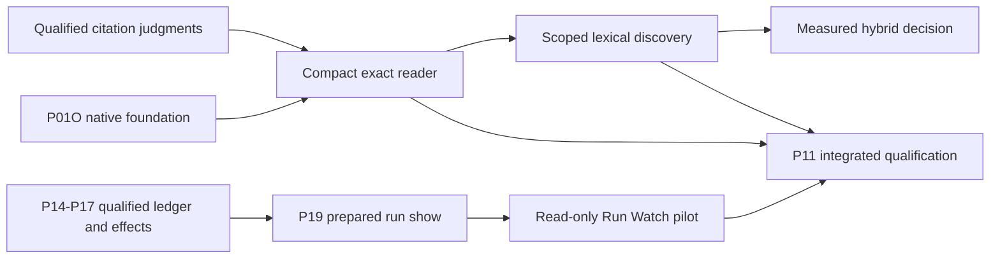

# Scoped revision-9 feature plan

Admitted for planning on 4 November 2026 after review of the supplied revision-9
handover. Tarek selected **features; separate proof-policy decision**. The exact
original is retained under
[`handovers/revision-9/writfold/`](../../handovers/revision-9/writfold/README.md).
[The adoption record](../../qualification/revision-9-feature-adoption.json) binds
its archive, manifest, selected scope, exclusions and investigation evidence.

## Authority and exclusions

Revision 5 remains the implementation, admission and release-gate authority.
This document is the controlling scoped supplement for the feature requirements
below. Where the original revision-9 package requires its universal proposal
floor, that requirement is **not adopted**. Reading or importing the package does
not activate its entrypoint, priority queue, proposal profiles or gate registry.
Historical handovers remain immutable; disagreements are recorded here, not
patched into the supplied bundle.

Adopt citation integrity and compact interactions, Run Watch/session handoff,
and authorized corpus-wide discovery as planned features. Preserve their formal,
production-refinement, native qualification and empirical obligations. This is
not permission to enable an unproved implementation, and it passes no gate.

The [shared proof-client reference requirements](shared-client-references.md)
fold Weft's WR1–WR8 integration request into these same epics. They require
realm/kind/revision-qualified durable references, a citation-table epoch distinct
from request correlation, faithful assessment/read-set metadata, bounded artifact
transfer and a pinned owner-published client contract. They do not add a separate
API or adopt Weft's language as Writfold semantics. The
[integration inventory](../../qualification/weft-integration.json) records exact
reviewed inputs, owner stages and still-unrun service acceptance obligations.

Specifically deferred:

- Plan 25's mandatory Lean-kernel instance certificate for every authoritative
  proposal, including the same requirement wherever repeated in other plans,
  stages, examples or screen text. Current checked witnesses, authorization,
  independent review, freshness, predecessor checks and conditional publication
  remain required; no existing proof or runtime guard is relaxed.
- CIT07's universal new admission floor, V23's corresponding new production
  boundary, `proposal-proof-profiles.json` and the proposed instance-receipt
  schema. Their trust-root, worker, certificate and invalidation policy remains
  a separate decision. Proving a general rule and checking each instance through
  qualified production predicates is distinct from requiring a fresh Lean
  specialization for every material proposal.
- Wholesale activation of P03C/P05C and WF32/WF33. The original stages combine
  accepted feature work with the deferred policy. They are traceability
  references, not independently enabled stage/gate producers. Their identifiers
  must not be repurposed silently.
- The separate proof-query demo, its language/runtime architecture and any SAT,
  LRAT or Metamath runtime dependency. It remains exploratory, not a Writfold
  feature, trusted verifier, admission route or fallback.
- Per-observation TTL changes, a general graph canvas, automatic learning from
  traffic, arbitrary graph mutations and remote embedding-provider fallback.

The active inventory remains 25 stages, WF00-WF31, 37 V/M entries, E01-E12 and
148 scenarios. The supplied package separately inventories 27 stages, WF00-WF33,
39 V/M entries, E01-E12, CIT01-CIT08 and 164 scenarios. Neither that candidate
inventory nor its `not_run` labels replaces current implementation evidence.
The completed revision-5 mathematical work keeps its exact recorded scope.

## Citation integrity and compact operations

Sources: [plan 24](../../handovers/revision-9/writfold/plan/24-citation-calculus.md)
and [plan 26](../../handovers/revision-9/writfold/plan/26-compact-citations-and-followups.md),
subject to the exclusions above.

1. Keep **resolve**, **compare** and **assess** distinct. Historical resolution
   reads the original retained representation; correspondence addresses an
   explicitly named target; assessment applies the existing signed context.
   None refreshes an observation or transfers approval implicitly.
2. Start with half-open byte selectors into exact retained Git blobs. Bind realm,
   repository/path provenance, source revision, representation/profile, selector
   units and selection identity. Preserve legacy public tokens and signed bytes.
   Refuse unsupported selectors. Native UTF-16/Docs mappings require a separately
   qualified profile; a Markdown export is its own representation.
3. `find` returns bounded candidate handles and coverage; `peek` expands exact
   retained evidence; `cite` expands the durable public citation and may prepare
   an explicitly authorized candidate binding; `compare` reports justified
   correspondence, ambiguity, evidenced deletion/replacement or uncertainty.
   Citation rendering is not authoritative attachment. Any selected binding
   still goes through the current qualified admission boundary.
4. A compact handle is neither a portable identity nor a capability. Bind its
   table generation, authorized session/run, realm, context and cut. After
   compaction or reconnect restore that exact mapping or return Expired. Recheck
   access at expansion and attachment; never use the most recently viewed file
   to infer the handle's scope.
5. Preserve search coverage separately from presentation completeness. Truncation
   cannot establish uniqueness or absence. Do not hide material contrary, stale
   or ambiguous evidence in an apparently complete packet. Pin continuation
   cursors to the query, cut, profile, ordering and budget contract.
6. Equal bytes, normalized text, a symbol name or even one exhaustive textual
   match do not establish semantic lineage. A successor needs a qualified
   correspondence witness; unsupported moves/renames may conservatively remain
   Unknown. The copied-line fixture must not attach the old occurrence to the
   inserted copy. Historical resolution must still select the original bytes.

Proof targets CIT01-CIT06 and CIT08 are accepted as feature requirements, not
completed declarations. Preserve legacy T01-T22 and signed-context expiry rules.
Qualify the actual Rust selectors, handle expansion, coverage, correspondence
and reuse decisions (the V22 feature scope), with explicit Lean-to-production
mapping and applicable M01/M02/M03 retention/publication/recovery bridges. Extend
other existing design/view/epoch/learning/cut models only where these features
change their operations; no cross-prover refinement is inferred from agreement.

Acceptance includes copies and moves, changed semantic context, incomplete
search, missing or inaccessible retained material, evidenced deletion, mixed
coordinate units, Unicode/CRLF, empty and invalid ranges, scope collisions,
revoked grants, changed indirect dependencies and independent valid witnesses.
Compare complete repeated tasks against competent targeted search plus kctx,
including handle acquisition, follow-up expansion and compaction recovery.
Measure actual tokens, round trips, latency, omissions and wrong attachments.
No token-saving claim follows from the supplied payload-size example. Keep a
compact default opt-in if the stronger baseline wins; citation safety remains
mandatory regardless of that presentation choice.

## Run Watch and session handoff

Source: [plan 27](../../handovers/revision-9/writfold/plan/27-run-watch-and-session-handoff.md)
and its retained five-screen design. Adopt the read-only Gates default,
Pipeline, Citation and Effects views; proof-instance labels in those mockups are
not adoption of plan 25. Render the actual governing prerequisites instead.

- A logical change owns a durable RunRef, not a chat, branch or current directory.
  Several chats can resume one run; one chat can discuss multiple independent
  runs. Lookup, status questions and opening a viewer do not create runs.
- Persist the task's start-request key before submission. Atomically bind the
  authenticated realm/principal/key, canonical immutable request digest, RunId
  and first ledger event. Identical retries recover the same run; conflicting
  intent under the same key refuses. Lost acknowledgement is not permission to
  invent another key or infer identity from a title.
- Start returns only after durable commit. Proposed is not activated. Recovered
  drivers must recheck procedure, repo vector, completion boundary, current grant,
  owner generation and unresolved effects. Writer transfer retains the existing
  quiescence/fencing rules. A reader never claims the writer.
- CLI and RPC use one typed service. Planned surfaces are `run start`, `run list`,
  `run show`, `run show --at` and `run watch`. A RunRef carries no grant and resolves
  in the configured realm independently of the working directory. Non-TTY users
  use `show`; an unavailable historical cut must not silently become latest.
- Render one immutable RunView, with corpus/procedure/repo pins, ledger prefix,
  projection epoch/cut, sampled head and disclosed lag. On gaps or epoch changes,
  reacquire a consistent snapshot. Historical test receipts cannot turn a new
  revision green. Agent prose and ordinary unobserved shell activity do not
  advance the ledger.
- Closing a viewer only detaches it. An unknown external outcome retains its
  EffectId and reservation until reconciliation; watch cannot redispatch it.
  A confirmed PR opening does not imply review or merge.

Implement durable intake and `show` before the Ratatui surface. Map intake,
response-loss, reader-noninterference and takeover into the existing E/V/M
contracts before enabling them. Require concurrent identical/conflicting starts,
new-session recovery, two independent readers, stale receipts, rebase/reconnect,
revocation and lost-forge-response cases. The installed WSL pilot must compare
`show` with `watch` on blocker/revision/next-evidence/outcome identification,
including narrow-terminal fallback. Screens and fixture checks are not runtime
or usability qualification. Session-driver import/activation and provider effects
remain separately authorized; this adoption activates neither.

## Authorized corpus-wide discovery

Sources: [plan 30](../../handovers/revision-9/writfold/plan/30-corpus-discovery.md)
for the product boundary, [plan 28](../../handovers/revision-9/writfold/plan/28-similar-incident-discovery.md)
for the first incident benchmark, and
[plan 29](../../handovers/revision-9/writfold/plan/29-omnigraph-capability-fit.md)
for capability choices, not new native-backend qualification.

- One `find` searches qualified, readable kinds at an authorized named context and
  pinned release. Preserve kind, asset, exact revision, representation, selector
  and evidence role. Deduplicate exact bindings only; a review and policy sharing
  an external numeric ID are different objects. Exact identifiers use exact
  lookup first. Budget across independent assets, not just their chunks.
- Ranker output is untrusted candidate material. Resolve against the canonical
  registry before issuing handles, and recheck access/retention at `peek`.
  Similarity cannot establish equivalence, causal diagnosis, policy precedence,
  present ownership, procedure activation or authority to execute.
- Scope ranking inputs as well as returned rows: corpus statistics, ANN windows,
  snippets, counts and explanations must not depend on inaccessible material.
  Final ACL filtering alone is insufficient. Use a qualified same-scope lexical
  path or disclose unavailability when stronger isolation is not established.
- State coverage by qualified mode and requested kind without leaking hidden
  inventories. Empty search is not proof of absence. Preserve historical,
  superseded, draft and admitted roles distinctly. Live activity requires its
  separately authorized watermark-bearing view, never an implicit corpus merge.
- Derived index generations bind the source cut, input/dependency closure,
  chunker/tokenizer, model/configuration, normalization, query template, engine
  pin and ranking parameters. Publish a validated immutable generation
  conditionally; retain actual ordered results for replay of approximate search.
  Embedding failure must not fabricate vectors or call an unapproved provider.
- Start with scoped lexical search. Hybrid ranking is conditional on a frozen,
  blinded comparison against the stronger competent-search baseline, with
  held-out incident families, hard negatives and no-answer cases. Measure exact
  cited answers, wrong-cause transfers, omissions, total task tokens, p50/p95
  latency and index/model cost. An inconclusive result leaves hybrid off.
  Add a separate mixed design/review benchmark; incident success does not
  qualify every kind or procedure selection.

The supplied discovery Lean module is an abstract model with assumed checked
visibility/retention predicates, not a Rust or Omnigraph proof. Cross-kind safety
requires a kind-qualified identity or a proved globally injective AssetId. Retain
the read-erasure, eligibility/revocation and authorized-projection requirements,
then qualify the concrete adapter and index-publication interleavings with the
existing Lean/Verus/TLC/TLAPS discipline. Supplemental Metamath evidence does not
replace those obligations or add a product dependency.

## Execution dependencies and gate integration

The existing dependency order remains controlling. Citation calculus and retained
fixture work can proceed independently of the known storage blocker. Native
search/index integration cannot bypass P01O/WF24. Run intake, drivers, effects
and cross-repository work depend on P14-P17; prepared run views depend on P19.
Final composed qualification still belongs to P11, then packaging/launch.

Before any feature becomes an enabled production path, its implementation slice
must add the scoped requirement/theorem/caller/scenario mappings and executable
receipt producers to current qualification tooling. Record partial features as
partial; do not treat revision-5 release aggregation as covering these additions.
Do not silently activate the original mixed-policy WF32/WF33 definitions. Freeze
feature-specific gate definitions in the mutable adoption delta, preserve the
original IDs and bytes, and obtain a separate decision before introducing the
excluded universal certificate requirement. This plan is not a release waiver.

## Exercised evidence and limits

The retained investigation report is
`~/.local/share/writfold/evidence/handover-review-20261104-001.json` (exact hash in
the adoption record). It preserves failed invocation/isolation attempts and
successful replacements. Execution used the existing storage admission and
pinned Compose tool image, with network disabled and source mounted read-only.

- All 359 listed revision-9 files matched the supplied manifest; package checks
  validated 27 stages, 34 gates, 39 V/M entries, 164 scenarios and 68 atlas pages.
- Citation-profile structure, engineering vectors, Run Watch fixtures, 720
  synthetic rankings and mixed-kind fixtures passed their respective checks.
  The independent finite Python index model explored 276 states / 1,640
  transitions and found counterexamples for all three supplied guard mutants.
  This is not TLC or TLAPS evidence.
- `CaseDiscovery.lean` checked with Lean 4.21.0. Its eight printed declarations
  depend on no axioms or only `propext`. This standalone result does not close
  CIT01-CIT08, adapter refinement, privacy, native storage or product gates.
- The external proof-query demo replayed its exact pinned two-line refutation,
  checked SAT assignments and rejected tampered evidence and invalid/reused
  certificates through LRAT-TRIM. The comparison-only checker accepted both
  invalid controls and remains excluded. This is not a Writfold runtime path,
  semantic-lineage proof, language implementation or admission mechanism.

No product TUI, native discovery, held-out token benchmark, new citation writer,
proposal worker, live provider effect or website publication was exercised by
this planning adoption. The known Omnigraph relocation blocker was not rerun.

## Citation components implemented after planning adoption

The [Rust component boundary](semantic-core.md#rust-citation-component-boundary)
now includes pure selectors/resolution/correspondence/aliases/pagination/reuse,
strict citation descriptors and fingerprints, and contained native Git capture.
The [shared-client byte contract](shared-client-references.md#implemented-citation-byte-boundary)
keeps native Git blob identity, whole-capture SHA-256, selected-byte SHA-256,
logical IDs and scoped aliases distinct. It preserves the legacy observation
content projection instead of substituting a Git object ID.

The current component tests exercise both native Git object formats, packed and
loose histories, corruption/refusals, exact Unicode/CRLF/binary/empty selections,
scope collisions/revocation and actual child-process reaping. A real static-musl
consumer exercises the composed library boundary. Its isolated missing-reap
mutation fails while the unmodified control passes; each variant uses a distinct
build cache and must compile its own source. Failed attempts remain retained.
Exact receipts, source identities and applicability belong to
[`qualification/status.json`](../../qualification/status.json), not the immutable
planning registries.

These are not enabled production `find`/`peek`/`cite` methods, corpus authorization,
durable alias restoration, an installed CLI/stdio host or an empirical token win.
P01O/WF24 still blocks storage-dependent integration; P14–P19 retain their existing
prerequisites. No stage/full-gate completion, fallback backend, Weft-specific API,
TUI capability or universal per-proposal certificate policy is implied.
