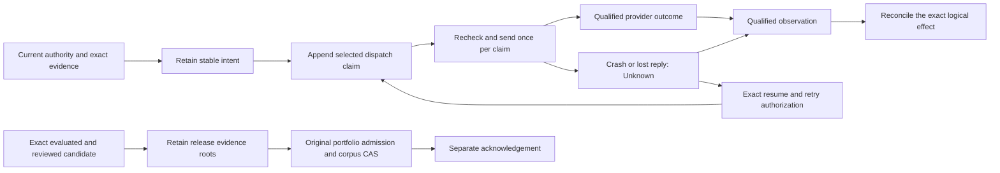

# Rust semantic core

The IO-free `writfold-kernel` core implements the retained semantic-2.0.0
checker, mathematical time rules, and whole-candidate invariants. The legacy
Python and Lean theorem sources remain unchanged compatibility material;
revision 5 adds the separate engineering reference described below. The
source-sealed Rust executable-body campaign is not a Lean-to-Rust refinement
theorem or a whole-product qualification.

## Source mapping

| Reference module/functions | Rust owner |
| --- | --- |
| `semantics/time.py`: `fresh_at`, `assess_fresh` | `time` (same public names) |
| `semantics/checker.py`: `context_matches`, `source_selected`, `inventory_content`, `retracted`, `dependencies_union`, `correction_dependency`, `check`, `accepted`, `supported`, `same_context` | `checker` (same public names) |
| `semantics/checker.py`: `_check`, all six witness branches | private `checker::evaluation::{evaluate,evaluate_valid,attest,enumerate}` |
| `semantics/checker.py`: `reusable`, `witness_freshness`, `policy_allows`, `assess`, `usable_for`, `assessment_gaps` | `checker` exports from private `assessment` |
| `semantics/wellformed.py`: `nonempty`, `natural`, `ttl_wf`, `scope_wf`, `formula_wf`, `statement_wf`, `context_wf`, `witness_wf`, `dependency_wf`, `well_formed` | `wellformed` (same public names) |
| Whole-candidate attestation, enumeration, correction and supersession-cycle checks | `wellformed::{rows,graph}` |

The domain's nominal values eliminate Python runtime type confusion. They do
not turn candidate records into evidence or grant production authorization.
The existing model approval wrappers remain reference assumptions.

## Public calling convention

All KB/context/reference/witness/receipt inputs are borrowed. `supported`
receives its final `Polarity` by value. `check` returns `Option<Checked>`;
`accepted<'a>(&'a KB, &Context, &ClaimRef)` returns
`Vec<(&'a Witness, Checked)>`. Witnesses in accepted results belong to the KB;
only retained checked outputs own their dependency records.

`assess` returns `Assessment`, and `assessment_gaps` returns ordered
`Vec<String>` diagnostics. `dependencies_union` takes two dependency slices;
`witness_freshness` takes a context and dependency slice. `inventory_content`
takes a string slice and returns `ContentId`. `correction_dependency` returns
the domain's `Dependency::Corrections` variant. `policy_allows` takes the
seven Boolean arguments in reference order. Time functions take
`(&Ttl, &Integer, &Integer)`, returning `bool` and `Freshness` respectively.
Well-formedness helpers take borrowed domain values and return `bool`;
formula, statement, witness and dependency helpers take the KB second.

Internal evaluations borrow evidence, scopes, atomic conclusions and context
frames. Composed formula ownership moves upward rather than recursively
copying already-built conclusions. Boolean support queries short-circuit;
assessment reuses its selected accepted alternatives for freshness and
validation. No query duplicates the KB or materializes owned evidence merely
to compare a conclusion or receipt.

The recursive evaluator validates its immutable context frame once, then
checks each witness branch against that same KB/frame. Ghost-only content
views describe exact ordered footprints without adding fields to runtime
records. `checker::spec` exposes the mathematical contracts consumed by
admission and selection; it is not a second executable checker.

For workflow candidate evaluation, `usable_for_snapshot(&KB, &Context,
&SnapshotId, &ClaimRef)` and `check_matches_snapshot(&KB, &Context,
&SnapshotId, &Witness, &Statement)` use a concrete borrowed context frame.
Only the snapshot changes; policy, time, source order, intended use and target
remain the base context's values. `check_matches(&KB, &Context, &Witness,
&Statement)` offers the corresponding no-retained-output ordinary check.
These predicates do not establish registration or non-retraction of a target
claim on their own: workflow callers separately enforce the reference's
exact derivation registration and claim acceptance conditions.

## Preserved decisions

- Time arithmetic uses signed arbitrary-precision `Integer`, including
  direct evaluation of negative TTLs. Equality at expiry is fresh. Future
  observations and missing policy are unknown. Well-formed candidate
  contexts independently reject negative time or negative expiring TTL.
- Attestation, truth, conjunction, specialization, absence and universal
  witnesses retain their individual premises. Inventory completeness uses
  exact ordered members/universe equality, uniqueness, nonempty query and
  method, selected successful nonfuture observations, and byte-framed content.
  The framing counts UTF-8 bytes, not Unicode characters.
- Dependency unions preserve first-occurrence order and compare complete
  records. Correction dependencies retain only matching events effective at
  evaluation time, in KB order. Context dependencies normalize only `now` to
  zero. A receipt requires exact witness and ordered dependency equality,
  exact context except time, a passing result, and inclusive validity bounds.
- Retraction removes dependent derivations without erasing independent ones.
  Dispute and contrary support contest claims; supersession does not transfer
  validation. Whole-candidate validation detects supersession cycles without
  applying evaluation-time filtering to the history.
- References always resolve to their first KB row. A contrary candidate row
  selects a reference; accepting its derivations still uses that reference's
  first row, not the later candidate's statement. Direct pure APIs retain this
  rule even for unadmitted duplicate-reference KBs. The wire boundary separately
  refuses those KBs through whole-state validation.
- Positive and negative support, applicability, freshness, validation,
  contestation and availability remain independent. Any fresh accepted
  alternative makes freshness fresh; all-stale alternatives make it stale;
  otherwise it is unknown. Within one witness stale outranks unknown.
  Policy applies to the selected claim's polarity, including negative claims.
- Recursive formula/witness operations do not invent depth-based semantic
  refusals. Resource bounds belong to the wire admission profile.

## Tests and remaining assurance

`crates/writfold-kernel/tests/core.rs` and its `core/first_match.rs` regression
cover inclusive/future/signed/unbounded freshness, independent witness
revocation, exact receipt ordering and context matching, borrowed snapshot
evaluation, contradictory evidence, first-match duplicate references,
independent assessment dimensions, and UTF-8 inventory framing. The retained
334-scenario three-host corpus remains unchanged.

The sealed P03 integration in
`~/.local/share/writfold/qualification/p03-kernel-010/native-smoke.json`
compiled and executed the static musl `writfold-ref` with `PATH=/nonexistent`.
All 335 responses (handshake plus 334 scenarios) matched both retained
Lean and Python responses field-for-field. This exercised the composed
borrowed checker, assessment, receipt-reuse, well-formedness, admission and
selection implementations. It reused retained oracle outputs; it was not a
fresh three-host gate, whole-kernel proof, or P03 completion. Failed proof
and native-build attempts remain alongside the successful runtime record.
Inventory premise comparison traverses the borrowed conjunction/atomic tree
directly, preserving ordered members, exact predicates, empty arguments and
the terminal truth node without allocating a duplicate expected formula.

The 3 November source-sealed `unblocked-proof-20261103-020` campaign completed
the whole-crate Verus invocation with **428 obligations verified and zero
errors**, at the normal solver resource limit. This covers the checked
decision bodies and proof helpers, including borrowed context projections,
ordered footprint materialization, assessment/reuse, workflow, portfolio and
design contracts. Ordinary Rust diagnostic rendering and trusted external
implementations are not thereby proved. No decision-body exclusion or new
assumption was introduced to close the campaign.

Earlier failures remain retained. In particular, the first-receipt theorem
exhausted an 8 GiB solver allowance when expressed directly over the full KB;
a generic first-match congruence lemma using the shared lookup lemmas closed
the same obligation without expanding reuse semantics or increasing limits.

The duplicate-reference discrepancy was reproduced through direct Rust,
Python and Lean APIs before correction. Rust incorrectly reported negative
support where both references reported none. The implementation and model
now resolve the canonical first row; the permanent positive control also
preserves the reference's `Both` result when that first row has an accepted
positive witness. Rejecting all invalid KBs or ignoring duplicate rows would
not satisfy that contract.

Exact current source/compilation/calibration links belong in
`qualification/revision-4-progress.json`. Full V02–V06/V12/V13 closure,
caller/integration admission and cross-logic correspondence remain separate
obligations; counts, finite agreement and a correctly checked Rust model do
not establish them automatically.

## Revision-5 engineering calculus progress

`formal/Kctx/Engineering/` now models the three semantic graphs through a
typed procedure IR, invocation-specific control and returns, shared root budgets,
per-stream immutable records and expected-head selection. Captured historical
premises are distinct from current authorization. The interpreter does not accept
a successor merely because an invariant checker approves it.

Physical send and completed corpus publication are separate from ledger append.
The environment models time, revocation, policy/correction changes, provider
changes, external completion, reply loss and generation-bound process termination.
This is an executable mathematical reference, not the production engine.

The reference exercises nested calls, typed dependencies, Join and non-success
returns; immutable delegation snapshots; bounded resource loading; exact
receipt reuse; competing learning publication and lost acknowledgement; and
complete old/new cuts across native epochs. Missing retained material refuses
instead of consulting mutable HEAD. Destructive GC is disabled.

Qualified retries retain the logical intent but obtain a fresh claim and current
authorization. A duplicate application response cannot rewrite current provider
state. Recovery alone does not make old invocations live, reload their context,
renew receipts, or release owned process trees.
Prepared intents retain their reservations until explicit cancellation or settlement;
quiescence cannot strand an unresolved intent while transferring its resource.
`World.replies` records untrusted transport delivery/loss for observable traces;
only qualified observations can classify an effect.

`revision-5-engineering-lean-complete-002.json` records clean offline kernel
acceptance and a transitive audit of **571 declarations**: 353 unchanged legacy
declarations, 176 engineering roots and 42 nonvacuity declarations. All **66
reference cases** pass; only `propext`, `Classical.choice` and `Quot.sound` occur.
Independent statement review closed all E01–E12 findings under the explicit
assumptions. These theorems quantify arbitrary finite traces of the model, not a
fixed TLC exploration bound.

The expanded semantic campaign kills nine actual interpreter mutations. Every
changed model compiles, an actual execution violates the expected behavior, and
the intended safety declaration fails. It includes stale heads, timeout
misclassification, privilege amplification, stale evidence/provider state,
canonical-reply rollback, publication before retention, process-generation reuse
and release of a live prepared intent. Failed calibration and build attempts remain
retained. The old 407/30/4 result applies only to its first-increment sources.

The [formal registry](../../formal/engineering-theorems.json) maps the expanded
statements and essential negatives. The [qualification index](../../qualification/engineering-theorems.json)
and [revision-5 progress](../../qualification/revision-5-progress.json) retain
exact evidence and historical scope. Source/status changes require a fresh
matching receipt; a scoped pass never closes full product WF31 or Rust refinement.

## Engineering/1 Rust byte boundary

`writfold_domain::engineering` exposes 16 private-array nominal digest types and
the sealed `EngineeringDigest` trait. Parsing requires the exact
`wf1:<kind>:sha256:<64 lowercase hex>` form; no trimming, case folding, algorithm
substitution or cross-domain coercion occurs. `from_digest` wraps supplied bytes
only and does not authenticate or validate a payload.

`writfold_wire::engineering::cbor::Value` borrows text, byte strings, unbounded
`Integer` values and container contents. `encode` returns owned canonical
`RawCbor`; `RawCbor::parse` validates canonical input without copying its bytes.
Both use the existing byte/depth/container-entry/value-node `Limits` and iterative
traversal. Native integers and minimal tags 2/3 share one mathematical encoding.
Maps have unique text keys in encoded-byte order; arrays, Unicode and line endings
remain material. Nonminimal headers/bignums, invalid UTF-8, unsupported tags,
floats, indefinite lengths, truncation and trailing bytes refuse.

`fingerprint::<D>(&raw)` streams the profile/kind/NUL prefix and the exact
canonical bytes into SHA-256. No temporary concatenated preimage is allocated.
The 18 hand-encoded vectors and four frozen fingerprint fixtures exercise this
boundary. A real static-musl program also exercises canonical encoding, typed
hashing, wrong-domain refusal and negative bignum parsing.

The actual nominal parser, constructors and accessors are Verus-checked inside
the whole domain crate. This is not verification of the CBOR encoder/parser,
SHA-256, formatter, cryptographic assumptions, or the full V16 ledger obligation.
Schema validity, complete input capture, current authority and receipt reuse
remain separate application decisions. No ledger writer or new graph owner is
introduced by these primitives.

## Scoped citation calculus

The selected revision-9 feature contract is implemented mathematically in
`formal/Kctx/Citation/`, with a separate root, executable and
[`formal/citation-theorems.json`](../../formal/citation-theorems.json).
It covers CIT01–CIT06 and CIT08. CIT07 and universal per-proposal Lean
certificates are not part of this extension.

| Boundary | Executable model and statement |
| --- | --- |
| Exact resolution | Full realm/repository/revision/path/content/profile key, byte units, half-open bounds, expected preimage and access-before-disclosure. Missing objects, invalid bindings and denial remain distinct. |
| Historical stability | Retention rejects an existing key; arbitrary finite append histories preserve previously resolved exact bytes under unchanged authorization. |
| Correspondence | Only the same immutable occurrence with a checked identity witness can justify transport. Bounded text enumeration reports actual positions and coverage, never lineage or deletion from a singleton/empty result. |
| Scoped aliases | Audience, generation, named context, release, lifetime, stored binding and current access are checked. Appending a handle cannot replace an older mapping. |
| Presentation | Cursors bind the complete prepared query, source notices, ordering/profile and budget. Omitted notices make the packet partial; pagination cannot upgrade underlying search coverage. |
| Reuse | Exact current bindings and named context must match the retained validation; each source must occur in the legacy witness's observation footprint. Original correction, policy, time and reuse checks remain mandatory. |
| Conservation | The closed citation updater cannot write engineering state. Erasing arbitrary interleaved citation/core/environment/refusal traces yields the original engineering trace and exact knowledge/journal admission history. |

`Coverage.unavailable` is not `Coverage.measured 0 0`: only the latter describes
an actually exhaustive empty enumeration. An invalid-but-present original
comparison carries `originalInvalid(reason)`, not an unavailable-source claim.
The initial transport profile deliberately leaves unsupported source-history
transformations unknown; exact same-position evidence does not establish program
meaning or the truth of the citing claim.

The model uses exact byte preimages and mathematical coordinates. Production
capture, hashing, checked machine conversions, current authenticated access,
already-authorized prepared notices and durable scope restoration are separate
refinement/adapter obligations. No new `Witness` or `Derives` constructor, legacy
theorem source, root import, signed byte domain or context-freshness rule changes.
Acquisition scheduling hints live outside knowledge and cannot retimestamp it.

The reference contains 90 executable positive/negative cases. Incremental
diagnostic `citation-development-20261104-007/report.json` executed all 90.
`citation-mutation-smoke-20261104-001/report.json` exercised nine actual semantic
source mutations: each changed model compiled, a concrete violating witness was
kernel-checked and executed, and its intended safety declaration was rejected.
The matching unmodified controls passed. These diagnostics are retained under
`~/.local/share/writfold/evidence/`, together with the initial clean-build failure
and subsequent development failures; they are not a clean gate receipt.

`scripts/gate citation-lean --receipt <new-external-path>` is the clean
source-bound producer: legacy/engineering/citation build, transitive axiom audit,
native reference execution and semantic calibration. Its receipt has
`citation-lean-only` scope under WF08. Consult `qualification/status.json` for
current receipt admission; command availability and these diagnostic counts
cannot close WF08, a Rust refinement obligation, a product stage or release.

