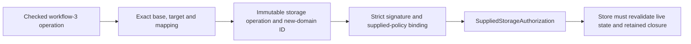

# Signed operations and supplied-policy authorization

This is an implemented wire/cryptographic boundary, not a release qualification or a proof of Rust semantics. The immutable Python implementation remains the historical reference. No store publication capability is exposed here.

## Typed input and preparation

`writfold_wire::operation::Operation::decode(bytes, limits)` admits exactly four bodies:

- `OperationBody::LegacyAdmission(LegacyAdmissionPlan)` — schema 2;
- `OperationBody::LegacySelection(LegacyReleaseSelectionPlan)` — schema 2;
- `OperationBody::PortfolioAdmission(PortfolioAdmissionPlan)` — schema 3;
- `OperationBody::PortfolioSelection(PortfolioReleaseSelectionPlan)` — schema 3.

Each has private fields and typed semantic records decoded through the existing semantic codecs. Unknown fields, duplicate JSON keys, unsupported versions, invalid identities, mismatched inner/outer IDs and incorrect canonical identities are rejected. The SHA256 operation identity covers the full outer object **after removing both outer `id` and semantic `plan.id`**. Ordered captures, contexts, assignments, selected claims and retirements are not sorted. `canonical_bytes()` retains the complete canonical outer operation, not just its semantic plan or digest.

The operation owns one canonical domain-prefixed signing buffer. `approval_message()` borrows that complete message; `canonical_bytes()` borrows the suffix after the fixed domain. Signing and verification do not allocate another plan-sized message. Identity hashing temporarily detaches and restores only the two ID fields in its private raw tree; it never recursively clones untrusted JSON before semantic admission.

`Operation::prepare_admission` and `Operation::prepare_selection` take typed schema-3 semantic inputs plus the typed outer closure, assign both canonical IDs, and return a new immutable operation. An input semantic ID is not trusted or preserved. An already prepared operation is never mutated or silently refreshed. There is no legacy preparation/upgrade/signing factory. A changed plan requires a separately prepared and approved operation.

Preparation and decoding establish representation and content identity, not semantic validity, source authenticity, current predecessor, durable capture retention or publication permission. Those remain kernel/store premises.

## Policy identity and projections

`AuthorityPolicy::historical(bytes, limits)` preserves the original bytes and hashes those exact bytes as its policy identity. It validates schema 2, exact fields, trusted-key identity grammar, exact 32-byte upper/lower hexadecimal syntax, and distinct nonblank use strings. Historical policy identity text remains opaque and untrimmed, including text that cannot be used in a new semantic bootstrap.

`AuthorityPolicy::new_bootstrap(bytes, limits)` additionally checks every public key can be decoded and is not weak, checks `bootstrap:<kb_id>` as a semantic `SnapshotId`, and checks the unmodified policy version as a semantic `PolicyId`. Only then does it admit the identity of canonical policy bytes. It does not trim opaque string contents, lowercase a policy's public-key text, or rewrite the original artifact. `original_bytes`, `original_digest`, `canonical_bytes`, `identity` and `profile` distinguish provenance from the admitted identity. Formatting-only historical policy differences still have different historical identities; canonical new anchoring is an explicit operation, not a migration of old signatures.

`authorized_actors(use)` and `validate_context(context)` are immutable projections, not another policy writer. Every current context must carry the exact semantic policy ID and the exact set of authorized actors, without duplicates. Context ordering and actor list ordering in signed bytes remain unchanged.

## Cryptography and authority limits

`ApprovalSigningKey::from_pkcs8_pem` imports only unencrypted Ed25519 PKCS8 PEM through actual `ed25519-dalek`. `sign(operation, policy, key_id, expected_toolchain)` signs exactly the prepared schema-3 operation, checking its designated actor, the actual public key derived from the private key, policy identity, every context use, semantic actor projection and toolchain digest.

The signed message is exactly one selected historical domain followed by the complete canonical outer operation:

- schema 2: `kctx-operation-v2` + NUL + canonical operation bytes;
- schema 3: `kctx-operation-v3` + NUL + canonical operation bytes.

There is no domain fallback. Approval schema/plan/key must match the operation. Approval signatures accept upper/lower hexadecimal on input and emit lowercase hexadecimal. Declared portfolio use must occur in the family, and the actor's policy key must permit that use and every context's use.

`verify_current(operation, approval, policy, expected_toolchain)` accepts only schema 3 and uses strict Ed25519 verification with explicit weak-key refusal. Its private-field `SuppliedAuthorization<'a>` borrows the exact supplied operation, approval, policy and expected toolchain. It does **not** establish that the caller supplied live store state or a trusted policy anchor. There is no public Boolean/trait factory for this result. The final store facade must load and recheck the actual policy, toolchain and predecessor, discharge semantic/state/capture checks and own publication capability. `ModelApproval` and related kernel reference wrappers are not IO authority and cannot replace this boundary.

`inspect_historical` checks historical bindings and reports `HistoricalEquation::{Rejected, StrongStrict, WeakOrNonStrict}`. Even `StrongStrict` is an inspection result, not publication authority. Legacy context equality and declared-use policy checks follow the historical adapter; legacy inspection does not retroactively impose the schema-3 context-family projection contract.

WF-AUTH-001 preserves the observed pinned Python acceptance of an identity-point public key (`01` plus 31 zero bytes) and identity-R/zero-S signature (`01` plus 63 zero bytes) for arbitrary messages. Dalek's ordinary verification result is retained for historical inspection and explicitly distinguished from strict/strong acceptance. Weak/non-strict results cannot mint current authority. New bootstrap rejects weak keys. No automatic re-signing, rewriting, restoration of authority or re-anchoring is supplied. The retained vectors exercise this named compatibility case and ordinary strong-key signatures; they are not a universal equivalence proof for every malformed point/scalar accepted by every OpenSSL version.

## Storage-aware operations and approvals

`storage_operation::StorageOperation::{prepare, decode}` binds an unchanged,
checked **workflow-3** operation to an explicit storage transition. The closed
schema-1 envelope has exactly `namespace`, `schema`, `id`, `operation`, `base`,
`target` and `mapping`; its namespace is `writfold-storage-operation`.

The nullable base contains exactly a completed `release` and versioned storage
`pin`. Its presence/release must equal the embedded operation's base. The target
binds Omnigraph backend, KB, graph, epoch/schema/query identities, storage profile,
native format and producing tool generation. It deliberately contains **no
candidate native commit**, avoiding a circular approval of a commit derived
from its own signed input.

Base and target KB identities must match. Legacy import, or a changed
graph/epoch/schema/query/profile/native-format binding, requires an explicit
mapping digest. A producer-only upgrade does not itself require a data mapping.
A bootstrap has neither base nor mapping. These are structural binding rules;
the digest does not prove the mapping correct or establish migration authority.

The exact new byte domains are:

- Outer identity: SHA256 of `writfold-storage-plan-v1` + NUL + canonical envelope
  **without** its `id` field.
- Approval message: `writfold-storage-operation-v1` + NUL + complete canonical
  envelope **including** the checked outer ID.
- Detached approval: namespace `writfold-storage-approval`, integer schema 1,
  exactly `namespace`, `schema`, `plan`, `key` and `signature`.

`ApprovalSigningKey::sign_storage` and
`signatures::storage::verify_storage_current` reuse current-policy,
all-context-use, actor and toolchain admission. They additionally bind target KB
to policy KB and the approval to the new outer ID. Weak keys refuse and only the
new message receives strict Ed25519 verification. Relabelling a historical
approval cannot authorize this wrapper. `SuppliedStorageAuthorization` borrows
the exact supplied inputs and remains incapable of publication or backend IO.

Preparation/decoding retain one canonical outer signing buffer, with the
approval prefix included in the byte budget. The encoder appends the existing
canonical nested operation without recursively cloning or serializing an
untrusted JSON tree. Decoding moves subtrees into iterative-drop owners.
Complete-envelope depth/entry/node budgets still apply.



`fixtures/storage-operation/` retains independent canonical/signature goldens
for bootstrap, native selection and explicit legacy selection. The sealed
`storage-approval-smoke-20261103-001` campaign executed a static musl consumer
with `PATH=/nonexistent`: 35 scenarios covered exact bytes, real signing and
verification, old-domain transplant refusal, target/base/mapping tampering,
policy/actor/toolchain binding and RPC profile selection. Its permission-only
post-build failure and continuation remain retained. This is API component
evidence, not a release-manifest implementation, a working store, or full WF03.

`scripts/writfold_storage_fixtures.py --verify` independently regenerates all
nine storage vector payloads and checks their exact bytes and provenance.
Run it through the admitted offline Compose image. Its manifest records the
generator, immutable input vectors, Python/cryptography versions and output
hashes; the signing seed is only the public `00..1f` test seed. Generation
refuses differing existing files rather than silently replacing a golden.
The synthetic native-format/profile values are not an admitted engine profile.


## Reproducible public fixtures

`crates/writfold-wire/fixtures/signatures/` contains actual Python-generated normal schema-2/schema-3 admission and selection operations, approvals, exact signed messages, wrong-domain signatures, and the named weak-key historical vectors. The deterministic seed is the public bytes `00` through `1f`. `PUBLIC-TEST-ONLY.pem` is a **published synthetic test key**, never an operational credential. These are codec/crypto fixtures, not evidence that their synthetic knowledge records form publishable semantic plans.

`manifest.json` records generator/input/output SHA256, reference-source hashes, the pinned image and cryptography version. Its `qualification: not_run` describes generation itself, not subsequent qualification. Generation ran offline against a read-only baseline. P02 separately verified those fixtures in Python, exercised Rust signature regressions and ran a static musl consumer; these results are retained outside the fixture manifest.

Generation command (run from the repository root, after creating the output directory):

```sh
docker run --rm --network=none --user "$(id -u):$(id -g)" \
  --entrypoint python3 -e PYTHONDONTWRITEBYTECODE=1 \
  -e PYTHONPATH=/work/writfold/src \
  -v "$PWD:/work/writfold:ro" \
  -v "$PWD/crates/writfold-wire/fixtures/signatures:/fixtures:rw" \
  -w /work/writfold \
  writfold-tools@sha256:c854889f19c83174e69600ee28f0d4d35a0d2de1a23b3a35b1ecf4c4a88e0fc6 \
  scripts/writfold_signature_fixtures.py --output /fixtures
```

To requalify, run the same pinned command with `--verify` appended and a read-only fixture mount, then run `cargo test -p writfold-wire --test signatures --locked --offline` in the admitted environment. The Python command rechecks provenance hashes and cryptographic equations. Rust compares exact canonical bytes, identities, domain messages and deterministic signatures, then exercises current/historical refusals. Bind each new result to its actual source/dependency/fixture candidate; generation alone remains insufficient.

The cryptographic library and policy adapter are trusted implementation dependencies, not mechanically verified Ed25519 arithmetic. These checks are neither a full Rust semantic proof nor product release evidence.
