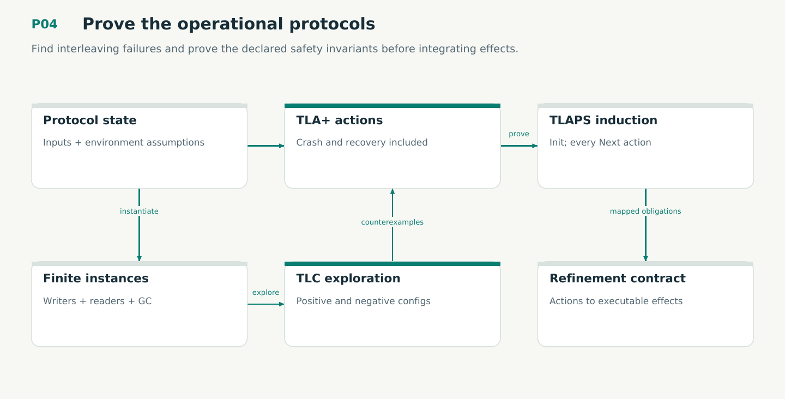

# P04 — Prove the operational protocols

Find interleaving failures and prove the declared safety invariants before integrating effects.

Status: **not implemented by this plan**. Dependencies: P02, P01O.

## Work in order

1. Define M01–M06 state/action/assumption registries with explicit crash/restart/uncertain-outcome semantics.
2. Run TLC finite configurations with multiple writers/readers, replay collisions, GC and two remote clients; retain calibrated failing models.
3. Write TLAPS Init and each-action preservation lemmas, frame/stutter cases, and Inv-implies-Safety proofs.
4. Prove bridge invariants between publication/recovery/retention/supervisor/sync/migration; map reducer commands and effect results to actions.
5. Document fairness and eventual-IO assumptions for bounded liveness checks. Implement complete obligation reports and negative harness controls.
6. Model authored bind/reopen/transition CAS as M09 and compose recovery with M02. Keep authored record authority separate from the completed knowledge ref.
7. Specify M11 schema epochs and compose M01–M06/M10 bridges using the P01O-admitted Omnigraph effect contract. Native behavior remains tested assumptions, not a verified engine.

## Required deliverables

- spec/M01-M06, M09 and M11 + TLC/TLAPS modules
- Action/refinement/effect contract map
- TLC/TLAPS receipts + calibrated mutant registry

## Exit gate

- Every named action and bridge has a checked safety obligation.
- All positive TLC runs finish; mutants violate the intended property, not parsing.
- No general temporal proof claim is inferred from the supported TLAPS fragment.

Mandatory gates: WF06, WF07. Required proof/model entries: M01, M02, M03, M04, M05, M06, M09, M11. Additional scenarios: X15, X16, X17, X18, X19, X21, X22, X24, X30, X32, X33, X34. All applicable existing G/Q/D/R behaviors remain required.

## Evidence and recovery

Use plan/08 for gate receipts, plan/11 for workflow-3 authority/version rules and plan/12 for playbook adoption. Plans/13–16 own views, reading design, the Omnigraph-first decision and storage-epoch contract. Plans/17-23 add engineering layout, fingerprints, skills, execution, learning and the proposed calculus. Preserve exact source/tool/fixture hashes, failed attempts and successful replacements. A failed gate does not authorize rewriting current user state or weakening a contract. Keep the stage diagram and atlas explanation current under WF21.

Finish with a cohesive commit, updated traceability and a concise report of delivered behavior, evidence and remaining blockers. Planned command names or created files do not pass a product stage.
