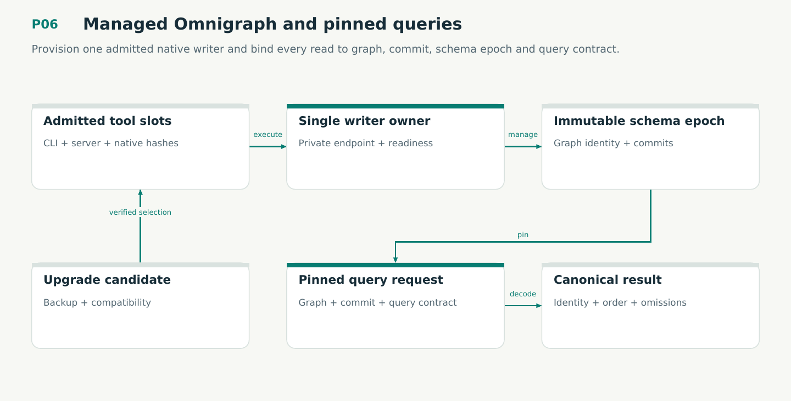

# P06 — Managed Omnigraph and pinned queries

Provision one admitted native writer and bind every read to graph, commit, schema epoch and query contract.

Status: **not implemented by this plan**. Dependencies: P01, P02, P04, P01O.

## Work in order

1. Implement immutable verified CLI/server installation and offline native closure; no ambient PATH fallback.
2. Implement one-writer supervisor ownership, private authenticated transport, query readiness, bounded shutdown and cancellation ownership.
3. Implement immutable schema epochs, typed GQ/record mapping and canonical reconstruction; preserve IDs, arbitrary integers, null rules and order.
4. Implement explicit graph/commit/epoch/query pins and identity validation on every request; exact judgments never depend on approximate search completeness.
5. Implement root-before-visibility candidate retention, compatible upgrades/backups and explicit refusal of old-schema branching or incompatible tool rollback.
6. Verify V15 production admission/callers and M11 refinement; own all native work until teardown and report uncertainty without blind retries.
7. Map isolated Dolt reference/import profiles without a second normal writer; preserve signed legacy bytes and IDs.

## Required deliverables

- omnigraph adapter + native supervisor/installer
- Epoch/query profiles + exact canonical mapping
- Integrated native lifecycle and pinned-read evidence

## Exit gate

- Fresh/offline install uses admitted CLI/server and native dependencies.
- Queries cannot drift across graph, commit, epoch or query contract.
- Wrong pins, overlap, uncertain writes and unsafe rollback fail explicitly.

Mandatory gates: WF09, WF24. Required proof/model entries: V09, M03, M04, V15, M11. Additional scenarios: X01, X02, X20, X21, X22, X23, X24, X25, X35, X80, X84, X100, X101, X102, X103, X104, X105, X106, X107, X108. All applicable existing G/Q/D/R behaviors remain required.

## Evidence and recovery

Use plan/08 for gate receipts, plan/11 for workflow-3 authority/version rules and plan/12 for playbook adoption. Plans/13–16 own views, reading design, the Omnigraph-first decision and storage-epoch contract. Plans/17-23 add engineering layout, fingerprints, skills, execution, learning and the proposed calculus. Preserve exact source/tool/fixture hashes, failed attempts and successful replacements. A failed gate does not authorize rewriting current user state or weakening a contract. Keep the stage diagram and atlas explanation current under WF21.

Finish with a cohesive commit, updated traceability and a concise report of delivered behavior, evidence and remaining blockers. Planned command names or created files do not pass a product stage.
