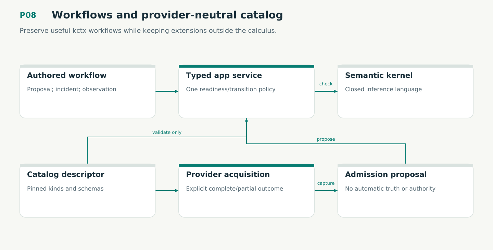

# P08 — Workflows and provider-neutral catalog

Preserve useful kctx workflows while keeping extensions outside the calculus.

Status: **not implemented by this plan**. Dependencies: P03, P05, P07.

## Work in order

1. Port inventory, relations, proposal/gates, investigation, KTLO, signatures, dossiers, correction, observations/runs and admission-refresh as cohesive application services.
2. Bind readiness/gates to exact material/target/environment/checker/scope and preserve intentional old bypass repairs.
3. Implement data-only catalog descriptors, namespaced kinds/providers, pinned schemas, aliases and rename-stable asset IDs.
4. Qualify a software-service workflow and a research/document workflow through the same semantic kernel.
5. Migrate caller/skill assumptions and compatibility map; source acquisition and session summaries remain proposals rather than auto-admitted facts.
6. Fix aggregate context partial diagnostics and managed stable lock ownership rather than porting FR8/FR11 defects. Use the exact typed fix-reference union.

## Required deliverables

- Complete authored workflow services
- Catalog defaults + legacy provider profiles
- End-to-end multi-domain fixtures and updated operation map

## Exit gate

- All baseline command behaviors have tested parity or approved explicit changes.
- Unknown extensions cannot silently fall back or inject inference/authority.
- Unknown authored content survives edits; gate readiness has one owner.

Mandatory gates: WF12. Required proof/model entries: V06. Additional scenarios: X12, X26, X27, X28, X29, X76, X78, X81. All applicable existing G/Q/D/R behaviors remain required.

## Evidence and recovery

Use plan/08 for gate receipts, plan/11 for workflow-3 authority/version rules and plan/12 for playbook adoption. Plans/13–16 own views, reading design, the Omnigraph-first decision and storage-epoch contract. Plans/17-23 add engineering layout, fingerprints, skills, execution, learning and the proposed calculus. Preserve exact source/tool/fixture hashes, failed attempts and successful replacements. A failed gate does not authorize rewriting current user state or weakening a contract. Keep the stage diagram and atlas explanation current under WF21.

Finish with a cohesive commit, updated traceability and a concise report of delivered behavior, evidence and remaining blockers. Planned command names or created files do not pass a product stage.
