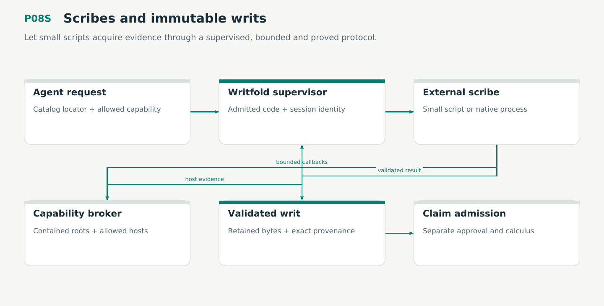

# P08S — Scribes and immutable writs

Let small scripts acquire evidence through a supervised, bounded and proved protocol.

Status: **not implemented by this plan**. Dependencies: P04, P05, P06, P08.

## Work in order

1. Implement admitted scribe descriptors with exact code/interpreter/dependency identities, catalog routing and separate capability grants.
2. Implement JSON-RPC/NDJSON handshake, request/session correlation, bounded frames/chunks/pages, cancellation and owned child lifecycle.
3. Implement restricted Linux sandbox and host file/Git/HTTP broker; refuse missing isolation and keep explicit trusted-exec profile separate.
4. Add M07 session and M08 acquisition TLC/TLAPS models, bridge them to publication/retention, and verify production acceptance reducer V11.
5. Deliver two real read-only scribes, a simple script SDK/example and a standalone conformance tool; qualify hostile output, retries, false completeness and credential boundaries.
6. Bind every completion to instance/session/request/generation, exact source and grant. Keep resource capacity charged after cancellation until child teardown; Scribes cannot pick an unsigned approval context.

## Required deliverables

- writfold-scribes + catalog descriptors + optional script SDK
- M07/M08/V11 source-bound proof and calibration receipts
- Real local/HTTP integrations and script-author guide

## Exit gate

- Only admitted code/runtime/grants can execute; no automatic plugin loading from sources.
- Late, duplicate, cancelled or old-session replies cannot create accepted writs.
- Complete acquisition requires validated stable transfer; no plugin can sign/admit claims.

Mandatory gates: WF18, WF05, WF06, WF07. Required proof/model entries: V11, M07, M08, M01, M03. Additional scenarios: X41, X42, X43, X44, X45, X46, X47, X48, X49, X50, X51, X52, X53, X54, X55, X84. All applicable existing G/Q/D/R behaviors remain required.

## Evidence and recovery

Use plan/08 for gate receipts, plan/11 for workflow-3 authority/version rules and plan/12 for playbook adoption. Plans/13–16 own views, reading design, the Omnigraph-first decision and storage-epoch contract. Plans/17-23 add engineering layout, fingerprints, skills, execution, learning and the proposed calculus. Preserve exact source/tool/fixture hashes, failed attempts and successful replacements. A failed gate does not authorize rewriting current user state or weakening a contract. Keep the stage diagram and atlas explanation current under WF21.

Finish with a cohesive commit, updated traceability and a concise report of delivered behavior, evidence and remaining blockers. Planned command names or created files do not pass a product stage.
