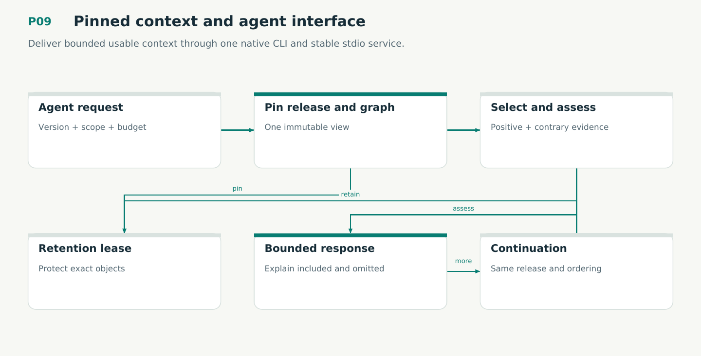

# P09 — Pinned context and agent interface

Deliver bounded usable context through one native CLI and stable stdio service.

Status: **not implemented by this plan**. Dependencies: P06, P07, P08, P08S, P08D.

## Work in order

1. Port all production CLI/JSON-RPC contracts to common typed application requests; preserve exit codes and version negotiation.
2. Implement one-release query selection, exact graph binding, deterministic ordering, explicit omissions and continuation leases.
3. Include applicable contrary evidence and required dependencies; budget exhaustion is visible and cannot certify an omitted check.
4. Verify pagination/budget reducer V10 and connect pins to M03; close uncertain connections on cancellation.
5. Qualify actual installed CLI/TTY/pipe/stdio behavior: framing, malformed requests, EOF/shutdown, concurrent requests, logs, color and redaction.
6. Expose protocol 2, explicit knowledge contexts and full context requests, context-claim pairs and pinned continuations. Prepare immutable views in the engine; CLI/RPC renderers perform no IO or mutation.

## Required deliverables

- Native CLI + initialized JSON-RPC service
- Context/explain/graph query and continuation types
- Installed transport and query completeness fixtures

## Exit gate

- No command shells out to the Python host or another CLI frontend.
- Every page uses the same release, filters and ordering or refuses.
- Machine stdout is clean; omissions/contradictions remain explicit.

Mandatory gates: WF13, WF19, WF21. Required proof/model entries: V10, M03, V12. Additional scenarios: X04, X20, X23, X37, X38, X61, X62, X75, X78, X85. All applicable existing G/Q/D/R behaviors remain required.

## Evidence and recovery

Use plan/08 for gate receipts, plan/11 for workflow-3 authority/version rules and plan/12 for playbook adoption. Plans/13–16 own views, reading design, the Omnigraph-first decision and storage-epoch contract. Plans/17-23 add engineering layout, fingerprints, skills, execution, learning and the proposed calculus. Preserve exact source/tool/fixture hashes, failed attempts and successful replacements. A failed gate does not authorize rewriting current user state or weakening a contract. Keep the stage diagram and atlas explanation current under WF21.

Finish with a cohesive commit, updated traceability and a concise report of delivered behavior, evidence and remaining blockers. Planned command names or created files do not pass a product stage.
