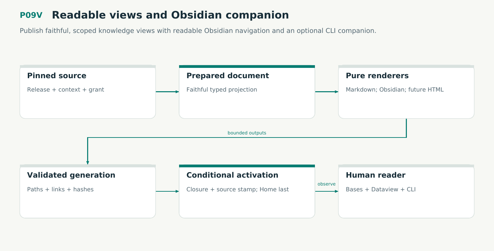

# P09V — Readable views and Obsidian companion

Publish faithful, scoped knowledge views with readable Obsidian navigation and an optional CLI companion.

Status: **not implemented by this plan**. Dependencies: P09.

## Work in order

1. Implement plan/13 prepared document values, nominal output identities and pure Markdown/Obsidian renderers; no renderer IO or query authority.
2. Implement immutable generation publication, ownership manifests, conditional Home activation and crash recovery. Preserve human edits and old-generation links.
3. Complete V14 production/caller proofs and M10 TLC/TLAPS safety/bridge obligations with negative calibration; no claims about third-party GUI correctness.
4. Produce plan/14 reading templates, Bases and scoped Dataview DQL with pinned plugin assets and portable fallback. Follow the provided synthetic sample without copying fictional facts into real exports.
5. Add exact-vault CLI lifecycle, version/capability discovery and separately admitted plugin setup; qualify Linux/WSL and optional Windows desktop bridge.
6. Execute WF22/WF23, inspect light/dark/narrow native views, validate query results and document stale index behavior. Update the atlas and receipts.

## Required deliverables

- Typed prepared documents + pure renderers
- Owned generation publisher and recovery model
- Native Obsidian profile and reading acceptance

## Exit gate

- V14/M10 and all view isolation/recovery scenarios pass.
- Human files survive; stale views never masquerade as current.
- CLI/plugin profile and readable fallback pass on the admitted PC.

Mandatory gates: WF02, WF05, WF06, WF07, WF21, WF22, WF23. Required proof/model entries: V14, M10. Additional scenarios: X86, X87, X88, X89, X90, X91, X92, X93, X94, X95, X96, X97, X98, X99. All applicable existing G/Q/D/R behaviors remain required.

## Evidence and recovery

Use plan/08 for gate receipts, plan/11 for workflow-3 authority/version rules and plan/12 for playbook adoption. Plans/13–16 own views, reading design, the Omnigraph-first decision and storage-epoch contract. Plans/17-23 add engineering layout, fingerprints, skills, execution, learning and the proposed calculus. Preserve exact source/tool/fixture hashes, failed attempts and successful replacements. A failed gate does not authorize rewriting current user state or weakening a contract. Keep the stage diagram and atlas explanation current under WF21.

Finish with a cohesive commit, updated traceability and a concise report of delivered behavior, evidence and remaining blockers. Planned command names or created files do not pass a product stage.
