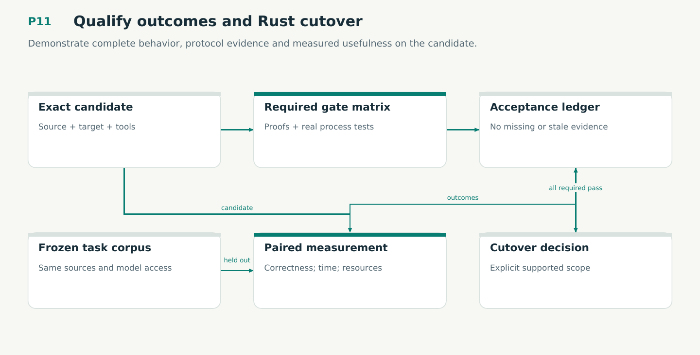

# P11 — Qualify outcomes and Rust cutover

Demonstrate complete behavior, protocol evidence and measured usefulness on the candidate.

Status: **not implemented by this plan**. Dependencies: P03, P04, P08, P09, P10, P08S, P03P, P08D, P09V, P19.

## Work in order

1. Run all required proof/conformance/quality/native/fault/migration/transport gates on the exact integrated candidate.
2. Run frozen paired Python/Rust retrieval and held-out agent tasks with decision-time source isolation and unchanged grading.
3. Profile cold/warm startup/query, refresh, memory, subprocesses, history growth and cancellation; fix measured bottlenecks without changing semantics.
4. Reconcile every G/Q/D/R requirement and WF gate with source-bound evidence. No count-only or doc-only completion.
5. Prepare caller migration and default-runtime cutover; explicitly reject unsafe mixed writers and retain isolated historical readers only where required.
6. Qualify native views and Omnigraph as the intended primary backend under plans/13–16. Confirm WF24 foundation identity matches integrated WF09/WF11/WF14/WF15 evidence.
7. Run all revision-5 engineering scenarios, E01-E12 and V16-V21/M12-M16 bridges on exact shipping inputs. No planning receipt passes product qualification.

## Required deliverables

- Integrated qualification and traceability report
- Matched correctness/resource/outcome measurements
- Cutover decision + migrated caller contracts

## Exit gate

- No unresolved deterministic candidate regression or required proof gap.
- Predeclared budgets/outcome policy met; limits and confounders disclosed.
- All delivered workflows run with the Rust artifact; no hidden Python fallback.

Mandatory gates: WF00, WF01, WF02, WF03, WF04, WF05, WF06, WF07, WF08, WF09, WF10, WF11, WF12, WF13, WF14, WF15, WF18, WF19, WF20, WF21, WF22, WF23, WF24, WF25, WF26, WF27, WF28, WF29, WF30, WF31. Required proof/model entries: V01, V02, V03, V04, V05, V06, V07, V08, V09, V10, M01, M02, M03, M04, M05, M06, V11, M07, M08, V12, V13, M09, V14, M10, V15, M11, V16, V17, V18, V19, V20, V21, M12, M13, M14, M15, M16. Additional scenarios: X01, X03, X39, X56, X57, X58, X59, X60, X61, X62, X63, X64, X65, X66, X67, X68, X69, X70, X71, X72, X73, X74, X75, X76, X77, X78, X79, X80, X81, X82, X83, X84, X85, X86, X87, X88, X89, X90, X91, X92, X93, X94, X95, X96, X97, X98, X99, X100, X101, X102, X103, X104, X105, X106, X107, X108, X109, X110, X111, X112, X113, X114, X115, X116, X117, X118, X119, X120, X121, X122, X123, X124, X125, X126, X127, X128, X129, X130, X131, X132, X133, X134, X135, X136, X137, X138, X139, X140, X141, X142, X143, X144, X145, X146, X147, X148. All applicable existing G/Q/D/R behaviors remain required.

## Evidence and recovery

Use plan/08 for gate receipts, plan/11 for workflow-3 authority/version rules and plan/12 for playbook adoption. Plans/13–16 own views, reading design, the Omnigraph-first decision and storage-epoch contract. Plans/17-23 add engineering layout, fingerprints, skills, execution, learning and the proposed calculus. Preserve exact source/tool/fixture hashes, failed attempts and successful replacements. A failed gate does not authorize rewriting current user state or weakening a contract. Keep the stage diagram and atlas explanation current under WF21.

Finish with a cohesive commit, updated traceability and a concise report of delivered behavior, evidence and remaining blockers. Planned command names or created files do not pass a product stage.
