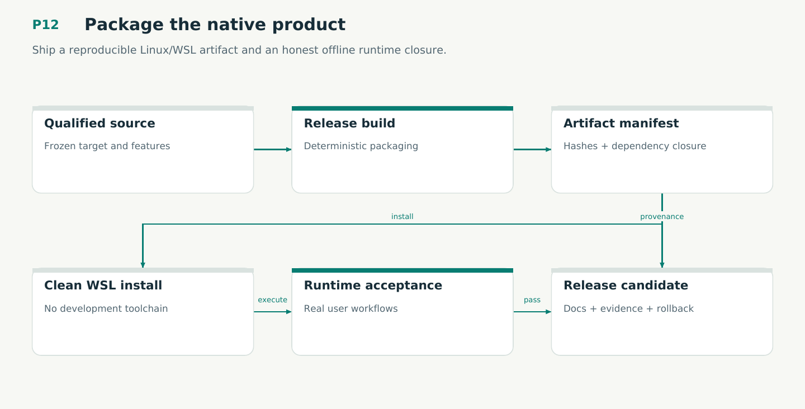

# P12 — Package the native product

Ship a reproducible Linux/WSL artifact and an honest offline runtime closure.

Status: **not implemented by this plan**. Dependencies: P11.

## Work in order

1. Create versioned core archive, Omnigraph/Git dependency closure or enforced prerequisites, offline bundle, checksums, licenses and SBOM. Package a separately declared legacy import kit only when requested by migration scope.
2. Build deterministic archives and verify source/features/executable correspondence to the qualified candidate; compare clean builds if claiming reproducibility.
3. Test install/open/query/sign/admit/recover/update/uninstall-retain-data with proof/Python/toolchain artifacts absent.
4. Implement installer/update verification against the selected release trust policy and preserve user state on partial failure.
5. Prepare exact release notes, assurance page data, migration/restore docs and publication manifest; do not publish an unqualified artifact.
6. Package engineering schemas, procedure dependencies, effect adapters and restoration profiles; preserve old release/signature compatibility and unresolved effect reconciliation.

## Required deliverables

- Linux x86_64 release archives and offline bundle
- Checksums/SBOM/license/qualification closure
- Installed clean-machine acceptance report

## Exit gate

- No hidden Docker/Python/proof runtime dependency; Git/Omnigraph closure is explicit.
- Bad download/update is refused; user data survives interrupted install/uninstall.
- Every release claim maps to exact artifact/source evidence.

Mandatory gates: WF16. Required proof/model entries: M04. Additional scenarios: X21, X24, X35, X40. All applicable existing G/Q/D/R behaviors remain required.

## Evidence and recovery

Use plan/08 for gate receipts, plan/11 for workflow-3 authority/version rules and plan/12 for playbook adoption. Plans/13–16 own views, reading design, the Omnigraph-first decision and storage-epoch contract. Plans/17-23 add engineering layout, fingerprints, skills, execution, learning and the proposed calculus. Preserve exact source/tool/fixture hashes, failed attempts and successful replacements. A failed gate does not authorize rewriting current user state or weakening a contract. Keep the stage diagram and atlas explanation current under WF21.

Finish with a cohesive commit, updated traceability and a concise report of delivered behavior, evidence and remaining blockers. Planned command names or created files do not pass a product stage.
