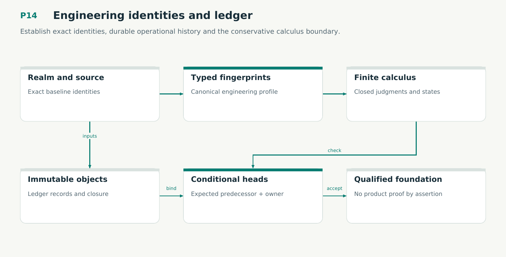

# P14 — Engineering identities and ledger

Establish exact identities, durable operational history and the conservative calculus boundary.

Status: **not implemented by this plan**. Dependencies: P02, P04, P08D, P10.

## Work in order

1. Read plans/17-18 and /22-23. Preserve v4 authorities and historical codecs; freeze engineering/1 domains and canonical schemas.
2. Implement typed realm/stream/attempt/effect identities, flat dependency locks, input fingerprints and exact read-cut manifests.
3. Implement immutable ledger records, conditional stream heads, stable coordination and corruption/refusal diagnostics.
4. Formalize E01-E12 definitions and begin proofs; map V16/M12 to actual bodies and durable boundaries. Do not introduce unproved truth premises.
5. Qualify canonical vectors, stale-head conflicts, realm isolation, complete input capture and backup-incarnation handling.

## Required deliverables

- Identity and codec contracts
- Durable ledger and head CAS
- Lean definitions and proof mapping

## Exit gate

- No identity or authority substitution.
- Crashes preserve honest stream state.
- Golden codecs and model checks agree.

Mandatory gates: WF25, WF02, WF03. Required proof/model entries: V16, M12. Additional scenarios: X109, X110, X111, X112, X113, X114. All applicable existing G/Q/D/R behaviors remain required.

## Evidence and recovery

Use plan/08 for gate receipts, plan/11 for workflow-3 authority/version rules and plan/12 for playbook adoption. Plans/13–16 own views, reading design, the Omnigraph-first decision and storage-epoch contract. Plans/17-23 add engineering layout, fingerprints, skills, execution, learning and the proposed calculus. Preserve exact source/tool/fixture hashes, failed attempts and successful replacements. A failed gate does not authorize rewriting current user state or weakening a contract. Keep the stage diagram and atlas explanation current under WF21.

Finish with a cohesive commit, updated traceability and a concise report of delivered behavior, evidence and remaining blockers. Planned command names or created files do not pass a product stage.
