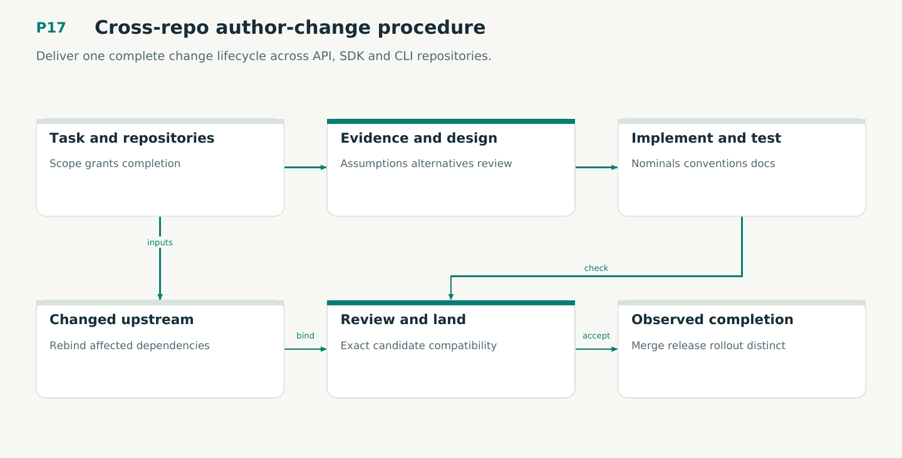

# P17 — Cross-repo author-change procedure

Deliver one complete change lifecycle across API, SDK and CLI repositories.

Status: **not implemented by this plan**. Dependencies: P16, P08D, P09.

## Work in order

1. Build the three-repository pagination fixture and a skill-driven run from intake through critical design review.
2. Bind repository vectors, assumptions, conventions and compatibility constraints; preserve user work and BuildKit setup.
3. Implement author/test/review/docs/PR feedback loops with dependency-based receipt invalidation and nominal types.
4. Qualify exact merge-candidate checks, safe partial landing and explicit rollout/completion boundaries in authorized profiles.
5. Prove V19/M13 and E04/E11/E12; retain failures and follow-up obligations without rewriting old runs.

## Required deliverables

- Complete author-change procedure
- Cross-repo compatibility matrix
- PR and recovery evidence

## Exit gate

- Tests bind the actual repo vector.
- Partial landing has a safe path.
- Review changes invalidate evidence.

Mandatory gates: WF28, WF02. Required proof/model entries: V19, M13. Additional scenarios: X129, X130, X131, X132, X133, X134. All applicable existing G/Q/D/R behaviors remain required.

## Evidence and recovery

Use plan/08 for gate receipts, plan/11 for workflow-3 authority/version rules and plan/12 for playbook adoption. Plans/13–16 own views, reading design, the Omnigraph-first decision and storage-epoch contract. Plans/17-23 add engineering layout, fingerprints, skills, execution, learning and the proposed calculus. Preserve exact source/tool/fixture hashes, failed attempts and successful replacements. A failed gate does not authorize rewriting current user state or weakening a contract. Keep the stage diagram and atlas explanation current under WF21.

Finish with a cohesive commit, updated traceability and a concise report of delivered behavior, evidence and remaining blockers. Planned command names or created files do not pass a product stage.
