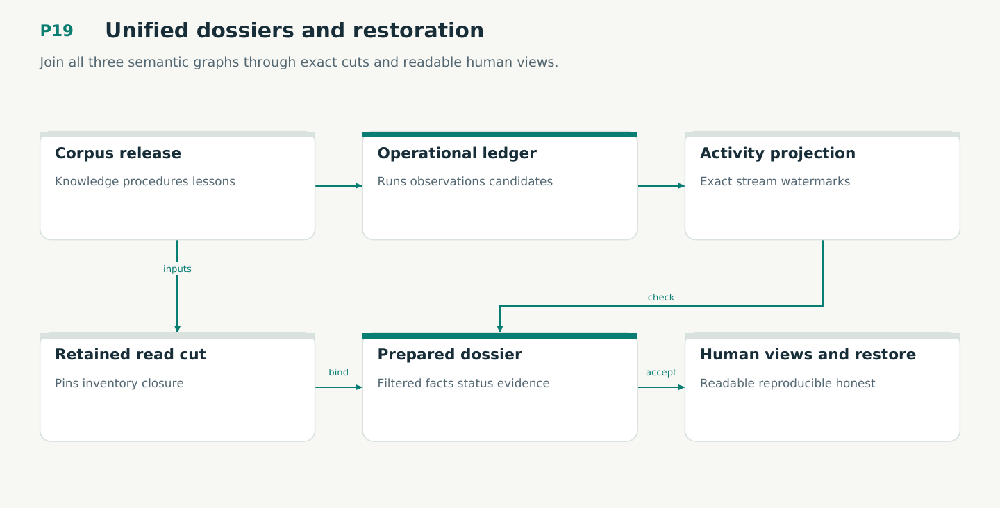

# P19 — Unified dossiers and restoration

Join all three semantic graphs through exact cuts and readable human views.

Status: **not implemented by this plan**. Dependencies: P18, P09V, P10.

## Work in order

1. Provision two logical graph families with independent retained epochs; enforce one native cluster owner.
2. Implement activity projection from validated ledger streams with exact watermark and stream-inventory manifests.
3. Join corpus and activity through typed pinned references; report lag/incompleteness and pin pagination.
4. Render Obsidian change dossiers and skill/learning views through the existing pure prepared-document boundary.
5. Qualify corpus migration, full-root backup, source-inaccessible restore, activity rebuild and cross-store retention. Prove V21/M16 bridges.

## Required deliverables

- Two-family storage and exact cuts
- Human change and learning dossiers
- Independent restore and rebuild

## Exit gate

- Projection cannot authorize effects.
- Views disclose pins and omissions.
- Restore cannot replay old effects.

Mandatory gates: WF30, WF21, WF22, WF23. Required proof/model entries: V21, M16. Additional scenarios: X143, X144, X145, X146, X147, X148. All applicable existing G/Q/D/R behaviors remain required.

## Evidence and recovery

Use plan/08 for gate receipts, plan/11 for workflow-3 authority/version rules and plan/12 for playbook adoption. Plans/13–16 own views, reading design, the Omnigraph-first decision and storage-epoch contract. Plans/17-23 add engineering layout, fingerprints, skills, execution, learning and the proposed calculus. Preserve exact source/tool/fixture hashes, failed attempts and successful replacements. A failed gate does not authorize rewriting current user state or weakening a contract. Keep the stage diagram and atlas explanation current under WF21.

Finish with a cohesive commit, updated traceability and a concise report of delivered behavior, evidence and remaining blockers. Planned command names or created files do not pass a product stage.
