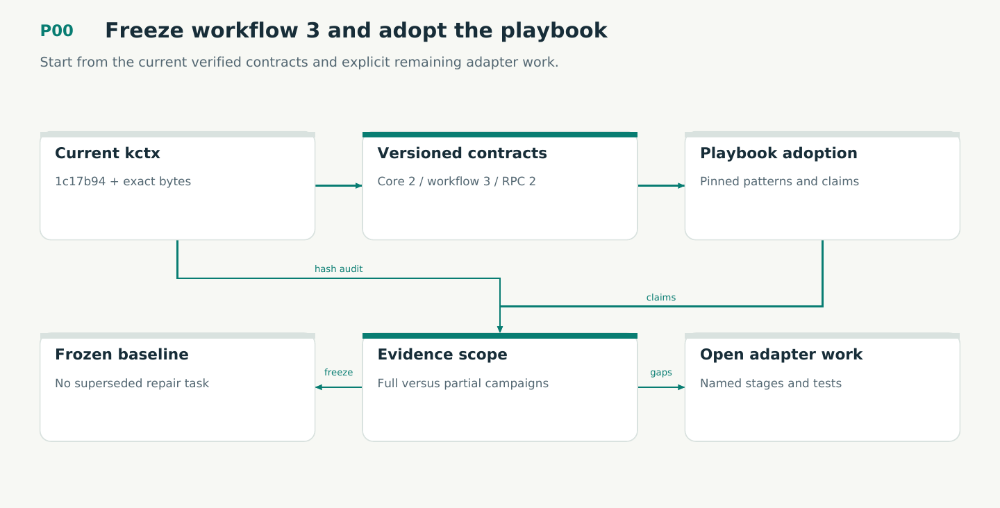

# P00 — Freeze workflow 3 and adopt the playbook

Start from the current verified contracts and explicit remaining adapter work.

Status: **not implemented by this plan**. Dependencies: none.

## Work in order

1. Compare source and dirty bytes with kctx 1c17b94; read current instructions. Pin playbook e7d991e and the project adoption record in plan/12.
2. Reconcile 353 Lean declarations, 334 conformance cases, 11 mutants and the current 740-test report by full input hashes. Retain the prior failure and newer fixes; do not repeat a superseded repair.
3. Validate the Dolt warning regression and descendant-lifetime fix. Keep strict parser/executable identity hardening as a Rust tool-admission obligation, not a claim the new parser already enforces it.
4. Classify workflow-3 knowledge campaign evidence separately from the full storage/remote gates. Record remaining FR3/FR8/FR9/FR10/FR11 and FR7/FR12 tasks with destination stages.
5. Inventory every current CLI/RPC/versioned envelope, requirement and producer provenance field. Freeze performance/outcome profiles and source qualification scope before porting.
6. Record the approved Omnigraph-first decision and legacy/reference boundaries in plans/15–16. P01O must qualify the backend before storage-dependent integration.

## Required deliverables

- Current-source baseline and version matrix
- Pinned playbook adoption + compatibility inventory
- Evidence applicability and unresolved-work ledger

## Exit gate

- Current source matches the claimed report inputs; unrun/full-scope claims stay explicit.
- Completed fixes are preserved and unresolved behaviors have destination gates.
- Workflow 3, protocol 2 and private playbook adoption are explicit.

Mandatory gates: WF00, WF21. Required proof/model entries: none at this stage. Additional scenarios: X01, X02, X03, X04. All applicable existing G/Q/D/R behaviors remain required.

## Evidence and recovery

Use plan/08 for gate receipts, plan/11 for workflow-3 authority/version rules and plan/12 for playbook adoption. Plans/13–16 own views, reading design, the Omnigraph-first decision and storage-epoch contract. Plans/17-23 add engineering layout, fingerprints, skills, execution, learning and the proposed calculus. Plans/24-26 and PRIORITIES.md govern all new proposal admissions. Preserve exact source/tool/fixture hashes, failed attempts and successful replacements. A failed gate does not authorize rewriting current user state or weakening a contract. Keep the stage diagram and atlas explanation current under WF21.

Finish with a cohesive commit, updated traceability and a concise report of delivered behavior, evidence and remaining blockers. Planned command names or created files do not pass a product stage.
