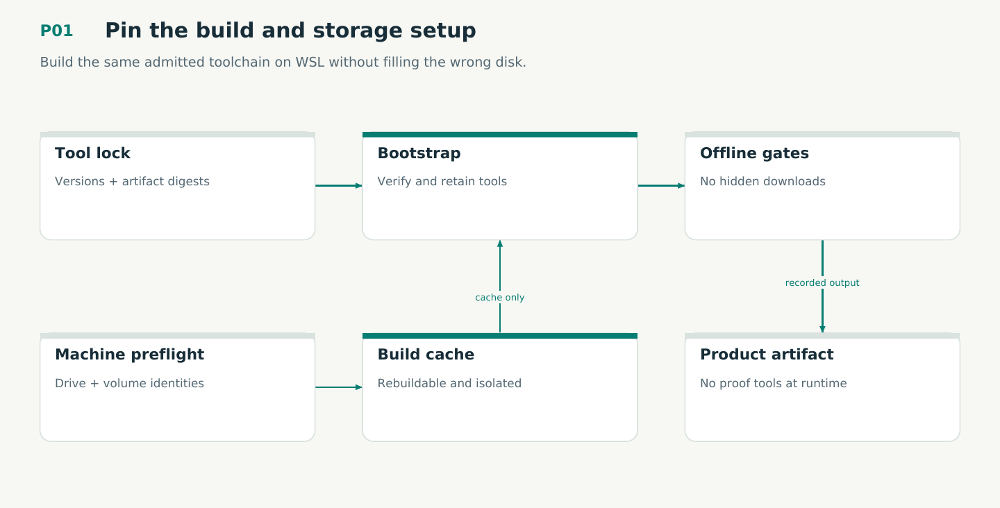

# P01 — Pin the build and storage setup

Build the same admitted toolchain on WSL without filling the wrong disk.

Status: **not implemented by this plan**. Dependencies: P00.

## Work in order

1. Inspect actual Docker context/buildx/cache volumes and external-drive filesystem identity. Fail if the configured cache mount is absent; keep authoritative state separate.
2. Admit Rust, Cargo, Verus/compiler, solver, Lean, TLC, TLAPS, Omnigraph CLI/server, legacy-only Dolt, Git and OCI bases into one byte-identified lock. Audit mutable package sources and bootstrap installers.
3. Implement Compose service ownership and gate receipts; online bootstrap is separate from offline verification. Keep heavy cache namespaces keyed by target/tool/source identities.
4. Verify and link a nontrivial Verus exec function into the musl product spike. Prove/check the release cfg/features match the verified body; record trusted compilation boundaries.
5. Implement offline dependency closure and a minimal installed-runtime smoke with proof tools absent. Record CPU/RAM/storage budgets without changing the workstation reserve policy.

## Required deliverables

- Dockerfiles/compose.yaml + toolchains.lock.json
- scripts/gate + receipt schema + preflight
- Verus-to-musl feasibility artifact and offline tool closure

## Exit gate

- Clean container build and offline rerun succeed from admitted bytes.
- Missing external mount fails before creating large output on the system disk.
- Verified executable body is linked into the smoke artifact with recorded target/features.

Mandatory gates: WF01. Required proof/model entries: V01. Additional scenarios: X02, X35, X36. All applicable existing G/Q/D/R behaviors remain required.

## Evidence and recovery

Use plan/08 for gate receipts, plan/11 for workflow-3 authority/version rules and plan/12 for playbook adoption. Plans/13–16 own views, reading design, the Omnigraph-first decision and storage-epoch contract. Plans/17-23 add engineering layout, fingerprints, skills, execution, learning and the proposed calculus. Plans/24-26 and PRIORITIES.md govern all new proposal admissions. Preserve exact source/tool/fixture hashes, failed attempts and successful replacements. A failed gate does not authorize rewriting current user state or weakening a contract. Keep the stage diagram and atlas explanation current under WF21.

Finish with a cohesive commit, updated traceability and a concise report of delivered behavior, evidence and remaining blockers. Planned command names or created files do not pass a product stage.
