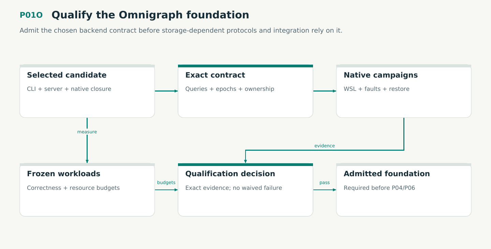

# P01O — Qualify the Omnigraph foundation

Admit the chosen backend contract before storage-dependent protocols and integration rely on it.

Status: **not implemented by this plan**. Dependencies: P01.

## Work in order

1. Freeze the exact CLI/server/runtime, transport, schema/query and workload profile; complete missing pins instead of extrapolating from the tested CLI.
2. Run both retained smoke fixtures and the full plan/15 WF24 campaigns on WSL: exact queries, atomic boundaries, uncertain writes and one-writer ownership.
3. Demonstrate the plan/16 two-epoch migration/old-read profile, native roots, quiesced backup and independent restore with originals unavailable.
4. Inject crashes and lost responses, test resource ownership/cancellation and measure frozen exact/discovery workloads against predeclared SLOs.
5. Record a source-bound qualified profile or a concrete failure. Fix causes; a backend fallback needs an explicit design deviation, not an automatic runtime switch.

## Required deliverables

- Pinned native backend and compatibility contract
- WSL storage/history/failure/restore evidence
- Frozen budgets and explicit go/no-go receipt

## Exit gate

- Full declared WF24 scope passes; smoke probes alone are insufficient.
- Old epoch reads and independent restore preserve exact identities.
- No second normal database writer or hidden fallback is introduced.

Mandatory gates: WF01, WF24, WF21. Required proof/model entries: none at this stage. Additional scenarios: X100, X101, X102, X103, X104, X105, X106, X107, X108. All applicable existing G/Q/D/R behaviors remain required.

## Evidence and recovery

Use plan/08 for gate receipts, plan/11 for workflow-3 authority/version rules and plan/12 for playbook adoption. Plans/13–16 own views, reading design, the Omnigraph-first decision and storage-epoch contract. Plans/17-23 add engineering layout, fingerprints, skills, execution, learning and the proposed calculus. Plans/24-26 and PRIORITIES.md govern all new proposal admissions. Preserve exact source/tool/fixture hashes, failed attempts and successful replacements. A failed gate does not authorize rewriting current user state or weakening a contract. Keep the stage diagram and atlas explanation current under WF21.

Finish with a cohesive commit, updated traceability and a concise report of delivered behavior, evidence and remaining blockers. Planned command names or created files do not pass a product stage.
