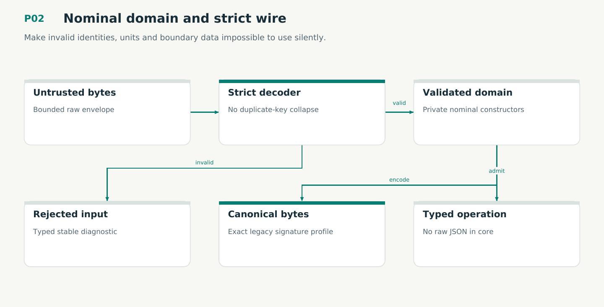

# P02 — Nominal domain and strict wire

Make invalid identities, units and boundary data impossible to use silently.

Status: **not implemented by this plan**. Dependencies: P01.

## Work in order

1. Create domain/kernel/wire/protocol workspace members with explicit dependency rules and private validated types.
2. Port exact reference/record/state distinctions and structured errors; implement semantic numeric range/profile policy without truncating Lean/Python integers.
3. Implement duplicate-key-aware bounded JSON decoding, Unicode/depth limits, exact variant/version refusal and deterministic model ordering.
4. Freeze legacy canonical approval bytes and cross-host Ed25519 verification. Add lossless authored-document spans and intentional change registry.
5. Add compile-fail wrong-ID/unit/state fixtures, syntax-aware module/function budgets, dependency direction and calibrated negative quality tests.
6. Implement ContextId, DesignRevision, ImplementationBinding, session/instance/generation and capability distinctions. Add strict schema-2 historical/schema-3 writer variants and protocol-2 initialization; preserve exact old signature domains.
7. Implement plan/16 nominal StoragePin/GraphId/GraphCommitId/SchemaEpochId and new outer release/approval profile. Freeze canonical bytes and capability/refusal fixtures; never reinterpret legacy IDs or signatures.

## Required deliverables

- Validated domain types + wire schemas/codecs
- Canonical byte/signature fixtures
- Architecture/size/type gate with deliberate failing controls

## Exit gate

- Wrong namespace/unit/state fails compilation for the intended reason.
- Malformed, oversized, ambiguous and unsupported inputs fail before domain construction.
- Legacy signatures verify over unchanged exact bytes; no JSON-number narrowing.

Mandatory gates: WF02, WF03. Required proof/model entries: V01. Additional scenarios: X05, X06, X07, X08, X65, X66, X67, X74. All applicable existing G/Q/D/R behaviors remain required.

## Evidence and recovery

Use plan/08 for gate receipts, plan/11 for workflow-3 authority/version rules and plan/12 for playbook adoption. Plans/13–16 own views, reading design, the Omnigraph-first decision and storage-epoch contract. Plans/17-23 add engineering layout, fingerprints, skills, execution, learning and the proposed calculus. Plans/24-26 and PRIORITIES.md govern all new proposal admissions. Preserve exact source/tool/fixture hashes, failed attempts and successful replacements. A failed gate does not authorize rewriting current user state or weakening a contract. Keep the stage diagram and atlas explanation current under WF21.

Finish with a cohesive commit, updated traceability and a concise report of delivered behavior, evidence and remaining blockers. Planned command names or created files do not pass a product stage.
