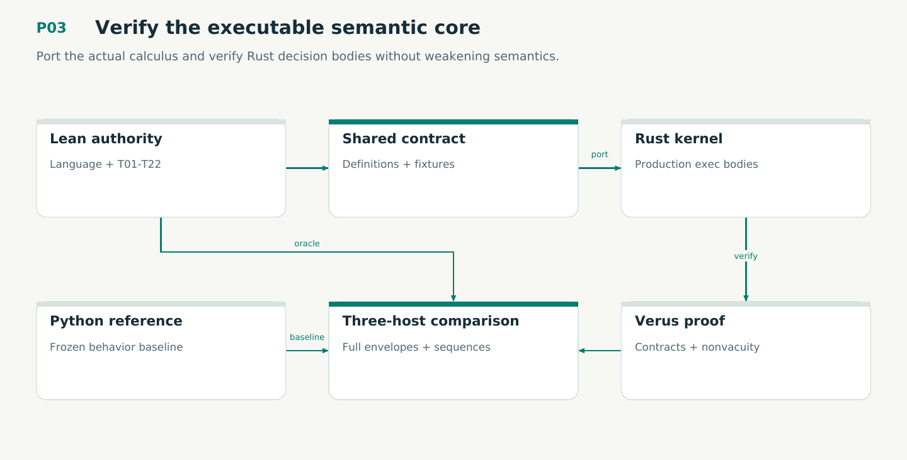

# P03 — Verify the executable semantic core

Port the actual calculus and verify Rust decision bodies without weakening semantics.

Status: **not implemented by this plan**. Dependencies: P02.

## Work in order

1. Map all 353 audited declarations within T01–T22 and every reference operation to Rust symbols and assumptions; portfolio/design extensions have dedicated P03P/P08D owners.
2. Implement recursive witness checking, finite inventory coverage, alternative support, corrections, independent assessment, receipt reuse and authored/knowledge transitions.
3. Write Verus specs over meaningful abstract representations and verify actual exec functions V01–V06. Keep IO/time acquisition outside the core.
4. Build a Rust reference runner for every operation and compare full responses against Lean/Python on the 334-case baseline plus adversarial/generated/stateful cases.
5. Run clean Lean axiom audit, nonvacuity checks and Verus trust-boundary scan; kill named semantic mutants without relying on syntax failures.

## Required deliverables

- Pure production kernel + Verus contracts
- Three-host reference harness and traceability
- Lean/Verus/conformance/mutation receipts

## Exit gate

- All reference operations agree on complete responses; no Python runtime fallback.
- Selected actual Rust functions verify and are linked into the candidate binary.
- Unapproved assumptions/open obligations are zero; cross-prover correspondence limits are stated.

Mandatory gates: WF04, WF05. Required proof/model entries: V01, V02, V03, V04, V05, V06. Additional scenarios: X07, X09, X10, X11, X12, X13, X14. All applicable existing G/Q/D/R behaviors remain required.

## Evidence and recovery

Use plan/08 for gate receipts, plan/11 for workflow-3 authority/version rules and plan/12 for playbook adoption. Plans/13–16 own views, reading design, the Omnigraph-first decision and storage-epoch contract. Plans/17-23 add engineering layout, fingerprints, skills, execution, learning and the proposed calculus. Plans/24-26 and PRIORITIES.md govern all new proposal admissions. Preserve exact source/tool/fixture hashes, failed attempts and successful replacements. A failed gate does not authorize rewriting current user state or weakening a contract. Keep the stage diagram and atlas explanation current under WF21.

Finish with a cohesive commit, updated traceability and a concise report of delivered behavior, evidence and remaining blockers. Planned command names or created files do not pass a product stage.
