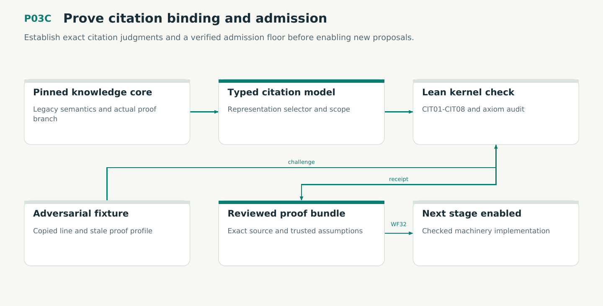

# P03C — Prove citation binding and admission

Establish exact citation judgments and a verified admission floor before enabling new proposals.

Status: **not implemented by this plan**. Dependencies: P03, P03P.

## Work in order

1. Reconcile the active proof branch first. Freeze new statement/source identities, original semantics and trusted external assumptions.
2. Model retained representations, typed selectors, scoped aliases, complete versus partial enumeration and independent correspondence evidence.
3. Model every authoritative proposal constructor, the trusted rule-profile selector and candidate-bound witness. Prove CIT01-CIT08 in Lean.
4. Execute both inhabited successful paths and semantic counterexamples. Include the copied-line fixture, independent witnesses, inclusive expiry and false proof receipts.
5. Retain exact proof source/toolchain/axiom/command receipts. WF32 is a prerequisite for production admission. Keep candidate work possible when blocked.
6. Reconcile the plan/28 discovery boundary with CIT obligations. Check the candidate Lean terms and register the exact receipt or blocker.

## Required deliverables

- Lean judgments and theorem map
- Checked proof bundles and assumptions
- Counterexamples and mutation results

## Exit gate

- CIT01-CIT08 have audited receipts.
- Legacy interpretations are preserved.
- Missing or mismatched proofs block.

Mandatory gates: WF32, WF02, WF04. Required proof/model entries: none at this stage. Additional scenarios: X149, X150, X151, X152, X153, X154, X155, X156. All applicable existing G/Q/D/R behaviors remain required.

## Evidence and recovery

Use plan/08 for gate receipts, plan/11 for workflow-3 authority/version rules and plan/12 for playbook adoption. Plans/13–16 own views, reading design, the Omnigraph-first decision and storage-epoch contract. Plans/17-23 add engineering layout, fingerprints, skills, execution, learning and the proposed calculus. Plans/24-26 and PRIORITIES.md govern all new proposal admissions. Preserve exact source/tool/fixture hashes, failed attempts and successful replacements. A failed gate does not authorize rewriting current user state or weakening a contract. Keep the stage diagram and atlas explanation current under WF21.

Finish with a cohesive commit, updated traceability and a concise report of delivered behavior, evidence and remaining blockers. Planned command names or created files do not pass a product stage.
