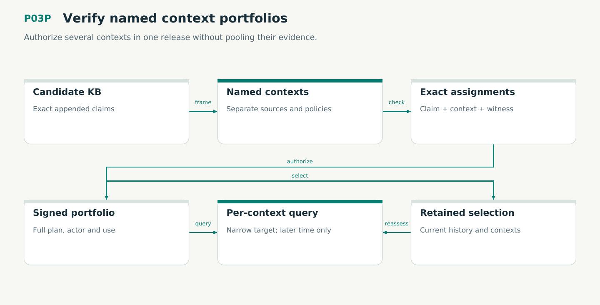

# P03P — Verify named context portfolios

Authorize several contexts in one release without pooling their evidence.

Status: **not implemented by this plan**. Dependencies: P03.

## Work in order

1. Implement exact portfolio state/family/evolution/assignment/apply/query/selection predicates with ordered nominal records.
2. Verify production V12; map the new Lean declaration families and nonvacuity examples; keep all 334 complete-response cases and 11 mutants.
3. Add source/key/policy adapter preconditions: every context use authorized, declared operation use present, exact captures retained and canonical schema-3 plan signed.
4. Extend M01/M02/M06 with portfolio identity and selection/migration rules, and M03/V10 with context-claim pagination. Carry these contracts into P07/P09.
5. Freeze schema-2 historical reads, legacy context projection and refusal of pending old writes; no new inference constructors or implicit context union.

## Required deliverables

- kernel/portfolio + nominal records
- V12 and updated model/conformance receipts
- Context query, version and migration contracts

## Exit gate

- Multiple targets remain separately assessed in one authenticated release.
- Cross-context borrowing, omitted assignments and implicit retirement fail.
- Historical selection preserves current corrections and context policy.

Mandatory gates: WF19, WF03, WF04, WF05, WF06, WF07. Required proof/model entries: V12, M01, M02, M03, M06, V10. Additional scenarios: X56, X57, X58, X59, X60, X61, X62, X63, X64, X65, X66, X67. All applicable existing G/Q/D/R behaviors remain required.

## Evidence and recovery

Use plan/08 for gate receipts, plan/11 for workflow-3 authority/version rules and plan/12 for playbook adoption. Plans/13–16 own views, reading design, the Omnigraph-first decision and storage-epoch contract. Plans/17-23 add engineering layout, fingerprints, skills, execution, learning and the proposed calculus. Plans/24-26 and PRIORITIES.md govern all new proposal admissions. Preserve exact source/tool/fixture hashes, failed attempts and successful replacements. A failed gate does not authorize rewriting current user state or weakening a contract. Keep the stage diagram and atlas explanation current under WF21.

Finish with a cohesive commit, updated traceability and a concise report of delivered behavior, evidence and remaining blockers. Planned command names or created files do not pass a product stage.
