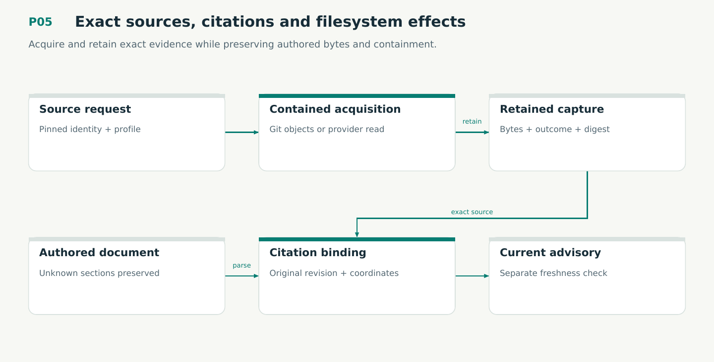

# P05 — Exact sources, citations and filesystem effects

Acquire and retain exact evidence while preserving authored bytes and containment.

Status: **not implemented by this plan**. Dependencies: P02, P04.

## Work in order

1. Port Git object/index/worktree acquisition with explicit profiles and retained exact revisions; block repository-controlled helpers/filters during reads.
2. Implement source/citation grammar, scanner, renderers and advisory refresh. Preserve original coordinates/time and disclose missing historical bytes.
3. Implement contained descriptor-relative reads/writes, atomic file publication, directory synchronization and typed durable effect outcomes.
4. Port lossless document edits, unknown sections, CRLF and ambiguous structure refusal; avoid generic parse-and-reserialize behavior.
5. Qualify symlink swaps, path traversal, binary/untracked/submodule inputs, interrupted publication, redaction limits and source denial/truncation.
6. Port typed fix references and local two-endpoint diff/citation mapping: no dirty-worktree substitution, provider fetch, external diff helper or fabricated hunk range.

## Required deliverables

- sources crate + filesystem/Git adapters
- Lossless document and citation fixtures
- Real-source containment/publication receipts

## Exit gate

- Historical citation bytes survive rename/refresh/correction.
- No lexical-path-only containment claim; symlink/TOCTOU profile is exercised.
- Missing/partial/denied sources cannot become complete empty evidence.

Mandatory gates: WF08. Required proof/model entries: V01, M01. Additional scenarios: X06, X08, X18, X29, X75, X76. All applicable existing G/Q/D/R behaviors remain required.

## Evidence and recovery

Use plan/08 for gate receipts, plan/11 for workflow-3 authority/version rules and plan/12 for playbook adoption. Plans/13–16 own views, reading design, the Omnigraph-first decision and storage-epoch contract. Plans/17-23 add engineering layout, fingerprints, skills, execution, learning and the proposed calculus. Plans/24-26 and PRIORITIES.md govern all new proposal admissions. Preserve exact source/tool/fixture hashes, failed attempts and successful replacements. A failed gate does not authorize rewriting current user state or weakening a contract. Keep the stage diagram and atlas explanation current under WF21.

Finish with a cohesive commit, updated traceability and a concise report of delivered behavior, evidence and remaining blockers. Planned command names or created files do not pass a product stage.
