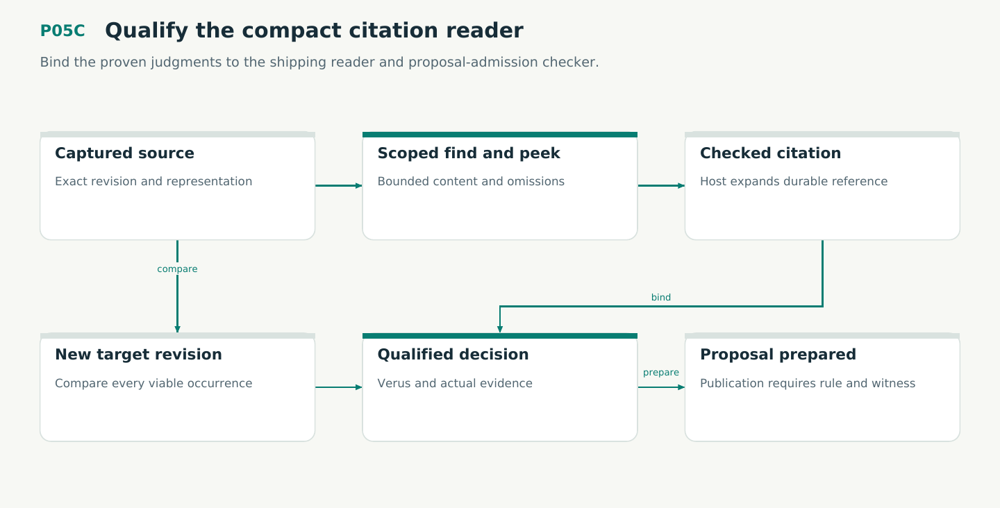

# P05C — Qualify the compact citation reader

Bind the proven judgments to the shipping reader and proposal-admission checker.

Status: **not implemented by this plan**. Dependencies: P03C, P05.

## Work in order

1. Implement find, peek, cite and compare as small modules over retained source, pinned access and scoped handle mappings. Preserve legacy tokens.
2. Verify V22/V23 shipping decision bodies, strict callers and all relevant IO assumptions. Reconcile retention/recovery tests with M01/M02/M03 at their owning stages.
3. Implement authenticated rule-bundle validation and per-proposal Lean instance checking on exact inputs. Retain the verified instance receipt before P07 or a later owner enables an authoritative transition.
4. Exercise duplicate/ambiguous spans, UTF-16/byte confusion, scope, access changes, pagination, invalidation and legacy historical resolution.
5. Measure complete repeated tasks against kctx and targeted rg. Record empirical default/opt-in decision and known limits.
6. Keep similar-case retrieval in find. Test arbitrary ordering, fresh authorization at peek, exact selectors and no inferred absence.
7. Use the general find contract in plan/30. Bind kind-qualified identities and evidence roles; cover omitted versus explicit kind restrictions and disabled profiles.

## Required deliverables

- Bounded reader and Rust checks
- Proof-bundle and witness validator
- Correctness and token evaluation

## Exit gate

- No incorrect successor attachment.
- Compact results preserve coverage.
- All admission paths require proofs.

Mandatory gates: WF33, WF02, WF05, WF06, WF07. Required proof/model entries: V22, V23. Additional scenarios: X157, X158, X159, X160, X161, X162, X163, X164. All applicable existing G/Q/D/R behaviors remain required.

## Evidence and recovery

Use plan/08 for gate receipts, plan/11 for workflow-3 authority/version rules and plan/12 for playbook adoption. Plans/13–16 own views, reading design, the Omnigraph-first decision and storage-epoch contract. Plans/17-23 add engineering layout, fingerprints, skills, execution, learning and the proposed calculus. Plans/24-26 and PRIORITIES.md govern all new proposal admissions. Preserve exact source/tool/fixture hashes, failed attempts and successful replacements. A failed gate does not authorize rewriting current user state or weakening a contract. Keep the stage diagram and atlas explanation current under WF21.

Finish with a cohesive commit, updated traceability and a concise report of delivered behavior, evidence and remaining blockers. Planned command names or created files do not pass a product stage.
