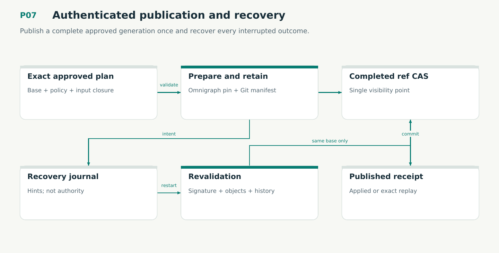

# P07 — Authenticated publication and recovery

Publish a complete approved generation once and recover every interrupted outcome.

Status: **not implemented by this plan**. Dependencies: P03, P04, P05, P06, P03P, P05C.

## Work in order

1. Build small capture/propose/authority/admission services using the verified kernel; preserve exact legacy signed plan semantics.
2. Implement protocol reducer V07 and adapter effects: durable intent, isolated native candidate, retained manifest/closure, exact Git predecessor CAS.
3. Distinguish recovery hints from semantic applied-operation journal. Revalidate canonical input, approval, native rows and current history during replay.
4. Implement correction and forward-selection publication without erasing later audit/history; reject self-issued authority and stale material.
5. Inject real process death around every durable boundary and run competing signed publishers with pinned readers. Preserve logs without pipe deadlock.
6. Integrate schema-3 portfolio signing/publication with canonical full contexts, exact assignments and explicit retirement. Verify declared/every-context key use, changed-policy preview and old/new signature domains.
7. Use the new signed storage profile and exact epoch/query pin under plan/16. Preserve the Git CAS visibility point and retain native roots across uncertain outcomes.
8. Apply plan/25 immediately before authoritative mutation. Preserve old signed histories and enforce the new signed proof-profile input for new admissions.

## Required deliverables

- Working source-to-approval-to-publication vertical slice
- Verified protocol reducer and action map
- Crash/race/replay receipts and operator recovery output

## Exit gate

- One winner per expected predecessor; changed replay input conflicts.
- Post-CAS crash recovers as already applied without duplicate admission.
- Journal tampering/missing closure never creates publication authority.

Mandatory gates: WF05, WF10, WF11, WF19. Required proof/model entries: V05, V07, M01, M02, M03, V12, V15, M11. Additional scenarios: X13, X14, X15, X16, X17, X18, X23, X59, X62, X64, X65, X66, X77, X85. All applicable existing G/Q/D/R behaviors remain required.

## Evidence and recovery

Use plan/08 for gate receipts, plan/11 for workflow-3 authority/version rules and plan/12 for playbook adoption. Plans/13–16 own views, reading design, the Omnigraph-first decision and storage-epoch contract. Plans/17-23 add engineering layout, fingerprints, skills, execution, learning and the proposed calculus. Plans/24-26 and PRIORITIES.md govern all new proposal admissions. Preserve exact source/tool/fixture hashes, failed attempts and successful replacements. A failed gate does not authorize rewriting current user state or weakening a contract. Keep the stage diagram and atlas explanation current under WF21.

Finish with a cohesive commit, updated traceability and a concise report of delivered behavior, evidence and remaining blockers. Planned command names or created files do not pass a product stage.
