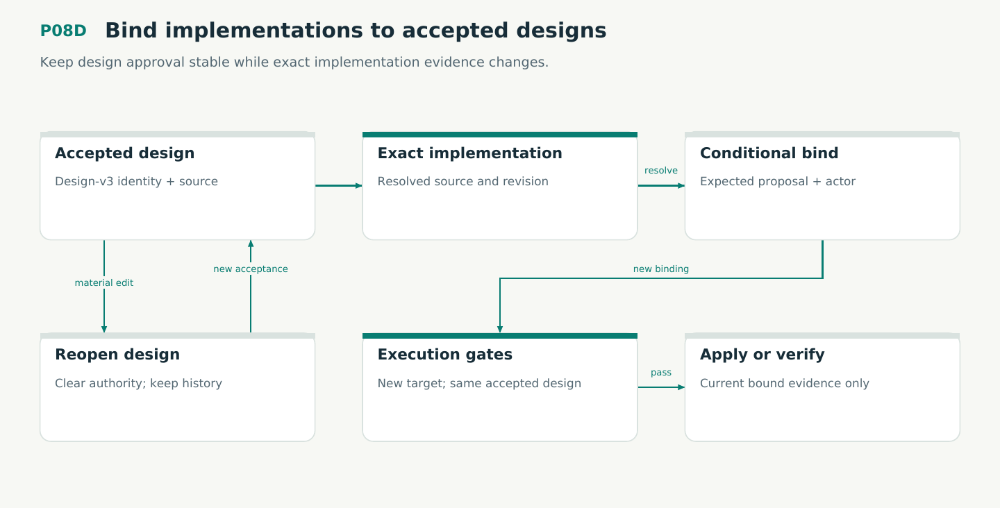

# P08D — Bind implementations to accepted designs

Keep design approval stable while exact implementation evidence changes.

Status: **not implemented by this plan**. Dependencies: P08, P03P, P04, P05.

## Work in order

1. Implement design-v3 material projection and distinct DesignRevision/TargetRevision/SourceId types; verify included and excluded fields against the current codec.
2. Port accepted/landing bind and rebind with exact expected-state CAS, real target resolution and preservation of design acceptance; clear all landed authority.
3. Port explicit reopen, renewed acceptance and terminal-state supersession; retain historical gates without granting them new-target validity.
4. Verify production V13 and complete M09 TLC/TLAPS, recovery bridge and negative calibration. Test competing bind/reopen/transition and interrupted authored writes.
5. Implement draft/proposed adoption, accepted/landing reopening and finalized supersession with no inferred acceptor or legacy custom-field authority. Run actual CLI/RPC service parity.
6. Enable this proposal kind only after its applicable Lean profile, per-proposal witness, executable checks and protocol receipts are qualified under plan/25.

## Required deliverables

- kernel/design + authored projection/service
- V13 + M09 with caller/effect correspondence
- Migration, bind/reopen CLI and recovery fixtures

## Exit gate

- Design can be accepted before implementation exists; bind resolves exact source/target.
- Rebind preserves approval but old-target passes cannot satisfy execution gates.
- Stale CAS, changed design and finalized-history rewriting are rejected.

Mandatory gates: WF20, WF02, WF04, WF05, WF06, WF07, WF11. Required proof/model entries: V13, V06, M09, M02. Additional scenarios: X68, X69, X70, X71, X72, X73, X74, X81, X85. All applicable existing G/Q/D/R behaviors remain required.

## Evidence and recovery

Use plan/08 for gate receipts, plan/11 for workflow-3 authority/version rules and plan/12 for playbook adoption. Plans/13–16 own views, reading design, the Omnigraph-first decision and storage-epoch contract. Plans/17-23 add engineering layout, fingerprints, skills, execution, learning and the proposed calculus. Plans/24-26 and PRIORITIES.md govern all new proposal admissions. Preserve exact source/tool/fixture hashes, failed attempts and successful replacements. A failed gate does not authorize rewriting current user state or weakening a contract. Keep the stage diagram and atlas explanation current under WF21.

Finish with a cohesive commit, updated traceability and a concise report of delivered behavior, evidence and remaining blockers. Planned command names or created files do not pass a product stage.
