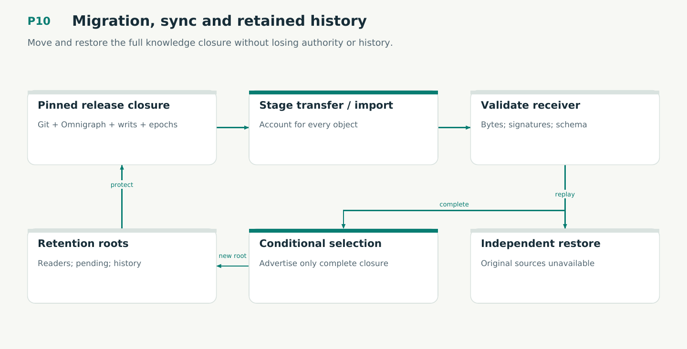

# P10 — Migration, sync and retained history

Move and restore the full knowledge closure without losing authority or history.

Status: **not implemented by this plan**. Dependencies: P07, P09.

## Work in order

1. Implement accounted legacy import dry-run/apply/repeat/quarantine/restore, preserving bytes and IDs without auto-admitting prose.
2. Implement complete closure backup and restore into empty owned staging; test after original sources are unavailable.
3. Implement forward history selection retaining later corrections, explicit policy/schema compatibility and independent runtime tool compatibility.
4. Implement remote closure-first transfer and conditional advertised release with two-client conflicts; keep enterprise-host qualification separate.
5. Implement auditable retention roots/leases and GC plan/apply under the modeled lock/epoch protocol; qualify publication/read/GC races.
6. Separate schema-2 authenticated history from forbidden pending old writes; forward selection retains current context policy/corrections.
7. Implement read-replica capabilities, portable logical identity versus local writer ownership, published-only transfer closure, typed missing-generation errors, and guarded unborn-branch restore with owned-ref cleanup.
8. Implement separately initialized schema-epoch migration and isolated Dolt import, complete native backup/restore and exact historical reads under plan/16; no cross-schema branch or JSONL-history shortcut.

## Required deliverables

- Migration and independent restore tooling
- Local native/Git sync with closure receipts
- Retention/GC reducer, roots explain and race fixtures

## Exit gate

- Every input has a disposition; repeats are idempotent; source-removal restore succeeds.
- Half-transfers never advertise incomplete releases; two clients do not erase history.
- Pinned readers and pending approved operations survive GC; rollback does not erase corrections.

Mandatory gates: WF05, WF11, WF14. Required proof/model entries: V08, V09, M02, M03, M05, M06, V12, M09, V15, M11. Additional scenarios: X19, X24, X29, X30, X31, X32, X33, X34, X37, X63, X65, X66, X74, X79, X80, X81, X82, X83. All applicable existing G/Q/D/R behaviors remain required.

## Evidence and recovery

Use plan/08 for gate receipts, plan/11 for workflow-3 authority/version rules and plan/12 for playbook adoption. Plans/13–16 own views, reading design, the Omnigraph-first decision and storage-epoch contract. Plans/17-23 add engineering layout, fingerprints, skills, execution, learning and the proposed calculus. Plans/24-26 and PRIORITIES.md govern all new proposal admissions. Preserve exact source/tool/fixture hashes, failed attempts and successful replacements. A failed gate does not authorize rewriting current user state or weakening a contract. Keep the stage diagram and atlas explanation current under WF21.

Finish with a cohesive commit, updated traceability and a concise report of delivered behavior, evidence and remaining blockers. Planned command names or created files do not pass a product stage.
