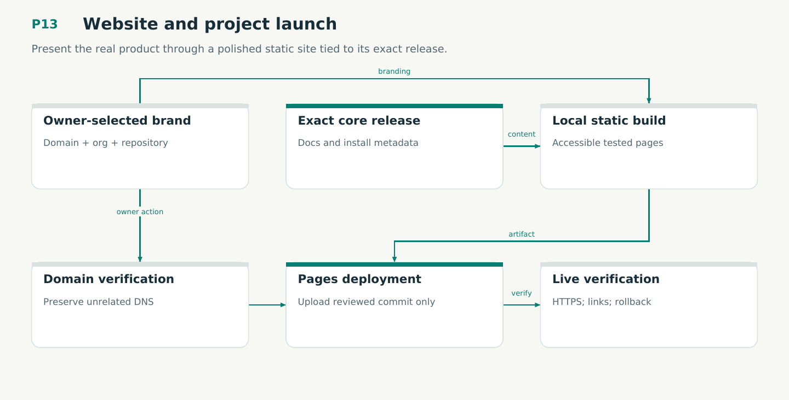

# P13 — Website and project launch

Present the real product through a polished static site tied to its exact release.

Status: **not implemented by this plan**. Dependencies: P12.

## Work in order

1. Use the settled Writfold name and registered writfold.dev; include the supplied SVG icon and minimal section outline. Preserve historical namespaces.
2. Implement the separate organization Pages repository, accessible design, tested quickstart/docs and generated assurance status.
3. Build static output locally from the selected core commit and release manifest; validate links/examples/mobile/keyboard/contrast.
4. Prepare exact domain-verification/DNS settings and a publish-only Pages workflow that validates the nominated static commit.
5. After owner/account authorization, configure domain and deploy the reviewed static commit; verify HTTPS, apex/www, deep links/downloads and retained rollback.
6. Update docs examples for named contexts, explicit design acceptance/binding and Scribe boundaries. Generate public assurance from actual receipts without publishing private playbook content.
7. Describe context, execution and learning with honest assurance. Keep the site minimal; publish no private source or unexecuted proof claim.

## Required deliverables

- Static website source + rendered artifact
- Porkbun/Pages checklist and exact release links
- Site qualification and, if authorized, deployment receipt
- SVG icon variants + minimal homepage specification

## Exit gate

- Install/examples match a real release; no exaggerated verification claim.
- Pages only deploys the reviewed static commit and never builds product code.
- Publication/DNS/purchase are reported distinctly from local preparation.

Mandatory gates: WF17, WF21. Required proof/model entries: none at this stage. Additional scenarios: X40. All applicable existing G/Q/D/R behaviors remain required.

## Evidence and recovery

Use plan/08 for gate receipts, plan/11 for workflow-3 authority/version rules and plan/12 for playbook adoption. Plans/13–16 own views, reading design, the Omnigraph-first decision and storage-epoch contract. Plans/17-23 add engineering layout, fingerprints, skills, execution, learning and the proposed calculus. Plans/24-26 and PRIORITIES.md govern all new proposal admissions. Preserve exact source/tool/fixture hashes, failed attempts and successful replacements. A failed gate does not authorize rewriting current user state or weakening a contract. Keep the stage diagram and atlas explanation current under WF21.

Finish with a cohesive commit, updated traceability and a concise report of delivered behavior, evidence and remaining blockers. Planned command names or created files do not pass a product stage.
