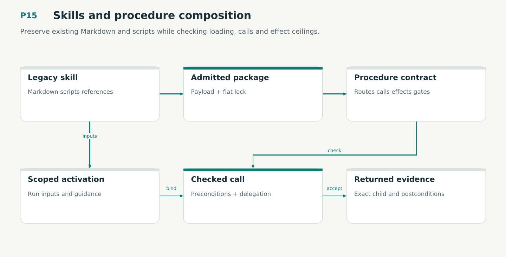

# P15 — Skills and procedure composition

Preserve existing Markdown and scripts while checking loading, calls and effect ceilings.

Status: **not implemented by this plan**. Dependencies: P14, P08S.

## Work in order

1. Inventory real author-change and reflection packages; preserve all bytes and produce reviewed sidecars and a flat dependency lock.
2. Implement discovery, progressive loading, scoped activation, typed routing and context delivery records.
3. Implement typed calls/returns/joins and bounded retries; allow document cycles and reject executable recursion in v1.
4. Separate advisory guidance from executable contracts; enforce parent delegation and the inherited policy gate floor.
5. Prove V17/M14, cross-model bridges and E03/E10; qualify stale returns, dependency drift and host context rehydration.
6. Enable this proposal kind only after its applicable Lean profile, per-proposal witness, executable checks and protocol receipts are qualified under plan/25.
7. Use the plan/27 session-driver candidate for package-local discovery, resume, narrowed grants and immediate human handoff rehearsals.

## Required deliverables

- Pinned skill import and loader
- Typed procedure contracts
- Nested-call qualification

## Exit gate

- Prose cannot grant capabilities.
- Calls bind exact inputs and results.
- Active revisions never hot-swap.

Mandatory gates: WF26, WF02. Required proof/model entries: V17, M14. Additional scenarios: X115, X116, X117, X118, X119, X120. All applicable existing G/Q/D/R behaviors remain required.

## Evidence and recovery

Use plan/08 for gate receipts, plan/11 for workflow-3 authority/version rules and plan/12 for playbook adoption. Plans/13–16 own views, reading design, the Omnigraph-first decision and storage-epoch contract. Plans/17-23 add engineering layout, fingerprints, skills, execution, learning and the proposed calculus. Plans/24-26 and PRIORITIES.md govern all new proposal admissions. Preserve exact source/tool/fixture hashes, failed attempts and successful replacements. A failed gate does not authorize rewriting current user state or weakening a contract. Keep the stage diagram and atlas explanation current under WF21.

Finish with a cohesive commit, updated traceability and a concise report of delivered behavior, evidence and remaining blockers. Planned command names or created files do not pass a product stage.
