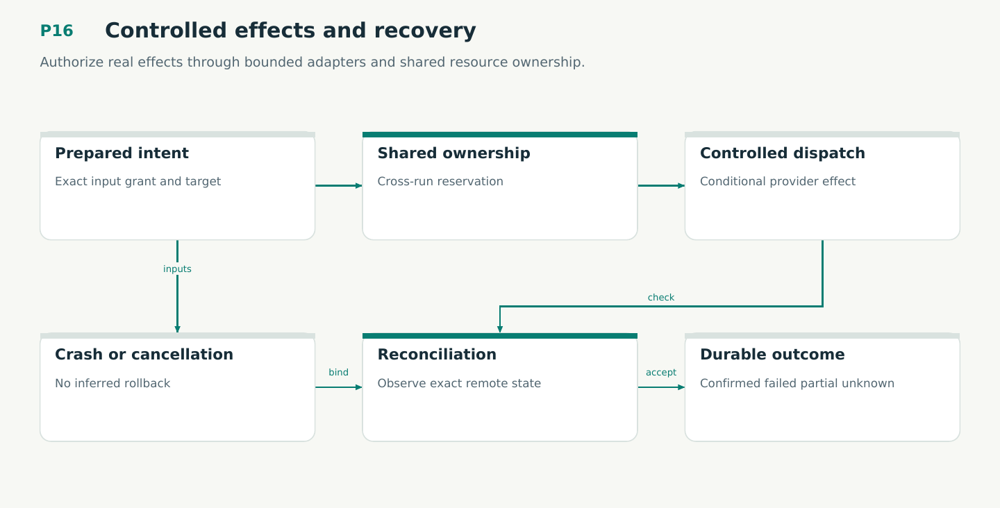

# P16 — Controlled effects and recovery

Authorize real effects through bounded adapters and shared resource ownership.

Status: **not implemented by this plan**. Dependencies: P15, P05, P06.

## Work in order

1. Implement Effect Adapter Protocol 1 separately from read-only Scribes; pin code/runtime schemas and profiles.
2. Implement shared resource reservations, ownership generations, controlled dispatch and durable intent ordering.
3. Qualify Worktrunk/Git/test adapters, hook descendants, sandbox limits and provider-specific conditional operations.
4. Implement Unknown/Partial outcomes, reconciliation, bounded cancellation and restore without blind external replay.
5. Prove V18/M12/M13 composition and E05-E07. Inject crashes at every retain/head/dispatch/observe boundary.
6. Exercise plan/27 viewer noninterference, writer transfer and unknown forge response under the qualified adapter and ownership model.

## Required deliverables

- Admitted effect adapters
- Shared ownership and fencing
- Crash and outcome reconciliation

## Exit gate

- No stale or ungranted dispatch.
- Unknown outcomes remain explicit.
- Resources wait for real teardown.

Mandatory gates: WF27, WF02. Required proof/model entries: V18, M12, M13. Additional scenarios: X121, X122, X123, X124, X125, X126, X127, X128. All applicable existing G/Q/D/R behaviors remain required.

## Evidence and recovery

Use plan/08 for gate receipts, plan/11 for workflow-3 authority/version rules and plan/12 for playbook adoption. Plans/13–16 own views, reading design, the Omnigraph-first decision and storage-epoch contract. Plans/17-23 add engineering layout, fingerprints, skills, execution, learning and the proposed calculus. Plans/24-26 and PRIORITIES.md govern all new proposal admissions. Preserve exact source/tool/fixture hashes, failed attempts and successful replacements. A failed gate does not authorize rewriting current user state or weakening a contract. Keep the stage diagram and atlas explanation current under WF21.

Finish with a cohesive commit, updated traceability and a concise report of delivered behavior, evidence and remaining blockers. Planned command names or created files do not pass a product stage.
