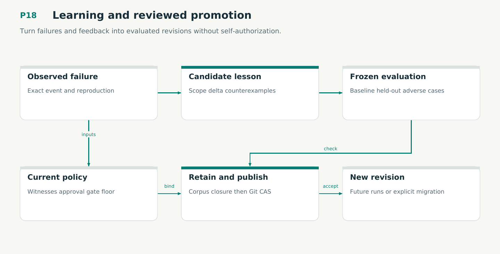

# P18 — Learning and reviewed promotion

Turn failures and feedback into evaluated revisions without self-authorization.

Status: **not implemented by this plan**. Dependencies: P17, P07.

## Work in order

1. Adapt the session hook into observation/proposal clients; capture relevant test/review/rollout/user feedback throughout runs.
2. Implement candidate kinds, scope/counterexamples, frozen evaluation protocol and held-out/adverse cases.
3. Enforce existing claim admission plus procedure type/effect/gate-floor and evaluation conditions.
4. Retain complete evidence in corpus closure before existing Git publication CAS; reconcile lost promotion acknowledgement.
5. Prove V20/M15, E03/E08/E12 and publication/retention bridges. Qualify competing promotions and procedure withdrawal.
6. Enable this proposal kind only after its applicable Lean profile, per-proposal witness, executable checks and protocol receipts are qualified under plan/25.

## Required deliverables

- Scoped candidate lifecycle
- Frozen empirical evaluation
- Authenticated promotion bridge

## Exit gate

- Observations do not self-admit.
- Learning cannot weaken gate floors.
- Published evidence survives pruning.

Mandatory gates: WF29, WF02. Required proof/model entries: V20, M15. Additional scenarios: X135, X136, X137, X138, X139, X140, X141, X142. All applicable existing G/Q/D/R behaviors remain required.

## Evidence and recovery

Use plan/08 for gate receipts, plan/11 for workflow-3 authority/version rules and plan/12 for playbook adoption. Plans/13–16 own views, reading design, the Omnigraph-first decision and storage-epoch contract. Plans/17-23 add engineering layout, fingerprints, skills, execution, learning and the proposed calculus. Plans/24-26 and PRIORITIES.md govern all new proposal admissions. Preserve exact source/tool/fixture hashes, failed attempts and successful replacements. A failed gate does not authorize rewriting current user state or weakening a contract. Keep the stage diagram and atlas explanation current under WF21.

Finish with a cohesive commit, updated traceability and a concise report of delivered behavior, evidence and remaining blockers. Planned command names or created files do not pass a product stage.
